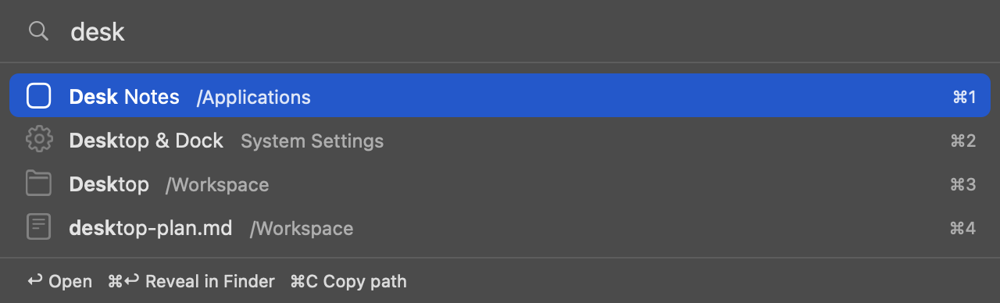

# Apparate


**A fast, minimal Spotlight replacement for macOS.**

Native Swift and AppKit. Find apps, files, folders and System Settings, or search the web.

[Download for macOS](https://github.com/rengwu/apparate/releases/latest/download/Apparate.zip)



<br clear="right">

## Features

- Find apps with fuzzy and acronym matching
- Search files and folders in chosen locations, with switches for `.gitignore` rules and hidden files
- Open System Settings panes and search within indexed paths
- Use **'** for files and folders, **.** for settings, or **?** for web searches; change these prefixes in Settings
- Browse paths beginning with **/** or **~/**; **Tab** completes a result, and **→** completes a selected folder when the caret is at the end
- **⇧Return** chooses an app to open a file or folder; change this shortcut in Settings
- **⌘Return** reveals a file, folder or app in Finder
- Results learn from what you open

## Install

1. [Download Apparate.zip](https://github.com/rengwu/apparate/releases/latest/download/Apparate.zip) and unzip it.
2. Move **Apparate** into **Applications** and open it.
3. Follow setup to choose folders and explicitly allow access to Desktop, Documents and Downloads. If Spotlight uses **⌘Space**, setup links to Keyboard Shortcuts so you can free it or choose another Apparate shortcut.

Requires macOS 27 or later on Apple Silicon (arm64 only). The app is ad-hoc signed,
not notarized. If macOS blocks it, use **System Settings → Privacy & Security → Open Anyway**.

To update, quit Apparate and replace the app in Applications. Your settings, usage
history and index are kept; an index rule change can require rebuilding the cache.

## Build

Requires Xcode Command Line Tools with Swift 6.4 or later and the macOS 27 SDK.

```sh
swift run ApparateCoreTests   # headless tests
./build.sh                   # build/Apparate.app and build/Apparate.zip
```

The shipped app excludes verification drivers and synthetic data. Hidden native
checks use a separate build with `APPARATE_BUILD_TESTING=1` and an explicit testing
binary; see the [verification setup](docs/wiki/verification/setup.md).

Design decisions and verification are in [the project wiki](docs/wiki/index.md).
