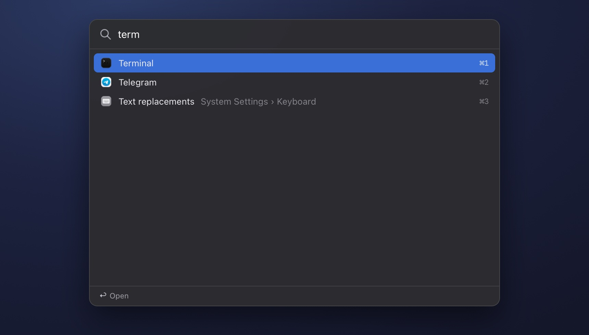
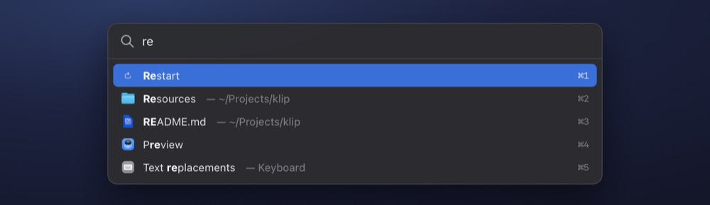
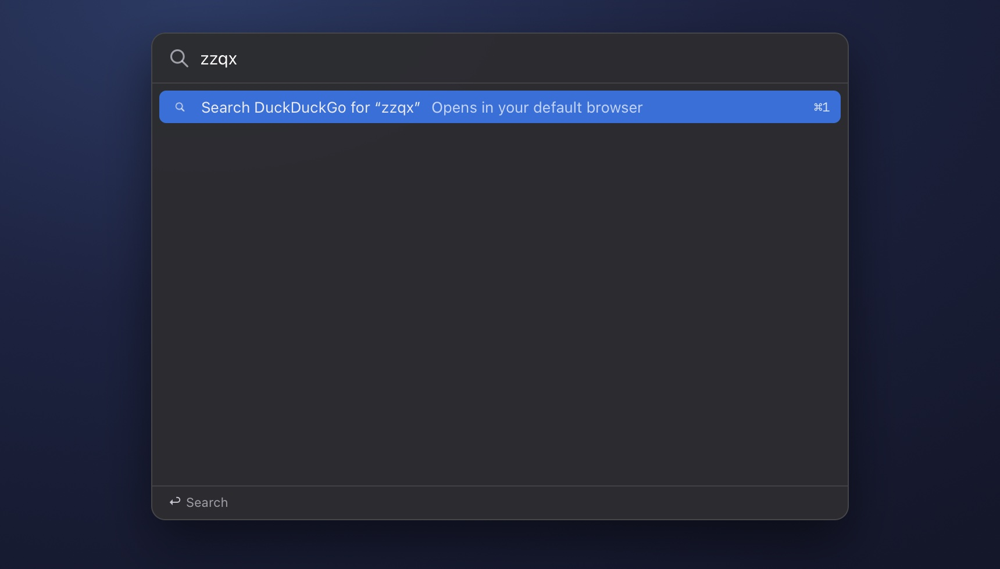
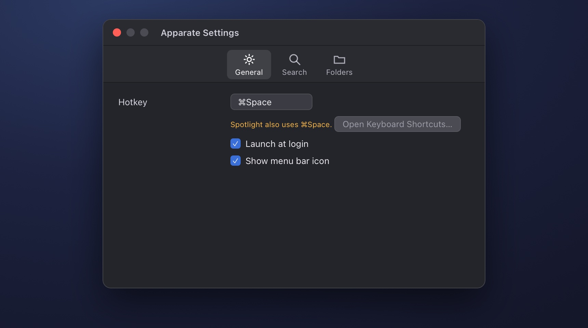

# M1 guide — Foundation, matching and ranking

Written by Claude for Codex, who builds M1 ([DEC-036](../decisions.md#round-4-2026-11-18)). The scope comes from [M1 in the plan](../plan.md#m1-foundation-matching-and-ranking). This guide adds the detail, the order of work, and references. Where it proposes something the user has not decided, it says so under [Proposals to confirm](#proposals-to-confirm). Codex's pushback of 2026-11-18 is folded in; see [Pushback and answers](#pushback-and-answers).

## Goal

A headless core that can take a typed query and return the right results, in the right order, fast. No real data sources yet: M1 works on items given to it. The app target only proves that the bundle builds, signs and finds its data folder.

M1 is done when:

- `./build.sh` builds a signed `build/Apparate.app`.
- `swift run ApparateCoreTests` passes, covering every test listed [below](#11-tests).
- A verification run with search timings and memory at 20,000 and 200,000 items is recorded in the wiki.
- Claude's review has passed, and the milestone is one commit.

## Decisions that apply

| Decision | What it means for M1 |
| --- | --- |
| [DEC-001](../decisions.md#round-1-2026-11-18) | A query without a prefix searches apps, settings, folders and files. System commands are included too ([REQ-010](../requirements.md)). |
| [DEC-002](../decisions.md#round-1-2026-11-18) | Equal matches rank apps > settings > folders > files. Usage reorders only within a tier. |
| [DEC-003](../decisions.md#round-1-2026-11-18) | Settings are saved to an editable, versioned JSON file. |
| [DEC-005](../decisions.md#round-1-2026-11-18), [DEC-020](../decisions.md#round-2-2026-11-18) | Default folders `~/Projects`, `~/Desktop`, `~/Documents`, `~/Downloads`, each with depth 10. |
| [DEC-004](../decisions.md#round-1-2026-11-18) | Default hotkey ⌘Space, stored in the config. |
| [DEC-016](../decisions.md#round-2-2026-11-18) | No user aliases or pinned results. |
| [DEC-017](../decisions.md#round-2-2026-11-18), [DEC-018](../decisions.md#round-2-2026-11-18) | The web fallback row appears when nothing local matches. The default search URL is `https://duckduckgo.com/?q={query}`, as in the [settings design](#visual-references). |
| [DEC-021](../decisions.md#round-2-2026-11-18) | The menu bar icon can be hidden: a config switch, on by default. |
| [DEC-028](../decisions.md#round-4-2026-11-18) | The DEC-008 budgets are goals. Measure search time from M1 on. |
| [DEC-030](../decisions.md#round-4-2026-11-18), [DEC-032](../decisions.md#round-4-2026-11-18) | Default prefixes are `'` files and folders, `.` settings and `?` web. DEC-032 (no others) is provisional: round 5 asks again. Keep the defaults in one place so one can be added cheaply. |
| [DEC-031](../decisions.md#round-4-2026-11-18) | A query containing `/` searches full paths. |
| [DEC-033](../decisions.md#round-4-2026-11-18) | A config switch for `.gitignore` handling, on by default. M3 uses it. |
| [DEC-010](../decisions.md#round-1-2026-11-18), [DEC-013](../decisions.md#round-2-2026-11-18), [DEC-014](../decisions.md#round-2-2026-11-18) | macOS 27, SwiftPM plus `build.sh`, ad-hoc signed with a fixed designated requirement. |

## Order of work

### 1. Package and build

Copy Klip's layout ([references](#non-visual-references)), with these changes:

- `// swift-tools-version: 6.4` and `platforms: [.macOS(.v27)]`. Checked on this Mac: `.v27` needs tools version 6.4, and Swift 6.4.2 builds it. Swift 6 language mode is on, so the compiler rejects most data races in safe Swift. The latency spike had two races in shared state, so this is worth its friction. Unsafe pointers, the SQLite C boundary and anything marked `@unchecked Sendable` still need clear ownership.
- Targets: `ApparateCore` (library, links `sqlite3`), `Apparate` (executable), `ApparateCoreTests` (executable, Klip's harness).
- `VERSION` holds `0.1.0`.
- `build.sh` builds **arm64 only**: no x86_64 slice, no `lipo`. The Info.plist has `CFBundleIdentifier` `local.apparate`, `LSMinimumSystemVersion` `27.0` and `LSUIElement` true. Sign with `--requirements '=designated => identifier "local.apparate"'`, then verify. Leave out the icon lines until M7.
- `.gitignore`: `.build/`, `build/`, `.swiftpm/`, `.DS_Store`.

### 2. App stub

`main.swift` and a small `AppDelegate`, as in Klip:

- the accessory activation policy;
- the data folder: `APPARATE_HOME` if set and not empty, else `~/Library/Application Support/Apparate/`;
- it loads the config, which writes the defaults on first launch, and logs any config error.

Nothing else. `APPARATE_SHOW`, the hotkey and the panel come in M2.

### 3. Config

`config.json` in the data folder. Proposed version 1, with defaults:

```json
{
  "version": 1,
  "hotKey": { "keyCode": 49, "modifiers": 256, "display": "⌘Space" },
  "showMenuBarIcon": true,
  "prefixes": { "files": "'", "settings": ".", "web": "?" },
  "searchURL": "https://duckduckgo.com/?q={query}",
  "folders": [
    { "path": "~/Projects", "depth": 10 },
    { "path": "~/Desktop", "depth": 10 },
    { "path": "~/Documents", "depth": 10 },
    { "path": "~/Downloads", "depth": 10 }
  ],
  "respectGitignore": true
}
```

- **Not in the config:** launch at login. `SMAppService` holds that state, and M5 shows it. The search engine menu in settings is a set of presets that fill `searchURL`; only the URL is stored.
- **Missing keys** take their defaults, as in Klip's `AppConfig`. Unknown keys are ignored.
- **Missing file:** write the defaults, so the user can find and edit it.
- **Invalid file:** keep the last valid config, report the errors, and never overwrite the broken file. At launch, "last valid" means the defaults. The whole file is accepted or rejected. A partly applied config would be harder to understand.
  - JSON that does not parse, or has a wrong type, reports that one error.
  - A file that parses reports all its value errors together.
  - When a broken file is fixed, its error clears, even if the fixed config equals the current one.
- **Newer version:** if `version` is higher than the app knows, treat the file as invalid and never write over it.
- **Migration:** version 1 is the only version, so there is no migration code yet. The version check above is the whole mechanism until a version 2 exists.
- **Saving:** pretty-printed with sorted keys, written atomically.
- **Reloading:** dispatch sources, not polling. Watch the file for writes, and the data folder for the file being replaced or deleted; re-arm the file watch after a replacement. A watch on the folder alone misses in-place edits, and a watch on the file alone misses atomic saves. On a change, read the file again. If the decoded config equals the current one, do nothing. That also covers the app's own saves.

Defined errors, each with a message the M5 settings window can show as is:

- a prefix that is empty, more than one character, or a letter, digit, whitespace or control character, `/` or `~` (see [proposals](#proposals-to-confirm));
- two scopes with the same prefix;
- a prefix for an unknown scope;
- a folder path that is not absolute after `~` is expanded, or that appears twice after lexical normalization (no disk access);
- a depth outside 1–30;
- a search URL that does not contain `{query}` exactly once, or that is not a complete `http` or `https` URL with a host once a sample query is put in its place;
- JSON that does not parse, or a value of the wrong type.

A folder that does not exist is not a config error. M3 reports it as unavailable.

### 4. Items

One item model for every kind:

| Kind | Rank | Stable ID (proposal) | Searchable text |
| --- | --- | --- | --- |
| app | 0 | `app:` + bundle path | display name, plus built-in alternate names |
| command | 0 | `command:lock`, `command:sleep`, `command:restart`, `command:trash` | name |
| setting | 1 | `setting:` + pane bundle ID + `?` + anchor + `#` + title | title, plus keywords |
| folder | 2 | `folder:` + absolute path | name, plus path in path mode |
| file | 3 | `file:` + absolute path | name, plus path in path mode |
| web | — | `web` | not searched |

- One anchor can carry several titles, so a settings ID includes the title. Escape or length-prefix the parts so that no two items can produce the same ID.
- IDs are opaque: nothing parses an ID to decide how to open an item.
- Duplicate apps at different paths are different items.
- These formats are for M1. Whether an ID survives a rename, a move or a language change is decided with the real sources in M2 and M3; M1 promises nothing about it.
- Commands rank like apps (plan, M2).
- In M1, items come from test fixtures. M2 and M3 add the real sources.

### 5. Query parsing

1. Trim leading and trailing whitespace. Keep the spaces inside the query as typed: a web search sends them unchanged. Matching splits the text into words separately.
2. If the first character is a configured prefix, the scope is that prefix's scope. The rest of the query, with any leading spaces trimmed, is the search text. There is no escape for searching a prefix character literally (see [pushback](#pushback-and-answers)).
3. Otherwise the scope is everything: apps, commands, settings, folders and files.
4. **Web scope:** the result is one web row for the text. An empty text gives no rows. An empty query is never a web search.
5. **Fallback row:** only for a query without a prefix that matches nothing. A query with a files, settings, apps or commands prefix that matches nothing shows no rows.
6. **Path mode:** if the scope includes files or folders and the text contains `/`, search files and folders by path ([§7](#7-path-mode)). An explicit prefix is applied first, so `?a/b` stays a web search.
7. Return the parsed query as a value, so tests and the panel can see the scope and mode.

### 6. Matching

Follow the plan: names first, fzy-style, with a character mask and a subsequence check before scoring.

**Prepared text,** built once per item when the snapshot is built, never per keystroke:

- Fold each displayed character case-, diacritic- and width-insensitively (`String.folding(options:locale:)` with a `nil` locale). Store the folded Unicode scalars, and for each one the index of the displayed character it came from. One displayed character can fold to several scalars (`ß` → `ss`), so the map is per scalar.
- ASCII names can take a fast path: lowercased bytes, one per character.
- Word-boundary classes come from the **original** characters, before folding: start of name, after a space, `-`, `_`, `/` or `.`, and camel-case humps. This is how `VSC` matches Visual Studio Code without an alias.
- A 64-bit mask: one bit each for `a`–`z` and `0`–`9`, and the remaining 28 bits for every other scalar by `scalar % 28`. The query's mask is built the same way. A candidate is skipped only if it lacks a bit the query has, so the mask can give false positives but never hide a real match. Test that property.

**Scoring:**

- Run the subsequence check, then fzy's dynamic-programming score: consecutive, word-start, camel-case and after-dot bonuses, and gap penalties, as in fzy's `match.c`.
- No length limits. The benchmark's 255-byte and 32-character caps must not come along. Per-worker scratch rows grow to the longest name and query seen.
- Highlight positions (fzy's traceback) only for results that are published, mapped back to displayed characters for the bold letters in [DEC-024](../decisions.md#round-3-ui-design-spike-2026-11-18).
- A result records what matched: the displayed name, an alternate name or a keyword. Only a match on the displayed name gets highlights. An alternate-name or keyword match shows the title without bold letters.
- Scores stay finite. fzy returns infinity for an exact match; here the tier carries "exact", and the score is a finite number, so usage and path scores still add.

**Tiers,** best first. Each item takes its best tier across its name and alternate names:

1. **Exact:** the folded query equals the folded name.
2. **Prefix:** the name starts with the query.
3. **Word:** each query word is a prefix of a name word, in order (`keyboard la` → Keyboard layouts); or the best alignment puts every query character on a word start or camel hump (`vsc`, `gc`); or the query is a prefix of any name word after the first (`code` → Visual Studio Code).
4. **Fuzzy:** any other subsequence of the name.
5. **Keyword:** for settings, the query, or each query word, is a prefix of one of the item's keywords. This tier ranks below every name match.

The interactive prototype ranks a match inside a word (Preview for `re`) above a match at a word start (Text replacements). That differs from these rules. This guide is the reference, not the prototype.

### 7. Path mode

Proposed rules for [DEC-031](../decisions.md#round-4-2026-11-18):

- Split the text on `/`, ignoring empty segments between separators. A leading `/` or `~/` is dropped in v1, with no anchoring. This is fuzzy path search, not lookup of an exact path.
- A query of only separators (`/`) gives no rows, like an empty query.
- The **last segment** matches the item's name, using the tiers above. If it is empty (`klip/`), any name matches: everything under the matched folders.
- Each **earlier segment** must fuzzy-match a different folder in the item's path, in order. The folders need not be next to each other. The indexed folder's own name counts, so `projects/klip/sources` works.
- **Score:** the name's score plus each segment's score, with a bonus when matched folders are adjacent.
- **Order:** tier from the last segment, then kind, then score.
- **Cost:** match names first, then check the parent folders only for names that passed. Never score every full path; Codex's benchmark measured 44 ms median for that at 200k. An empty last segment (`klip/`) skips the name filter, so it is the costly case: measure it, along with short common segments and segments that match nothing. Cache folder-segment work only if the measurements call for it.

Examples: `klip/sources` finds `~/Projects/klip/Sources`. `sources/klip` does not. `'klip/sources` finds the same as `klip/sources`.

### 8. Ranking

Sort key, in order:

1. tier (§6);
2. kind rank (§4);
3. text score plus a bounded usage boost (§9);
4. the folded name;
5. the stable ID.

The plan lists the fuzzy score and usage as separate steps. Combining them, with usage bounded, is what DEC-002 needs ("usage reorders only within a match tier"), and follows Codex's [ranking contract](../research/codex/fuzzy-matching.md#recommended-ranking-contract). If usage only broke exact score ties, it would almost never apply.

- Keep the best 50 with a bounded selection, not a full sort.
- Same query and same snapshot must always give the same order.

### 9. Usage history

In `index.sqlite` in the data folder, a `usage` table: item ID, decayed count, last update. Version the schema with `PRAGMA user_version`.

- **On open:** count = decayed count + 1, time = now. The clock is injected so tests can move time.
- **Decay:** the count has a half-life of 30 days. Boost = λ × min(1, log1p(count) / log1p(20)), from Codex's contract. Pick λ with the tests, starting at 0.5, and record the value used.
- **Bounded:** keep at most 2,000 items, dropping the lowest decayed count first.
- Recorded only after an item actually opens. M2 calls this; M1 exposes it.
- **Snapshot:** each search reads a usage snapshot taken before the search. An open changes the next search, never the list on screen.
- **Rebuilds:** M3 rebuilds file entries without touching this table.

### 10. Search, snapshots and generations

- `SearchIndex` is immutable and `Sendable`: the prepared items in flat arrays, struct-of-arrays as in the benchmark. A data change builds a new one.
- One search runs over one index snapshot and one usage snapshot.
- A coordinator in Core owns submission, invalidation and delivery on one executor, and runs scoring on a serial worker. Each new query, config change or snapshot starts a new generation.
- A search checks for cancellation between chunks and stops early when stale. An atomic flag is enough for that check; the final "still current?" check and the delivery happen together on the owner, so a newer request cannot slip in between.
- Only the current generation's complete result set is delivered. A result set carries its generation and parsed query.
- Scoring is single-threaded in M1. Tune layout, allocation and filtering first. 8 ms p95 for search alone at 200,000 items is a diagnostic target, not a trigger. If the measurements still argue for parallel scoring, bring the evidence and the CPU cost to the review instead of adding it.

### 11. Tests

All in `ApparateCoreTests`, each with a temporary data folder. Fixture names are made up or are well-known app names; never the user's files.

**Ranking:**

- `vsc` → Visual Studio Code first, with no alias.
- `code` → Visual Studio Code ("Code" is its built-in name) above a file `code-review.md`.
- `keyboard la` → Keyboard layouts first.
- `term` → Terminal above files `terminal-notes.md` and `term.txt` (same tier; apps first).
- `calc` → Calculator first; `cale` → Calendar first.
- A file in the prefix tier above an app in the fuzzy tier.
- `re` with the items in the [rows screenshot](#visual-references): Restart, Resources, README.md, Text replacements, then Preview.
- Same tier, same kind, same score: ordered by name, then ID, every time.
- Duplicate app names at two paths: both listed, in a stable order.

**Scopes:**

- `'notes` returns only files and folders; `.dns` only settings; `?swift actors` only the web row; `?` alone returns nothing.
- A space after the prefix is ignored.
- With a changed prefix in the config, the old character searches normally.
- Spaces inside a web query reach the web row unchanged.

**Fallback row:**

- No local match, no prefix → only the web row.
- No match with `'`, `.` or another non-web prefix → no rows.
- An empty query → no rows.
- A local match → no web row.

**Path mode:**

- `klip/sources`, `'klip/sources`, `projects/klip/sources` and `klip/` behave as in §7.
- `sources/klip` finds nothing; `/` alone gives no rows; `klip//sources` works like `klip/sources`.
- `?a/b` is a web search.

**Unicode:**

- "Café" stored composed and decomposed: both are found by `cafe` and `café`, and the highlight covers the right displayed letters.
- `strasse` finds "Straße".
- A CJK name is found by its own characters.
- Names with emoji match and highlight without crashing.
- A 300-character name and a 100-character query match, with no cap.
- Mask property: across many random names and queries, whenever the folded query is a subsequence, the mask passes.

**Usage:**

- An opened item moves up within its tier and kind, but never above a better tier or a better kind.
- With the injected clock, the count halves after 30 days, and the boost follows the formula in §9.
- The table stays at 2,000 items or fewer.
- Usage survives closing and reopening the database.

**Config:**

- Defaults are written when the file is missing.
- Broken JSON keeps the last valid config and reports it, and the file is left alone.
- Each defined error is raised by a small bad file.
- A newer version is not overwritten.
- An external edit is picked up without polling, both written in place and saved atomically. The app's own save does not cause a reload loop.
- Fixing a broken file clears its error.

**Generations:**

- With an injected slow search, a burst of queries delivers only the last one's results, and never a stale set.
- A query superseded after its scoring finished, but before delivery, is not delivered.

### 12. Measurements

Run in a release build and record in the verification run:

- search time per keystroke at 20,000 and 200,000 items, typing a fixed list of 10–20 queries one character at a time: median, p95 and maximum;
- the same for path-mode queries at 200,000;
- time to build the `SearchIndex` at both sizes;
- `phys_footprint` after building each size.

Use a seeded synthetic corpus: realistic name and path lengths, repeated folder structures, ASCII and Unicode names, and queries that match many items as well as few. Record the seed, sizes, query list and a hash of the corpus so the run can be repeated. Report preparation cost separately, and include top-50 selection and highlight output in the search time. These numbers do not claim DEC-008 compliance; M6 measures the built app on real data.

## Out of scope for M1

- Finding apps and settings on disk, crawling folders, FSEvents, and the file entries table (M2, M3).
- Opening anything, URL encoding for web search, system commands (M2).
- The hotkey, panel and any visible UI (M2, M4).

## Non-visual references

From the user's apps (read-only; do not change them):

- `~/Projects/klip/Package.swift`: three targets, Core linking `sqlite3`, tests as an executable.
- `~/Projects/klip/build.sh`: bundle layout, Info.plist, signing with a fixed designated requirement, and the version check on `VERSION`.
- `~/Projects/klip/Tests/KlipCoreTests/Harness.swift` and `main.swift`: the test harness and temporary folders.
- `~/Projects/klip/Sources/KlipCore/AppConfig.swift`: missing keys take defaults; atomic, sorted, pretty-printed saves. Apparate adds validation and keeps the last valid config, where Klip falls back to defaults.
- `~/Projects/klip/Sources/Klip/AppDelegate.swift`, lines 5–12: the `KLIP_HOME` data-folder pattern for `APPARATE_HOME`.
- `~/Projects/klip/Sources/KlipCore/Store.swift`: a small SQLite wrapper without dependencies.

From this wiki:

- [Claude's benchmark source](../research/claude/benchmark.md#source): flat prepared buffers, boundary classes, mask, fzy constants. Its ASCII folding and length caps are not for production.
- [Codex's fuzzy matching analysis](../research/codex/fuzzy-matching.md): ranking contract, preventing jumps, golden examples.
- [Codex's benchmark](../research/codex/benchmark.md): name versus full-path cost at 200,000.
- [Panel latency spike](../spikes/2026-11-18-panel-latency.md): the scorer with tiers and kind order, and its races.

External:

- fzy [`match.c`](https://github.com/jhawthorn/fzy/blob/34b88869d022e861da4846c4463aea3ddfb3ff30/src/match.c) and [`ALGORITHM.md`](https://github.com/jhawthorn/fzy/blob/34b88869d022e861da4846c4463aea3ddfb3ff30/ALGORITHM.md), pinned to the commit the research read.
- Apple: `String.folding(options:locale:)`, `Synchronization.Atomic`, `DispatchSource.makeFileSystemObjectSource`, and the SQLite C API as Klip uses it.

## Visual references

M1 has no UI, but its output feeds these agreed designs. Ranking and highlights must produce what they show.

The launcher with `term` ([DEC-023](../decisions.md#round-3-ui-design-spike-2026-11-18)): Terminal first.



Result rows ([DEC-024](../decisions.md#round-3-ui-design-spike-2026-11-18)): matched letters in bold, location dimmed. Highlight positions map to these displayed letters.



No local match: the web fallback row.



The Search tab of the settings design ([DEC-025](../decisions.md#round-3-ui-design-spike-2026-11-18)) shows the prefix table and the search URL with `{query}`.



The interactive prototypes are in the repository at `docs/design/`. `panel-a-compact.html` runs the prototype engine: prefixes, tiers, kind order and the fallback row. It shows the intended behaviour; do not port its code.

## Proposals to confirm

These are Claude's proposals, not user decisions. Codex can accept them or push back. If they still disagree after one exchange, the question goes to the user.

1. The config schema and field names in §3.
2. Prefixes are one character, and cannot be a letter, digit, space, `/` or `~`. Scopes that can take a prefix are `apps`, `settings`, `files` (files and folders), `commands` and `web`.
3. "Exact" means the whole name, so `cal` does not exactly match `cal.txt`.
4. A fifth tier for settings keywords, below all name matches.
5. Usage: general usage only, with no per-query learning; 30-day half-life; 2,000-item bound.
6. The path-mode rules in §7.
7. The stable ID formats in §4.

## Pushback and answers

Codex's pushback on 2026-11-18 and Claude's answers. All accepted points are folded into the sections above.

| # | Codex | Claude |
| --- | --- | --- |
| 1 | The guide's test "boost halves after 30 days" contradicts its formula; the count halves. Keep scores finite, since fzy's exact score is infinity. | Accepted; Claude's error. |
| 2 | Watch the file and the folder, not the folder alone. Clear the error when a broken file is fixed. Report a parse error alone, and value errors together. Validate the whole URL with a sample query. Detect duplicate folders lexically. | Accepted. |
| 3 | Keep spaces inside the query. The web fallback applies only to queries without a prefix. Add a backslash escape to search a prefix character literally. | Spaces and fallback accepted. **Escape not adopted:** no established need, per `rule-lean`. Names starting with `.` are hidden and never indexed, and fuzzy matching finds `'notes` or `?draft` without the leading mark. If Codex still disagrees, it goes to the user. |
| 4 | IDs are opaque, with escaped parts. Identity across renames is decided with the real sources. | Accepted. |
| 5 | Accepts proposals 3 and 4. Record which name matched, with no highlights for alternate names or keywords. Update the plan's ranking wording. | Accepted; the [plan](../plan.md#m1-foundation-matching-and-ranking) is updated. |
| 6 | Accepts the path rules, with edge cases. A separator-only query lists every indexed path. Measure the costly cases. | Edge cases and measurements accepted. **A separator-only query gives no rows,** like an empty query: listing every indexed path helps nobody. |
| 7 | Scope the Swift 6 claim. Make the final check and delivery atomic on one owner. Single-threaded scoring; parallelism only with evidence at review. | Accepted. |
| 8 | A seeded synthetic corpus for M1 measurements. | Accepted. |

## Review

Claude reviewed M1 on 2026-11-18: all of `Sources/`, `Tests/`, `build.sh`, `Package.swift`, the [verification run](../verification/runs/2026-11-18T154000Z-m1.md), the feature pages and the evidence. Claude re-ran `swift run ApparateCoreTests` independently: 20 groups passed, 0 failed. The records and evidence contain no personal names or paths.

**Result: passed, with one fix.**

| # | Finding | Action |
| --- | --- | --- |
| 1 | `build.sh` writes into an existing `build/Apparate.app` without clearing it, so a file removed from the build would survive in the bundle, and later in the release zip. | **Fix now:** remove the old bundle before assembling, as Klip's `build.sh` does. |
| 2 | `SearchIndex` throws on a duplicate ID, so one duplicate from a real source would fail the whole index. On this Mac, Safari is reachable both through `/Applications` and its system path. | M2: sources de-duplicate before building; the throw stays as a guard. |
| 3 | Each item keeps its full ID, name and path as strings. At 200,000 items the core read 119 MiB right after building and 56 MiB after searching. | M3: store file entries compactly (folder node plus name), and derive the path and ID when needed. Measure on real data. |
| 4 | Path segments can match folders above the indexed folder (`users/` matches everything). | M3: ancestor chains start at the indexed folder's name, as §7 intended. |
| 5 | When an alternate name wins (`code` → "Code"), the displayed name shows no bold letters, even though "Code" in "Visual Studio Code" also matches. | M4: show the displayed name's highlights when the name also matches. |
| 6 | Any change in the data folder, including SQLite's journal files when usage is recorded, re-reads `config.json`. | Accepted: the read is small and an unchanged config does nothing. |

Accepted as measured: path search at 200,000 items is 11.4 ms p95 (18.3 ms maximum), above the 8 ms diagnostic target but inside the end-to-end goal of [DEC-008](../decisions.md#round-1-2026-11-18). Revisit it in M3 with real folders.

## Records

- **Features:** add `features/search.md` (`FEAT-search`: parsing, scopes, matching, tiers, ranking, path mode, fallback row, usage) and `features/config.md` (`FEAT-config`), with verification recipes.
- **Setup:** add `verification/setup.md`, covering build, test and data-folder isolation.
- **Run:** record one run for M1 with the results table, the timings from §12, and the tested revision.
- **Progress:** update the table in the [plan](../plan.md#progress).
