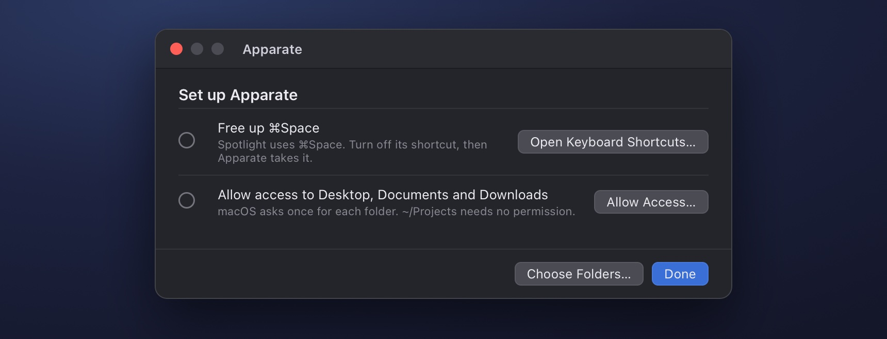

# M2 guide — Apps, settings, actions, first panel

Written by Claude for Codex after the [M1 review](m1-foundation.md#review). As with M1: read it, reply with pushback before writing code, then build ([how guides are used](index.md#how-a-guide-is-used)).

The M1 commit waits for the user to set up git. Claude keeps an exact copy of the reviewed M1 files, so M1 can still be committed alone later. M2 work can start in the same folder.

Scope: [M2 in the plan](../plan.md#m2-apps-settings-actions-and-a-first-panel). M2 connects the M1 core to real apps and settings, opens what the user picks, and puts a first, plain panel behind the hotkey. File indexing stays in M3, and the finished panel in M4.

## Decisions that apply

| Decision | What it means for M2 |
| --- | --- |
| [REQ-001](../requirements.md), [REQ-004](../requirements.md) | Launch apps; open settings items, including sub-items such as Keyboard layouts. |
| [DEC-004](../decisions.md#round-1-2026-11-18) | ⌘Space by default, changeable. The user frees it from Spotlight. |
| [DEC-007](../decisions.md#round-1-2026-11-18), [DEC-019](../decisions.md#round-2-2026-11-18) | Lock, Sleep, Restart, Show Trash. Restart needs a second Return. |
| [DEC-016](../decisions.md#round-2-2026-11-18) | Reveal in Finder and Copy path, for the kinds that have a path. |
| [DEC-017](../decisions.md#round-2-2026-11-18), [DEC-018](../decisions.md#round-2-2026-11-18), [DEC-030](../decisions.md#round-4-2026-11-18) | Web search with `?` and the fallback row, in the default browser. |
| [DEC-023](../decisions.md#round-3-ui-design-spike-2026-11-18) | The panel's size and layout. M2 builds a plain version; M4 finishes it. |
| [DEC-027](../decisions.md#round-3-ui-design-spike-2026-11-18) | First run asks for folder access. M2 builds the access step only. |
| [DEC-029](../decisions.md#round-4-2026-11-18) | Open settings links directly, even when System Settings is running. No recovery action. |

## What M1 gives you

- `SearchItem(id:kind:name:alternateNames:keywords:path:)` and `SearchIndex(items:)`, which rejects duplicate IDs.
- `ParsedQuery(_:config:)`, `SearchIndex.search(_:usage:limit:isCancelled:)` and `SearchCoordinator.submit(index:query:usage:deliver:)`, which delivers only the newest complete result set on the main actor.
- `UsageStore.recordSuccessfulOpen(id:)` and `snapshot()`; `ConfigStore` with `onChange`; `ItemID.setting(bundle:anchor:title:)`.
- `SearchResult.highlights` are displayed-character offsets; `source` says whether the name, an alternate name or a keyword matched.

M2 builds one `SearchIndex` from apps, system commands and settings items. M3 adds files and folders to the same snapshot.

## Order of work

### 1. Apps

- **Folders:** `/Applications`, `/Applications/Utilities`, `/System/Applications`, `/System/Applications/Utilities`, `/System/Library/CoreServices/Applications`, `~/Applications`, plus `Finder.app` from `/System/Library/CoreServices`.
- **Links:** follow symbolic links that are apps. On this Mac `/Applications/Safari.app` is a link into `/System/Cryptexes/App/System/Applications/`.
- **Nesting:** look one level into plain folders (for example `/Applications/Adobe Photoshop/`), never inside an app bundle.
- **Names:** the localized display name (`CFBundleDisplayName`, then `CFBundleName`, then the file name), with the file name and `CFBundleName` as alternate names. Visual Studio Code's bundle name is "Code".
- **Duplicates:** the same app can be reached twice (a link and its target). De-duplicate by resolved path before building the snapshot; `SearchIndex` rejects duplicate IDs ([M1 review](m1-foundation.md#review), item 2).
- **Updates:** FSEvents on those folders. Rebuild the app list and publish a new snapshot; never per keystroke.
- **IDs:** `app:` plus the resolved path.
- **Not built in M2:** the plan's "app folders the user adds". The settings design has no place for them ([DEC-025](../decisions.md#round-3-ui-design-spike-2026-11-18)), and an `.app` inside an indexed folder could be found by the M3 crawl with the app kind. Claude will ask the user whether to drop it; build without it.
- **Icons:** `NSWorkspace.icon(forFile:)`, loaded for visible rows only, cached by path, never on the keystroke path. Rows draw a blank icon space first, so text never moves.

### 2. Settings catalog

- Read each extension in `/System/Library/ExtensionKit/Extensions/*.appex` whose Info.plist has `EXAppExtensionAttributes.SettingsExtensionAttributes` with a `searchTermsFileName`, plus the legacy `DateAndTime.prefPane`.
- The file is `Contents/Resources/<language>.lproj/<name>.searchTerms`, an XML plist: anchor key → `localizableStrings` → entries with `title` and `index` (comma-separated keywords). Choose the language from the user's preferred languages, falling back to English.
- Pane names come from `localizedInfoDictionary["CFBundleDisplayName"]`, with fixed names for the headphone and battery panes ([UI spike](../spikes/2026-11-18-ui-design.md#verified-settings-item-names-and-icons)).
- Each entry is one item: title, pane name as its location, keywords for the keyword tier. Each pane is an item too, so `keyboard` finds the Keyboard pane itself.
- Icons: the extension bundle's icon, as the [UI spike](../spikes/2026-11-18-ui-design.md#verified-settings-item-names-and-icons) verified for 50 of 52 panes. Battery and Headphones use the System Settings app icon.
- Cache the catalog keyed by the macOS build and language; rebuild when either changes. Measure whether the cache is worth having: if parsing takes only a few milliseconds at launch, skip the cache ([`rule-lean`](index.md#rules-for-every-milestone)).

### 3. Opening and actions

- Apps: `NSWorkspace.openApplication(at:configuration:)`. Files and folders (M3 uses this): `NSWorkspace.open(_:)`.
- Settings: `x-apple.systempreferences:<pane bundle ID>?<anchor>` with `NSWorkspace.open(_:)`, directly ([DEC-029](../decisions.md#round-4-2026-11-18)). Report a failed open; a successful open does not prove navigation ([deep-link spike](../spikes/2026-11-18-settings-deep-links.md)).
- Web: the `searchURL` template with the query percent-encoded for a query value. Spaces, `&`, `+`, `#` and non-Latin text must survive. Open with the default browser through `NSWorkspace.open(_:)`.
- Reveal in Finder (`NSWorkspace.activateFileViewerSelecting`) and Copy path (the POSIX path as plain text) for apps, folders and files.
- Record usage (M1) only after an open succeeds.
- A missing item reports the failure and is dropped from the next snapshot.

### 4. System commands

- Items: "Lock Screen" (alternate "Lock"), "Sleep", "Restart", "Show Trash" (alternate "Trash"), with IDs `command:lock`, `command:sleep`, `command:restart`, `command:trash`, and SF Symbols for icons.
- Candidate mechanisms, each to be confirmed on macOS 27 by reading documentation and headers, not by running them:
  - Lock: `SACLockScreenImmediate` from the private `login.framework`, loaded at run time.
  - Sleep: `IOPMSleepSystem` through IOKit.
  - Restart: the `loginwindow` restart Apple event.
  - Show Trash: open `~/.Trash` in Finder.
- **Never run Lock, Sleep or Restart automatically on the user's Mac.** Tests use a fake executor. The real smoke test is a recipe the user runs, or approves at the time.
- Restart: the first Return arms it and the row says so; a second, fresh Return runs it. Typing, moving the selection, Esc or hiding disarms it, and a key repeat does not count.

### 5. First panel

- A non-activating `NSPanel` built at launch and reused, as in Klip's `PanelController`: hidden title bar, floating level, joins all Spaces and full-screen apps, no animation, closes when it loses key status.
- The DEC-023 geometry: 640 × 334 pt, a search field, 9 rows of 28 pt, a footer. Plain rows (icon, title, location) are enough for M2; M4 builds the finished rows.
- The Carbon hotkey as in Klip's `HotKeyCenter`, ⌘Space from the config. A failed registration is reported, not silent.
- `APPARATE_SHOW=panel|setup` opens that window at launch, for checks without the hotkey.
- Keys: ↑ ↓, Return, ⌘Return, ⌘C, Esc. ⌘1–9 can wait for M4.
- Put the selection rules in Core as a small model, so they can be tested without a window: the selection follows the item ID across result updates and falls back to the first row; Restart's armed state; what Return, ⌘Return and ⌘C act on.
- Typed text shows at once; results arrive through the coordinator.
- The footer shows the selected item's keys, as in the [panel design](m1-foundation.md#visual-references).

### 6. Access step

- A small window that asks for Desktop, Documents and Downloads access, ahead of M3's crawl. It is the folder step of the DEC-027 first-run window; the hotkey step and final layout come in M5.
- macOS shows its prompt when the app first reads a protected folder, so the step's button reads each default folder once and then shows the result for each: allowed, denied or not found.
- Store the results apart from `config.json` ([plan M5](../plan.md#m5-settings-menu-bar-and-first-run)).
- Grants are tested on the signed build, including whether they survive a rebuild with the fixed designated requirement ([plan risks](../plan.md#risks)). That test is supervised (below).

## Safety while testing

The build runs on the user's own Mac. Unattended checks must leave it as they found it.

- **System commands:** never run Lock, Sleep or Restart. Tests use a fake executor.
- **Opening things:** tests use a fake opener. One end-to-end open check may launch a test app that the test builds in a temporary folder and that quits at once. Do not open real apps, System Settings, web pages or the user's files automatically.
- **Hotkey:** every run uses `APPARATE_HOME` with a test config whose hotkey cannot clash with anything the user uses, such as ⌃⌥⌘F12. Never register ⌘Space during development.
- **Panel checks:** show the panel with `APPARATE_SHOW=panel`, capture it with `screencapture -l`, and quit the app straight away. While shown, the panel takes keyboard focus, so keep each showing short.
- **Folder access:** do not trigger the Desktop, Documents or Downloads prompts unattended. A grant or denial is stored by macOS against `local.apparate` and outlives the test.
- **Supervised checks:** write the real-command, real-open and folder-access checks as recipes in the feature pages, marked unvalidated. Claude asks the user to run them, or to approve a run, at the end of M2.

## Tests

- **Apps,** from fixture bundles in a temporary folder: name precedence and alternates; a linked app; one level of nesting; an app inside an app ignored; a link and its target giving one item; a removed app leaving the next snapshot.
- **Settings,** from fixture `.appex` bundles with `.searchTerms` files: entries, keywords, pane items, language fallback, the two name overrides, and cache invalidation if a cache is built.
- **Web URLs:** a table of queries (spaces, `&`, `+`, `#`, `%`, `/`, emoji, CJK) and the exact URLs they produce.
- **Actions:** the fake opener receives the right call for each kind; usage is recorded only after success; a failed open is reported, records nothing, and drops a missing item.
- **Panel model:** selection follows the item ID and falls back to the first row; Restart arms on the first Return and runs on a second, fresh Return; typing, moving, Esc or hiding disarms it; a key repeat never runs it.
- **Hotkey:** registration failure is reported (a fake registrar is enough).

## Measurements

Recorded in the M2 verification run, from the built app with a test `APPARATE_HOME`:

- app scan: count and time;
- settings catalog: count, and parse time with and without the cache, if a cache is built;
- `phys_footprint` of the idle app after launch, with apps and settings indexed;
- idle CPU over 60 quiet seconds with the panel hidden;
- hotkey callback to `makeKeyAndOrderFront` returning, and to the next Core Animation commit, using in-app timestamps only. The on-screen harness is M6's job.

## Records

- Feature pages: `FEAT-apps` and `FEAT-settings-items` (sources), `FEAT-actions` (open, reveal, copy, web, system commands), `FEAT-panel` (first panel and hotkey), `FEAT-access`. Update `FEAT-search` if ranking changes.
- One verification run for M2, with the supervised checks listed as Untested until the user runs them.

## References

- `~/Projects/klip/Sources/Klip/HotKeyCenter.swift`: Carbon hot key without permissions, and recording a shortcut from a key event.
- `~/Projects/klip/Sources/Klip/PanelController.swift`, lines 97–118 and 199–237: panel style, level, Spaces behaviour, centring, closing on resign key.
- `~/Projects/klip/Sources/Klip/LaunchAtLogin.swift`: `SMAppService` state (M5).
- [Settings deep-link spike](../spikes/2026-11-18-settings-deep-links.md): URL form, results by item, the open-sheet limit.
- [Claude research report](../research/claude/report.md) and [Codex research report](../research/codex/report.md): app folders, names, `.searchTerms` layout, TCC.
- Designs: `docs/design/panel-a-compact.html` and the [M1 visual references](m1-foundation.md#visual-references); first run:

## Pushback and answers

Codex's pushback of 2026-11-18, all accepted. Where these differ from the sections above, these win.

| # | Codex | Claude |
| --- | --- | --- |
| 1 | Invalidate the generation as soon as text, config or sources change, before any async preparation. Return, ⌘Return and ⌘C never act on an earlier query's rows. Restart's armed state is tied to the selected ID and result generation. The web fallback waits for the first catalog. | Accepted. **Return while results are pending** waits for the current generation's results and then acts on its selected row, so typing `term` and pressing Return at once opens Terminal. Same for ⌘Return and ⌘C. |
| 2 | Each catalog snapshot carries typed action targets; nothing parses IDs or titles. "Missing" (removed from the snapshot) differs from "failed" (kept). Failures are visible, not only logged. Only a successful primary open records usage. | Accepted. **Visible failure:** the panel has already hidden, so show a standard alert naming the item and the reason. Do not reopen the panel. |
| 3 | Register with `kEventHotKeyExclusive`. A failed replacement keeps the working hotkey; an unchanged key does nothing. Test that with the fake registrar. | Accepted. |
| 4 | `APPARATE_HOME` isolates data, not global effects. Rework `smoke-app.py` so it never registers ⌘Space. Use fake adapters and fixture rows for screenshots. Do not request Screen Recording unattended; use `CGPreflightScreenCaptureAccess` to check, or render the view inside the app. | Accepted. If capture is not already allowed, render inside the app, noting that vibrancy may not appear in that render. |
| 5 | Watch before the first scan; coalesce events; rescan if changes arrive mid-scan. Publish one complete catalog off the main actor. A failed read keeps the last snapshot. Handle dropped events and stream failure with a full rescan. Cover link targets outside the app folders. | Accepted. |
| 6 | Choose the settings language with `Bundle.preferredLocalizations(from:forPreferences:)`, then fall back to English explicitly. One localization per pane. De-duplicate settings IDs, merging keywords. A malformed pane is skipped and reported. | Accepted. |
| 7 | While the field has marked text (an input method is composing), Return and the arrows belong to the input method: no opening, arming or moving. | Accepted; a real IME check becomes a supervised recipe. |
| 8 | Folder probes run only from the access button, one at a time, off the main thread, with distinct denied, not-found and error results. Saved results are hints, never grounds for probing at launch. Add the three folder usage descriptions to Info.plist. The grant check uses the normally launched signed app, and never resets TCC. | Accepted. Usage text, plain: "Apparate searches file and folder names in your Desktop folder." (and the same for Documents and Downloads). |

**Runs.** The M2 verification run covers the automated checks, and its review and commit follow from it. The supervised checks (real commands, real opens, folder access and rebuild persistence, a real IME) go in a separate run once the user has run them. They must pass before M5 builds on first run.

## Review

Claude reviewed M2 on 2026-11-18: every new and changed source file, the tests, `build.sh`, the [automated run](../verification/runs/2026-11-18T164000Z-m2.md) and its evidence. Claude re-ran `swift run ApparateCoreTests` independently: 40 groups passed, 0 failed. The records contain no personal names or paths. The fixture panel and setup renders look right for a plain first panel.

**Result: five fixes before the commit.**

| # | Finding | Fix |
| --- | --- | --- |
| 1 | `LauncherSession.submit` reads the usage snapshot from SQLite on every keystroke. That breaks the ground rule that SQLite never runs on the keystroke path. | Take one usage snapshot when the panel shows and reuse it for every query in that showing. A successful open refreshes it for the next showing. Test that a showing with several keystrokes reads usage once. |
| 2 | Date & Time is listed twice. The modern `DateAndTime Extension.appex` (`com.apple.Date-Time-Settings.extension`) names `legacyPrefPaneBundleName = DateAndTime.prefPane`, and its `.searchTerms` live in that legacy pane. The code adds the modern pane with no entries (counted as malformed), then a second "Date & Time" pane whose entries open through the untested legacy ID `com.apple.preference.datetime`. | Read the extension's own `.searchTerms` first. Only if it has none and names `legacyPrefPaneBundleName`, read them from `/System/Library/PreferencePanes/<name>/Contents/Resources/`. Keep the extension's own bundle ID as the target, and remove the separate legacy-pane scan and its hard-coded English name. Add fixture tests for both cases. *Corrected after Codex found that reading the legacy pane first would have dropped the catalog from 734 to 156 items: many extensions name a legacy pane that has no terms.* |
| 3 | If `~/Applications` is missing, `watchableParent` makes FSEvents watch the whole home folder, recursively, with file-level events. Every change under the home folder, including `~/Library` caches, would then wake Apparate, against [REQ-007](../requirements.md). This Mac has `~/Applications`, so the idle measurement did not show it. | Never watch the home folder recursively. For a missing `~/Applications`, watch the home folder itself (a non-recursive vnode source) only for its creation. Also drop `kFSEventStreamCreateFlagFileEvents`: folder-level events are enough to notice apps added, removed, renamed or updated, and they cut the event volume during app updates. Add a fixture test where changes in a sibling folder cause no scan. |
| 4 | `report()` shows a modal `NSAlert` for every error, including config, catalog and usage errors. A broken usage database would raise an alert on each keystroke, and a background catalog error would raise one at a random moment. The app is not activated first, so the alert can open behind other windows. | Alerts only for failures of something the user just did (open, reveal, copy) and for a hotkey that cannot be registered. Activate the app before showing one. Config, catalog and usage errors are logged, and the latest config error is kept for the M5 settings window. |
| 5 | Every keystroke sets the pending state, so the footer and the empty label flash "Searching…" for a few milliseconds per key ([REQ-006](../requirements.md): no shifting). | While a query is pending, keep showing the previous footer and rows. Show "Searching…" only before the first catalog is ready. |

**Recheck, 2026-11-18: passed.** Claude checked each fix in the source and re-ran the suite: 43 groups passed, 0 failed. Usage is read once per showing; settings terms come from the extension first and the legacy pane only as a fallback (730 settings items, one Date & Time); missing roots use non-recursive vnode watches, and FSEvents runs without file-level events; only user-action failures and hotkey failures raise an alert; pending queries keep the previous rows and footer. Codex's [post-review record](../verification/runs/2026-11-18T164000Z-m2.md#post-review-fixes) has the details; idle CPU fell to 0.004% of one core over 64 s.

Carried forward, no action now:

- The test-profile diagnostics take up about 60 lines of `AppDelegate`. Move them into `TestProfile.swift` when that file is next touched.
- The Restart confirmation is appended to the row title. M4 designs the final row and footer states.
- Cold first show: callback to show-return took 19–29 ms. M4 works on the warm-up, and M6 measures the show properly.

## Proposals to confirm

Claude's proposals, not user decisions. Push back on any of them.

1. The command names and alternates in §4.
2. The System Settings app icon for Battery and Headphones.
3. Skipping the settings cache if parsing is fast.
4. The selection rules living in a Core model.
5. User-added app folders: not built in M2, pending the user's answer. Codex notes that an `.app` found in an M3 folder is not the same as configurable app folders; the question to the user will say so.
