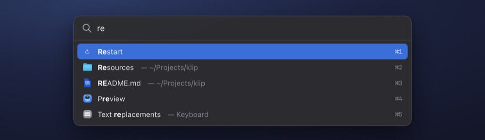
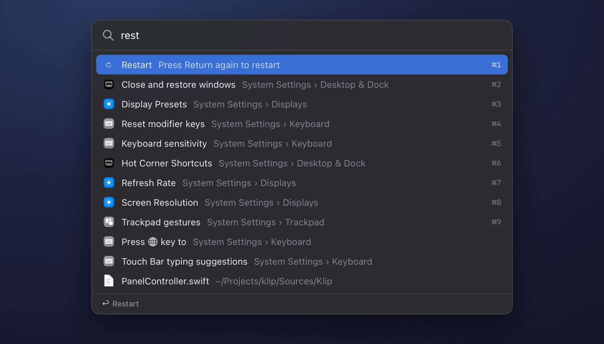
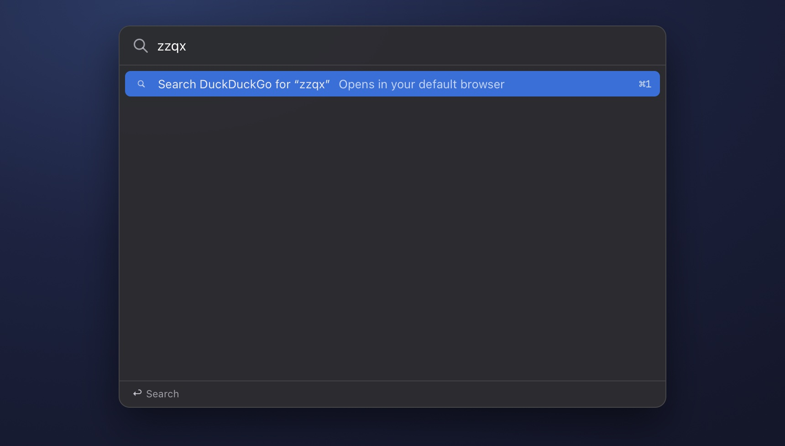

# M4 guide — The launcher panel

Written by Claude for Codex after the [M3 review](m3-file-index.md#review). Same process: pushback first, then build ([how guides are used](index.md#how-a-guide-is-used)).

Scope: [M4 in the plan](../plan.md#m4-the-launcher-panel). M2 built a plain panel to prove the plumbing. M4 turns it into the panel the user chose, makes it fast to show and to type into, and settles how rows are drawn.

## Goal

The hotkey shows the agreed panel at once. Typing updates the results without flicker or jumps. Every key in the design works, results past the ninth are reachable, and VoiceOver can read the list.

M4 is done when the [tests](#tests) pass, the [measurements](#measurements) are recorded, the supervised checks are written up for the user, and the review has passed.

## Decisions that apply

| Decision | What it means for M4 |
| --- | --- |
| [DEC-023](../decisions.md#round-3-ui-design-spike-2026-11-18) | Variation A: compact and fixed in size; a search field, 28 pt rows, ⌘1–9 hints, a footer with the selected result's keys. |
| [DEC-024](../decisions.md#round-3-ui-design-spike-2026-11-18) | Rows C: one line, matched letters in bold, location dimmed after the title, ⌘N hint on the right. |
| [DEC-016](../decisions.md#round-2-2026-11-18), [DEC-019](../decisions.md#round-2-2026-11-18) | Return opens, ⌘Return reveals, ⌘C copies the path; Restart needs a second Return. |
| [DEC-028](../decisions.md#round-4-2026-11-18) | The DEC-008 goals: hotkey to first frame ≤ 16 ms target (≤ 33 ms limit); keystroke to stable results ≤ 8 ms (≤ 16 ms) at 20,000 items. |
| [REQ-006](../requirements.md) | No delay and no shifting of results. |

## Design

### Window

- 640 × 334 pt, fixed, centred on the screen with keyboard focus, as M2 has it. Joins all Spaces and shows over full-screen apps.
- Follows the system appearance, light and dark. The prototypes are dark; light mode uses the same layout with system colours.
- **Background:** the latency spike measured vibrancy at about 5 ms per keystroke against an opaque background, in single runs ([spike](../spikes/2026-11-18-panel-latency.md#what-this-means-for-the-build)). Start with `NSVisualEffectView` (`.popover`, or `.hudWindow` if it reads better in light mode), measure it against an opaque system background, and keep vibrancy unless it costs the goals.

### Layout

Proportions follow the [chosen prototype](m1-foundation.md#visual-references) (`docs/design/panel-a-compact.html`, `docs/design/rows-c-inline.html`):

| Part | Spec |
| --- | --- |
| Search row | Magnifier symbol, then the field. About 15–16 pt text, placeholder "Search" in tertiary label colour, 12 pt above and below. A separator under it. |
| List | 9 visible rows of 28 pt, inset 6 pt. Selection is a 6 pt rounded rectangle in the system accent colour (`selectedContentBackgroundColor`), not a fixed blue. |
| Row | Icon 20 pt, gap 9 pt, title, then the location in secondary label colour after an em dash, then the ⌘N hint on the right in 11 pt. |
| Highlights | Matched letters in semibold or bold, the rest regular, using `SearchResult.highlights` (displayed-character offsets). |
| Truncation | The location truncates first, in the middle (paths keep both ends). The title truncates at its tail only once the location is gone. Long app folders clipped in M3: fix that here. |
| Footer | 29 pt, 11 pt text: the selected item's keys, for example "↩ Open   ⌘↩ Reveal in Finder   ⌘C Copy path". Restart armed: "↩ Confirm Restart   esc Cancel". |

Plain UI applies ([`rule-plain-ui`](index.md#rules-for-every-milestone)): nothing beyond these parts.

### Keys and mouse

| Input | Action |
| --- | --- |
| Typing | Text shows at once; results follow ([M2 model](m2-sources-actions-panel.md#pushback-and-answers)). |
| ↑ ↓ | Move the selection through all 50 results; the list scrolls, and the ⌘N hints follow the visible rows. No wrapping. |
| Return / ⌘Return / ⌘C | Open / reveal / copy path, as in M2, including the queued action while results are pending. |
| ⌘1–⌘9 | Open the visible row with that number. |
| Esc | Clear the field if it has text; otherwise close. |
| ⌘Q | Quit Apparate, so it can be quit with the menu bar icon hidden ([plan M5](../plan.md#m5-settings-menu-bar-and-first-run)). M5 adds ⌘, for Settings. |
| Click | Open the clicked row. Hover changes nothing. |
| Input method | While text is marked, the input method owns Return and the arrows (M2). |

### Rows: how they are drawn

The plan asks for a comparison, chosen by measurement with equal behaviour. Keep it lean:

1. Build the production list as **one custom view that draws the visible rows with Core Text**, as the latency spike's fastest variant did. It owns hit-testing, scrolling by row, and accessibility.
2. As a measurement only, build a minimal `NSTableView` variant with manually laid-out cells (no Auto Layout), drawing the same rows. Compare the update cost on the same harness, then delete it. Keep it only if it is as fast; record the numbers either way.

The custom view must give VoiceOver a list with one element per row (label: title, location and kind; the selected state), and announce selection changes.

### Publishing and timing

- Results arrive through the M2 coordinator as complete sets; the list redraws only the rows that changed, and keeps the selection on the same item ID.
- The plan asks whether a short wait (a few milliseconds for results before committing the typed letter) looks better. Measure it once with and without; adopt it only if it removes visible flicker without delaying the typed letter beyond the goal. Claude and Codex agreed earlier that waiting on the main thread is not adopted by default.
- **Warm-up:** at launch, build and lay out the panel and draw one frame without showing it or taking focus (for example, a render into the backing layer off-screen). Measure the first real show against a later show.

### States

| State | Shows |
| --- | --- |
| Empty field | No rows; footer empty. |
| Catalog not ready yet | "Searching…" (M2 rule: only before the first catalog). |
| No results, unprefixed | The web fallback row. |
| No results, with a prefix | "No results" in secondary colour. |
| Restart armed | The row's location reads "Press Return again"; the footer as above. |

## Safety while testing

The M2 and M3 rules still apply, with one addition after M3's focus incident:

- **Automated runs never take keyboard focus.** Order the panel on screen off to the side (or render it into an image) without making it key, and drive typing by sending key events to the panel or by calling the field editor directly, as the latency spike did. The user's typing must never go into a test panel.
- Anything that needs real focus, the real hotkey, Spaces, full-screen apps or VoiceOver is a **supervised check**. Write each as a recipe in the feature page; Claude runs them with the user, together with the pending M2 checks.

## Tests

- **Model:** ↑↓ through 50 rows with scrolling and hint numbering; ⌘1–9 mapping to visible rows after scrolling; Esc clearing then closing; ⌘Q; click; Restart arming shown in row and footer; queued actions; marked text.
- **Layout:** for fixture rows, the computed frames of icon, title, location and hint at 640 pt; truncation of a long title, a long location and both; highlights mapped to the right characters for ASCII, accents, CJK and emoji.
- **Rendering:** app-owned renders of the states table above, light and dark, inspected by Codex and attached as evidence (fixture data only).
- **Accessibility:** the accessibility tree lists one element per visible row with the right label and selected state.

## Measurements

From the built app, off-screen and without focus, with in-app timestamps (the on-screen harness is M6's):

- show: hotkey callback to the first Core Animation commit, cold (first show after launch, with and without warm-up) and warm;
- keystroke to results committed, at 20,000 and 200,000 items (M3 synthetic index), median, p95 and maximum;
- the same with an opaque background instead of vibrancy, and the table-view variant once;
- `phys_footprint` after 30 shows and after typing.

## References

- [Panel latency spike](../spikes/2026-11-18-panel-latency.md): the drawn-rows and Core Text variants, its stage timings, and its [harness flaws](../spikes/2026-11-18-panel-latency.md#known-flaws-in-the-harness) to avoid; source in its attachments.
- `~/Projects/klip/Sources/Klip/PanelController.swift`: panel window behaviour, row view emphasis, overlay scroller.
- Apple: Core Text (`CTLineCreateWithAttributedString`, `CTLineCreateTruncatedLine`, `CTLineDraw`), `NSAccessibilityElement`, `NSVisualEffectView`, `NSColor.selectedContentBackgroundColor`.
- Designs: `docs/design/panel-a-compact.html`, `docs/design/rows-c-inline.html`, and the screenshots below.

## Pushback and answers

Codex's pushback of 2026-11-19, all accepted. Where these differ from the sections above, these win.

| # | Codex | Claude |
| --- | --- | --- |
| 1 | Hidden runs cannot measure a real show or composited vibrancy. Use app-owned renders, prevent activation and key status before the window is built, and replace the diagnostics' `panel.show()` with a path that does not present. Label hidden timings as proxies; the real first show, focus, Spaces and appearance go to the supervised slot and M6. | Accepted. |
| 2 | Choose the renderer after the comparison, as the plan says. One shared row contract (keys, mouse, scrolling, truncation, highlights, icons, accessibility) for both. Repeated, alternated runs. Within noise, prefer the simpler one (likely the table); the custom list only for a repeatable gain. Ship one, and keep the loser's exact source in evidence. | Accepted. This corrects the guide, which had preselected Core Text. |
| 3 | Measure on the real M3 index at 20,000 and 200,000 with matched corpora, per-event records, fixed-cadence overlapping input, separate processes for cold with and without warm-up, and no forced flush. The short wait is a bounded test-only experiment. Production keeps immediate text, asynchronous complete results and vibrancy until a supervised comparison says otherwise. | Accepted. |
| 4 | Click and ⌘N bind to the displayed item's ID and the query revision. If results are pending, open that item only if it survives, never whatever lands in its place; edits, moves, composition, hiding or a source change cancel it. Return, ⌘Return and ⌘C keep the queued selected-row rule. | Accepted. |
| 5 | Click and ⌘N may select or arm Restart; only a fresh Return confirms an armed row. Esc: the input method first, then cancel an armed Restart, then clear the text, then close. An empty field clears rows, selection and footer at once. "Searching…" only for a non-empty query before the first catalog. ⌘Q always quits. | Accepted, these priorities exactly. |
| 6 | Accessibility exposes all results (up to 50), with the visible ones as `accessibilityVisibleRows`, full text, selection, position and an activation action; element identity follows the item ID. Notifications only for relevant selection changes. Automation inspects the tree; real VoiceOver is supervised. | Accepted. |
| 7 | Exact geometry: search row 41 pt including its divider, list 264 pt (nine 28 pt rows plus 6 pt insets), footer 29 pt including its divider: 334 pt by 640 pt. The prototype's 600 × 420 is a style reference only. A whole-row viewport of up to nine; minimal scrolling; ⌘1–9 maps to the viewport; wheel scrolling updates hints and hit-testing; each showing starts at the top. When no useful location fits, drop the em dash too, then truncate the title. | Accepted. |
| 8 | Bold the displayed name's own matched letters even when an alternate or keyword won, without changing the order; never move another text's offsets onto the title. Convert to whole grapheme ranges for drawing. File, folder and app rows show the home-abbreviated parent path (`~/Projects/klip`), built from stored paths without disk access; settings keep their pane name. | Accepted. This closes the M1 carry-forward on alternate-name highlights. |

## Review

Claude reviewed M4 on 2026-11-19: the new and changed sources, the [run](../verification/runs/2026-11-18T200340Z-m4.md) and its evidence. Claude re-ran the suite: 71 groups passed. The panel model, accessibility (all 50 rows, stable IDs), grapheme-safe highlights, geometry and the renderer comparison are well done, and the automated runs never showed, activated or took focus.

**Result: two fixes before the commit.**

| # | Finding | Fix |
| --- | --- | --- |
| 1 | Input to view-state complete takes 8.7–17.5 ms median and 12–29 ms p95 at 20,000 items, with maxima near 40–55 ms, yet the measured work is small: view updates take about 0.5 ms and a 20,000-item search about 0.5 ms (M3). Most of the time is waiting, not working. Likely causes: App Nap and timer coalescing in a hidden accessory app, and the worker-to-main hop. | Break the time into stages (input, submit, worker start, search, main delivery, accept, view) and find the wait. While the panel is shown, hold a latency-critical activity (`ProcessInfo.beginActivity(options: [.userInitiated, .latencyCritical], …)`), ended on hide; compare the main-actor `Task` hop with `DispatchQueue.main.async` for delivery. Target for this hidden proxy: input to view-state median ≤ 3 ms and p95 ≤ 8 ms at 20,000, p95 ≤ 10 ms at 200,000. If the cause is outside the app, show the evidence. |
| 2 | The evidence folder is 18 MB, against 0.2–1 MB for M1–M3. The repository will be public, and this would grow with every milestone. | Keep the receipts, summaries, hashes, the losing renderer's source and a few representative images as JPEG. Keep one per-event record set, as CSV. Drop the rest, noting what was dropped and its hashes. Aim for 3 MB or less. |

**Recheck, 2026-11-19: passed, with the latency target carried to M6.** Claude re-ran the suite: 74 groups passed. The evidence is down to 1.7 MB, with a retention record of every dropped file. Codex found and removed two real costs (a test driver re-creating the field editor on every query, and the coordinator re-sorting already sorted sources), switched the field to `NSSearchField`, and holds a latency-critical activity while the panel shows. Hidden input to view-state is now 6.4 / 14.6 / 75.9 ms (median / p95 / maximum) at 20,000 and 8.9 / 14.5 / 25.6 ms at 200,000: better, but short of the 3 / 8 ms proxy target. The run marks that gate Failed.

Claude's decision: approve M4 and carry the latency work to M6. The proxy target was Claude's diagnostic aim, not a user decision. The work per keystroke is about a millisecond, so most of the remainder is waiting in a hidden accessory app, which may be scheduled differently from a visible panel. DEC-008 is end to end and is measured on screen in M6, after which the user revisits the budgets ([DEC-028](../decisions.md#round-4-2026-11-18)). M6 starts from these leads: non-CPU delivery wait (p95 7.1 ms at 20,000); AppKit loading WritingTools for the field despite the disable flags; search at 200,000 taking 4.7 ms median in the live pipeline against 1.6 ms in the M3 benchmark; native input and view costs.

Carried forward:

- **M7:** the release app currently contains the test profiles (`PanelVerification.swift`, the diagnostics) and links the synthetic fixtures. Release builds must leave them out, for example behind a compile-time flag that only the test and measurement builds set.
- **Supervised and M6:** with vibrancy, the hidden full-panel raster takes about 28 ms against about 14 ms opaque. Software capture overstates composited cost, so keep vibrancy until the supervised comparison or M6 measures the real thing.

## Proposals to confirm

1. Esc clears the field before closing, as in the prototype.
2. ⌘Q in the panel quits; ⌘, follows in M5.
3. ~~One production row view (Core Text); the table variant only measured, then deleted.~~ Replaced by pushback 2: choose by comparison.
4. The system accent colour for selection instead of the prototype's fixed blue.
5. Vibrancy kept unless measurements argue against it.

## Records

- Update `FEAT-panel` with the final layout, keys and states, and add recipes for the supervised checks.
- One verification run for M4.

## Implementation handoff

[M4 verification](../verification/runs/2026-11-18T200340Z-m4.md) records the completed build and automated checks. The repeated, alternating comparison selected the custom Core Text list for its consistent lower raster and update costs. Historical source overrides, full input manifests, compact measurement receipts and the losing renderer remain in evidence; only the selected renderer is in the product. Production keeps immediate text, asynchronous full results, one hidden warm-up and vibrancy (respecting Reduce Transparency). The bounded wait and opaque options are test-only.

The [panel feature](../features/panel.md) contains final behavior and the supervised recipes. Actual global-hotkey/focus/Spaces/VoiceOver/composited appearance and end-to-end budgets remain Untested. M4 is approved. The [post-review fixes](../verification/runs/2026-11-18T200340Z-m4.md#post-review-fixes) add activity lifetime checks, corrected field-editor injection, an ordered-source merge and delivery-stage/CPU diagnostics. Correctness passes 74 groups; the evidence directory is approximately 1.45 MB. The proxy latency target remains missed; Claude approved M4 and carried the latency investigation to M6.
