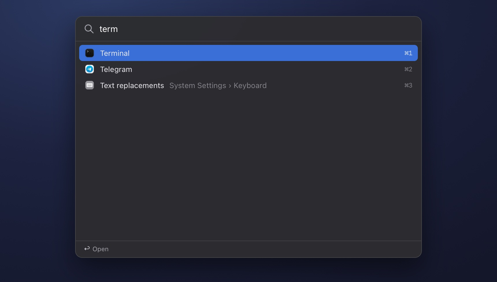
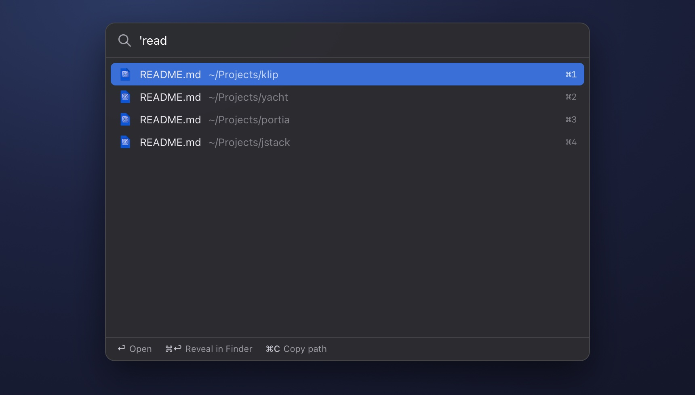

# M4 guide — The launcher panel

Written by Claude for Codex after the [M3 review](m3-file-index.md#review). Same process: pushback first, then build ([how guides are used](index.md#how-a-guide-is-used)).

Scope: [M4 in the plan](../plan.md#m4-the-launcher-panel). M2 built a plain panel to prove the plumbing. M4 turns it into the panel the user chose, makes it fast to show and to type into, and settles how rows are drawn.

## Goal

The hotkey shows the agreed panel at once. Typing updates the results without flicker or jumps. Every key in the design works, results past the ninth are reachable, and VoiceOver can read the list.

M4 is done when the [tests](#tests) pass, the [measurements](#measurements) are recorded, the supervised checks are written up for the user, and the review has passed.

## Decisions that apply

| Decision | What it means for M4 |
| --- | --- |
| [DEC-023](../decisions.md#round-3-ui-design-spike-2026-11-18) | Variation A: compact and fixed in size; a search field, 28 pt rows, ⌘1–9 hints, a footer with the selected result's keys. |
| [DEC-024](../decisions.md#round-3-ui-design-spike-2026-11-18) | Rows C: one line, matched letters in bold, location dimmed after the title, ⌘N hint on the right. |
| [DEC-016](../decisions.md#round-2-2026-11-18), [DEC-019](../decisions.md#round-2-2026-11-18) | Return opens, ⌘Return reveals, ⌘C copies the path; Restart needs a second Return. |
| [DEC-028](../decisions.md#round-4-2026-11-18) | The DEC-008 goals: hotkey to first frame ≤ 16 ms target (≤ 33 ms limit); keystroke to stable results ≤ 8 ms (≤ 16 ms) at 20,000 items. |
| [REQ-006](../requirements.md) | No delay and no shifting of results. |

## Design

### Window

- 640 × 334 pt, fixed, centred on the screen with keyboard focus, as M2 has it. Joins all Spaces and shows over full-screen apps.
- Follows the system appearance, light and dark. The prototypes are dark; light mode uses the same layout with system colours.
- **Background:** the latency spike measured vibrancy at about 5 ms per keystroke against an opaque background, in single runs ([spike](../spikes/2026-11-18-panel-latency.md#what-this-means-for-the-build)). Start with `NSVisualEffectView` (`.popover`, or `.hudWindow` if it reads better in light mode), measure it against an opaque system background, and keep vibrancy unless it costs the goals.

### Layout

Proportions follow the [chosen prototype](m1-foundation.md#visual-references) (`docs/design/panel-a-compact.html`, `docs/design/rows-c-inline.html`):

| Part | Spec |
| --- | --- |
| Search row | Magnifier symbol, then the field. About 15–16 pt text, placeholder "Search" in tertiary label colour, 12 pt above and below. A separator under it. |
| List | 9 visible rows of 28 pt, inset 6 pt. Selection is a 6 pt rounded rectangle in the system accent colour (`selectedContentBackgroundColor`), not a fixed blue. |
| Row | Icon 20 pt, gap 9 pt, title, then the location in secondary label colour after an em dash, then the ⌘N hint on the right in 11 pt. |
| Highlights | Matched letters in semibold or bold, the rest regular, using `SearchResult.highlights` (displayed-character offsets). |
| Truncation | The location truncates first, in the middle (paths keep both ends). The title truncates at its tail only once the location is gone. Long app folders clipped in M3: fix that here. |
| Footer | 29 pt, 11 pt text: the selected item's keys, for example "↩ Open   ⌘↩ Reveal in Finder   ⌘C Copy path". Restart armed: "↩ Confirm Restart   esc Cancel". |

Plain UI applies ([`rule-plain-ui`](index.md#rules-for-every-milestone)): nothing beyond these parts.

### Keys and mouse

| Input | Action |
| --- | --- |
| Typing | Text shows at once; results follow ([M2 model](m2-sources-actions-panel.md#pushback-and-answers)). |
| ↑ ↓ | Move the selection through all 50 results; the list scrolls, and the ⌘N hints follow the visible rows. No wrapping. |
| Return / ⌘Return / ⌘C | Open / reveal / copy path, as in M2, including the queued action while results are pending. |
| ⌘1–⌘9 | Open the visible row with that number. |
| Esc | Clear the field if it has text; otherwise close. |
| ⌘Q | Quit Apparate, so it can be quit with the menu bar icon hidden ([plan M5](../plan.md#m5-settings-menu-bar-and-first-run)). M5 adds ⌘, for Settings. |
| Click | Open the clicked row. Hover changes nothing. |
| Input method | While text is marked, the input method owns Return and the arrows (M2). |

### Rows: how they are drawn

The plan asks for a comparison, chosen by measurement with equal behaviour. Keep it lean:

1. Build the production list as **one custom view that draws the visible rows with Core Text**, as the latency spike's fastest variant did. It owns hit-testing, scrolling by row, and accessibility.
2. As a measurement only, build a minimal `NSTableView` variant with manually laid-out cells (no Auto Layout), drawing the same rows. Compare the update cost on the same harness, then delete it. Keep it only if it is as fast; record the numbers either way.

The custom view must give VoiceOver a list with one element per row (label: title, location and kind; the selected state), and announce selection changes.

### Publishing and timing

- Results arrive through the M2 coordinator as complete sets; the list redraws only the rows that changed, and keeps the selection on the same item ID.
- The plan asks whether a short wait (a few milliseconds for results before committing the typed letter) looks better. Measure it once with and without; adopt it only if it removes visible flicker without delaying the typed letter beyond the goal. Claude and Codex agreed earlier that waiting on the main thread is not adopted by default.
- **Warm-up:** at launch, build and lay out the panel and draw one frame without showing it or taking focus (for example, a render into the backing layer off-screen). Measure the first real show against a later show.

### States

| State | Shows |
| --- | --- |
| Empty field | No rows; footer empty. |
| Catalog not ready yet | "Searching…" (M2 rule: only before the first catalog). |
| No results, unprefixed | The web fallback row. |
| No results, with a prefix | "No results" in secondary colour. |
| Restart armed | The row's location reads "Press Return again"; the footer as above. |

## Safety while testing

The M2 and M3 rules still apply, with one addition after M3's focus incident:

- **Automated runs never take keyboard focus.** Order the panel on screen off to the side (or render it into an image) without making it key, and drive typing by sending key events to the panel or by calling the field editor directly, as the latency spike did. The user's typing must never go into a test panel.
- Anything that needs real focus, the real hotkey, Spaces, full-screen apps or VoiceOver is a **supervised check**. Write each as a recipe in the feature page; Claude runs them with the user, together with the pending M2 checks.

## Tests

- **Model:** ↑↓ through 50 rows with scrolling and hint numbering; ⌘1–9 mapping to visible rows after scrolling; Esc clearing then closing; ⌘Q; click; Restart arming shown in row and footer; queued actions; marked text.
- **Layout:** for fixture rows, the computed frames of icon, title, location and hint at 640 pt; truncation of a long title, a long location and both; highlights mapped to the right characters for ASCII, accents, CJK and emoji.
- **Rendering:** app-owned renders of the states table above, light and dark, inspected by Codex and attached as evidence (fixture data only).
- **Accessibility:** the accessibility tree lists one element per visible row with the right label and selected state.

## Measurements

From the built app, off-screen and without focus, with in-app timestamps (the on-screen harness is M6's):

- show: hotkey callback to the first Core Animation commit, cold (first show after launch, with and without warm-up) and warm;
- keystroke to results committed, at 20,000 and 200,000 items (M3 synthetic index), median, p95 and maximum;
- the same with an opaque background instead of vibrancy, and the table-view variant once;
- `phys_footprint` after 30 shows and after typing.

## References

- [Panel latency spike](../spikes/2026-11-18-panel-latency.md): the drawn-rows and Core Text variants, its stage timings, and its [harness flaws](../spikes/2026-11-18-panel-latency.md#known-flaws-in-the-harness) to avoid; source in its attachments.
- `~/Projects/klip/Sources/Klip/PanelController.swift`: panel window behaviour, row view emphasis, overlay scroller.
- Apple: Core Text (`CTLineCreateWithAttributedString`, `CTLineCreateTruncatedLine`, `CTLineDraw`), `NSAccessibilityElement`, `NSVisualEffectView`, `NSColor.selectedContentBackgroundColor`.
- Designs: `docs/design/panel-a-compact.html`, `docs/design/rows-c-inline.html`, and the screenshots below.

## Proposals to confirm

1. Esc clears the field before closing, as in the prototype.
2. ⌘Q in the panel quits; ⌘, follows in M5.
3. One production row view (Core Text); the table variant only measured, then deleted.
4. The system accent colour for selection instead of the prototype's fixed blue.
5. Vibrancy kept unless measurements argue against it.

## Records

- Update `FEAT-panel` with the final layout, keys and states, and add recipes for the supervised checks.
- One verification run for M4.
