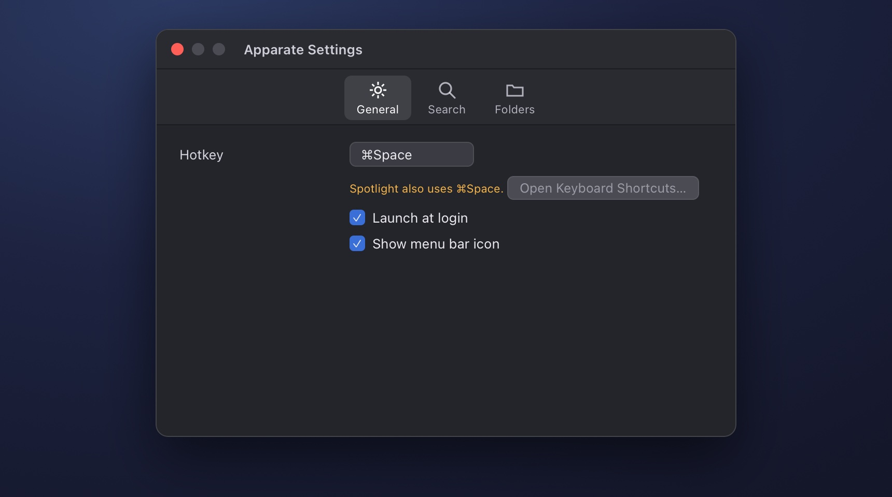
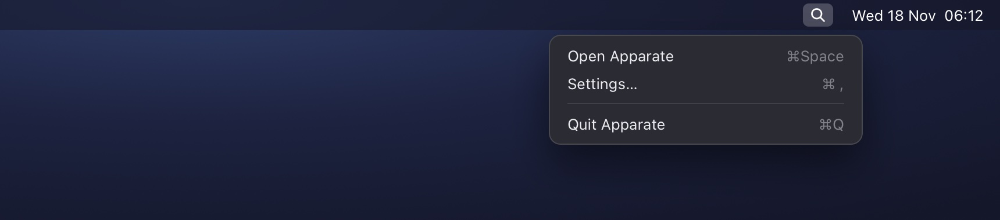
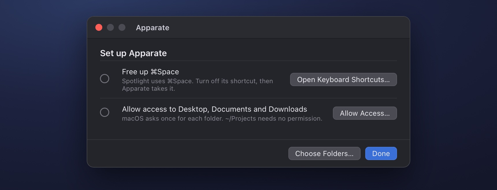

# M5 guide — Settings, menu bar and first run

Written by Claude for Codex after the [M4 review](m4-launcher-panel.md#review). Same process: pushback first, then build ([how guides are used](index.md#how-a-guide-is-used)).

Scope: [M5 in the plan](../plan.md#m5-settings-menu-bar-and-first-run). M5 adds the three remaining windows the user chose in the UI spike, all working against the M1 config and the M2–M3 status APIs.

**On the supervised checks.** The M2 guide said its supervised checks must pass before M5 builds on first run. The user has not had a session yet, so Claude relaxes that rule: M5 is built and reviewed now, its own on-screen checks join the same supervised session, and M7 does not release until all of them pass. This was Claude's rule, not a user decision.

## Decisions that apply

| Decision | What it means for M5 |
| --- | --- |
| [DEC-025](../decisions.md#round-3-ui-design-spike-2026-11-18) | Settings with toolbar tabs: General, Search, Folders. |
| [DEC-026](../decisions.md#round-3-ui-design-spike-2026-11-18), [DEC-048](../decisions.md#round-11-2026-11-19) | Menu: Open Apparate, Settings…, Quit Apparate, under the outlined-puff template glyph. |
| [DEC-027](../decisions.md#round-3-ui-design-spike-2026-11-18) | First launch: one setup window with two steps and their status, and the buttons Choose Folders… and Done. |
| [DEC-021](../decisions.md#round-2-2026-11-18) | The menu bar icon can be hidden; Settings and Quit must stay reachable. |
| [DEC-004](../decisions.md#round-1-2026-11-18) | ⌘Space by default; changeable; the user frees it from Spotlight. |
| [DEC-018](../decisions.md#round-2-2026-11-18), [DEC-032](../decisions.md#round-4-2026-11-18) | Search engine and editable URL; prefixes can be changed and added. |
| [DEC-005](../decisions.md#round-1-2026-11-18), [DEC-020](../decisions.md#round-2-2026-11-18), [DEC-033](../decisions.md#round-4-2026-11-18), [DEC-016](../decisions.md#round-2-2026-11-18) | Folders with depth, the `.gitignore` switch, index status and Rebuild. |

## Designs

The agreed designs, with their text. Build these parts and nothing more ([`rule-plain-ui`](index.md#rules-for-every-milestone)). The prototypes are in `docs/design/`.

## Order of work

### 1. Settings window

A standard preferences window: `NSToolbar` with three selectable items and `toolbarStyle = .preference`; the window resizes to each tab's content. Each tab is an `NSGridView` of label and control rows, as in Klip's `SettingsWindowController`.

**General**

- **Hotkey:** a shortcut recorder. Click it, press a combination with ⌘, ⌥ or ⌃; Esc cancels. Reuse Klip's `HotKey(event:)` logic, already adapted in M2. A combination that cannot be registered shows an inline error and keeps the old one.
- **Spotlight notice:** only while the hotkey is ⌘Space and Spotlight's own shortcut is still on: "Spotlight also uses ⌘Space." with **Open Keyboard Shortcuts…**, which opens the Keyboard pane's Shortcuts anchor ([deep-link spike](../spikes/2026-11-18-settings-deep-links.md)). Spotlight's state comes from reading the `com.apple.symbolichotkeys` preferences (key 64, `enabled`), read-only. Re-check when the window becomes key again, not by polling.
- **Launch at login:** shows `SMAppService.mainApp`'s real state, as Klip's `LaunchAtLogin` does. A failure shows inline.
- **Show menu bar icon:** the config switch.

**Search**

- **Prefixes:** a two-column table, Prefix and Searches. The prefix cell is editable; + adds a prefix for a scope that has none, − removes the selected one. The same validation as the config (one symbol, not `/` or `~`, no duplicates), shown inline.
- **Search engine:** a menu of presets that fill the URL (DuckDuckGo, Google, Bing, Kagi), plus Custom, which is selected whenever the URL matches no preset.
- **Search URL:** editable, validated as the config does, with `{query}` required.

**Folders**

- **Folder table:** Folder (home-abbreviated path) and Depth (1–30). A folder that is not indexed normally shows its status in secondary text (waiting for access, denied, not found, unavailable). + opens an `NSOpenPanel` for folders; − removes the selected one.
- **Skip files listed in .gitignore:** the config switch.
- **Index:** "13,412 items · updated 2 minutes ago" from the M3 status API, refreshed while the window is open, and **Rebuild**.

**Saving and errors**

- Every change saves through `ConfigStore.save` at once; there is no Apply button.
- If `config.json` is broken (hand-edited), the window shows the error at the top with **Show in Finder** for the file, and disables the controls. Settings never overwrites a broken file (M1).

### 2. Menu bar

- `NSStatusItem` with `Resources/MenuBarIconTemplate.png` (and `@2x`); `build.sh` copies both into the bundle. M7 adds `AppIcon.icns`.
- Menu: **Open Apparate** showing the configured hotkey, **Settings…** (⌘,), a separator, **Quit Apparate** (⌘Q).
- With the icon hidden: no status item. ⌘, in the panel opens Settings (M4 has ⌘Q), and opening the app again (`applicationShouldHandleReopen`) shows Settings, as in Klip.

### 3. First run

- Shown when there is no `config.json` at launch, and with `APPARATE_SHOW=setup`.
- Title **Set up Apparate**, two steps, each with a status mark:
  1. **Free up ⌘Space** — "Spotlight uses ⌘Space. Turn off its shortcut, then Apparate takes it." **Open Keyboard Shortcuts…**. Done when Spotlight's shortcut is off and Apparate holds ⌘Space.
  2. **Allow access to Desktop, Documents and Downloads** — "macOS may ask for access to each folder. ~/Projects needs no permission." (wording corrected in [pushback 4](#pushback-and-answers)) **Allow Access…** runs the M2 access step. Done when all three are allowed; otherwise it names the ones that are not.
- Buttons: **Choose Folders…** (opens Settings on Folders) and **Done**.
- Re-check both statuses when the window becomes key again.
- Partly granted, denied or cancelled access is a normal state: the launcher works with what it has.
- The M2 access window becomes this window's second step; remove the separate one.

## Safety while testing

All earlier rules apply. For M5:

- Settings and setup are ordinary windows that activate the app. **Automated runs never show them**; use app-owned renders of their content views, as in M4.
- **Never register or unregister launch at login**, never open System Settings, never change `com.apple.symbolichotkeys`. Reading it is fine.
- Fixture tests use a temporary `APPARATE_HOME`; `NSOpenPanel` is faked.

## Tests

- **Settings model:** each control reads and writes the right config field; inline errors for bad prefixes, duplicate prefixes, a bad URL and a bad depth; the engine menu shows Custom for an unknown URL; a broken config disables editing and never saves.
- **Hotkey:** recording, cancelling, a refused combination keeping the old one; the Spotlight notice shown only for ⌘Space with Spotlight's shortcut on (fixture preference values, including a missing key).
- **Folders:** add, remove, depth change, the `.gitignore` switch triggering a rebuild, status texts, and the item-count and relative-time line.
- **Menu:** items, key equivalents, the hotkey shown on Open; hiding the icon removes the item; reopen shows Settings.
- **First run:** shown only without a config; step statuses from fixture inputs; Choose Folders… opens Settings on Folders.
- **Renders:** each tab, the menu and the setup window, in light and dark, inspected and attached (fixture data only).

## References

- `~/Projects/klip/Sources/Klip/SettingsWindowController.swift`: grid layout, checkbox, popup and button helpers, the recorder pattern.
- `~/Projects/klip/Sources/Klip/LaunchAtLogin.swift` and `~/Projects/klip/Sources/Klip/AppDelegate.swift` (reopen shows Settings).
- `~/Projects/portia/Sources/Portia/MenuBarIcon.swift`: another way to make a template glyph (drawn in code); Apparate uses the bundled PNGs.
- [App icon](../design/icon.md) for the glyph files; [settings deep-link spike](../spikes/2026-11-18-settings-deep-links.md) for the Keyboard anchors.
- Apple: `NSToolbar` with `toolbarStyle = .preference`, `NSGridView`, `NSStatusItem`, `SMAppService`, `NSOpenPanel`.

## Pushback and answers

Codex's pushback of 2026-11-19, all accepted. Where these differ from the sections above, these win.

| # | Codex | Claude |
| --- | --- | --- |
| 1 | "Immediate" saving needs an edit boundary: switches, presets, add and remove save at once; text and table cells validate and save on Return or end of editing, and Esc restores the saved value. Each save applies the one field change to the freshly read file, keeping unrelated external edits, and detects a conflicting external change to the same field. A broken file disables editing; repairing it re-enables. | Accepted. |
| 2 | Hotkey change as one transaction: register the new key while keeping the old, save, then release the old; on failure keep the old. The menu shows the active shortcut. The recorder lives only in the Settings window, ends on Esc, tab change, close or lost focus, and suspends the launcher hotkey while recording without unregistering it. | Accepted. |
| 3 | Read Spotlight's binding as well as its enabled bit; missing or malformed data is "unknown", which neither completes the step nor claims a conflict. On returning to the window, also retry registering the configured key. Choosing another working shortcut completes step 1. A known conflict is explained in setup, not by an alert; the existing one-time startup alert stays for other cases. | Accepted. |
| 4 | Returning to a window must never probe protected folders; only **Allow Access…** does. Saved results are hints. Use "macOS may ask for access to each folder." Done always closes, whatever the steps' state. Add a conditional **Allow Access…** in Settings → Folders for protected roots that need a check, so access can be retried after setup. | Accepted, including the conditional button: it appears only when a protected folder needs a check, and it is the only way to retry once setup is gone. The wording change corrects the prototype, which said macOS "asks once". |
| 5 | Launch at login shows all `SMAppService` states: enabled on, not registered off, requires approval mixed with "Approval required in Login Items", not found unavailable with a reason. Re-read after each change and when Settings becomes key; never show the requested value as if it succeeded. Do not copy Klip's Boolean wrapper. | Accepted. |
| 6 | Presets use canonical HTTPS templates; the menu derives the preset from the saved URL, and Custom is not a saved field. Choosing Custom keeps the URL and focuses its field. + picks a scope that has no prefix, then takes a symbol; it is disabled when every scope has one. | Accepted. |
| 7 | Folder rows keyed by normalized path; picking an already-listed folder keeps its depth; the picker takes folders only, several at once, and never triggers an access probe. Add a status callback so Settings cannot stick on "Indexing". Count and time come from the file snapshot; the relative time refreshes only while Folders shows, from cached values. Rebuild is disabled while one runs. | Accepted. |
| 8 | One retained Settings and one setup controller. ⌘, from the panel hides it and opens Settings; the menu, reopen and Choose Folders… use the same route. ⌘W and ⌘Q work in both windows. First-run eligibility is taken before defaults are written; Done does not bring back setup on the next launch. | Accepted. |
| 9 | Fake the status item too in automated runs: creating one changes the visible menu bar. Test the real `NSMenu` graph without opening it; the menu's appearance moves to the supervised session. Update the M2 recipes' "before M5" wording to the M7 release gate. | Accepted. |

## Review

Claude reviewed M5 on 2026-11-19: the new and changed sources, the [run](../verification/runs/2026-11-18T212428Z-m5.md) and its renders. Claude re-ran the suite: 83 groups passed. The windows are native and follow the chosen designs, including the corrected setup wording, the step that adapts to a custom shortcut, and the conditional Allow Access…. Nothing in the automated runs presented a window, a status item or a real effect.

**Result: approved for commit after the small fix below.**

| # | Finding | Fix |
| --- | --- | --- |
| 1 | In the prefix and folder tables, single-line rows sit at the top of a tall row with empty space below them (for example "." Settings, and ~/Projects with no status line). | Centre each row's content vertically. Use one row height per table: about 24 pt for prefixes, and a height that fits the folder name plus its optional status line, with a single-line folder centred. |

**Fix verification (Codex, 2026-11-19):** Prefix rows are now 24 pt; folder rows stay 36 pt and centre either the name or the name/status group, with centred depth fields. The affected light/dark renders and existing native editor checks passed on the rebuilt signed app. [Post-review record](../verification/runs/2026-11-18T212428Z-m5.md#post-review-fix). Claude authorized committing after this correction without another review round.

## Proposals to confirm

1. Spotlight's shortcut state read from `com.apple.symbolichotkeys` (key 64), read-only, re-checked when a window becomes key.
2. Search engine presets: DuckDuckGo, Google, Bing, Kagi, and Custom.
3. A broken config shows the error and Show in Finder, with no Reset button.
4. Changes save immediately.
5. The M2 access window folds into first run.

## Records

- Feature pages `FEAT-settings`, `FEAT-menu`, `FEAT-first-run`, with supervised recipes for the real windows, launch at login, the Spotlight shortcut, folder access and the open panel.
- One verification run for M5.

## Build handoff

Codex implemented the accepted scope and recorded [M5 automated verification](../verification/runs/2026-11-18T212428Z-m5.md). Feature records: [Settings](../features/settings.md), [Menu bar](../features/menu.md), [First run](../features/first-run.md). The mixed-state login action and initial General-tab alignment were corrected during verification; failure evidence is retained. The row-layout review fix is verified above and included in the M5 milestone commit. Native window/menu appearance, focus, actual login/Spotlight/privacy effects and the picker remain supervised, required before M7 release. M6 retains the M4 latency investigation.
