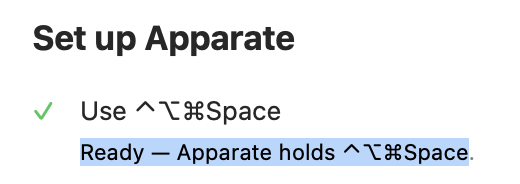
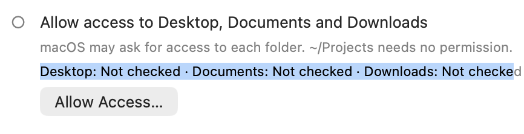
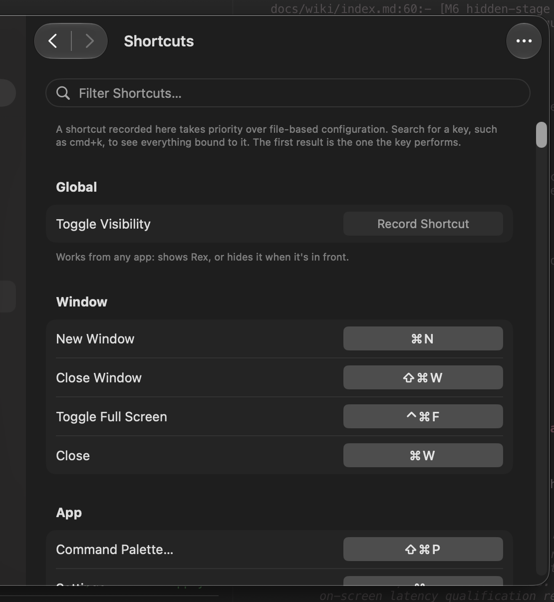
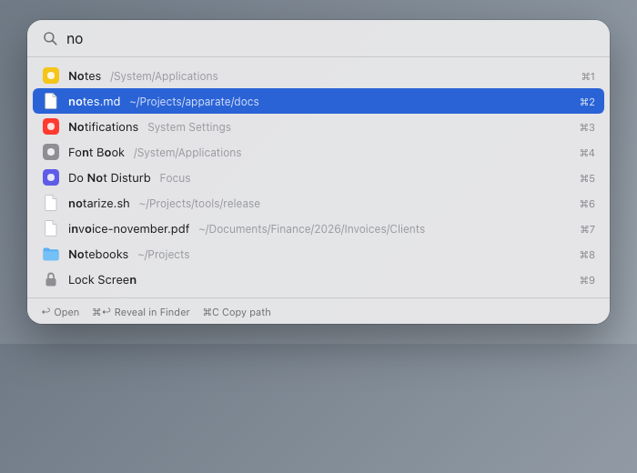
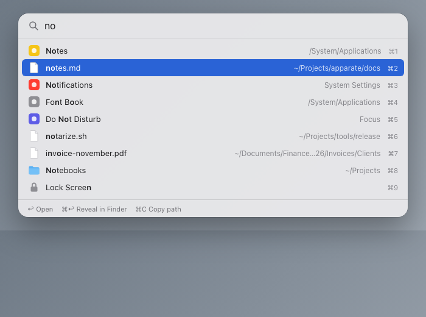
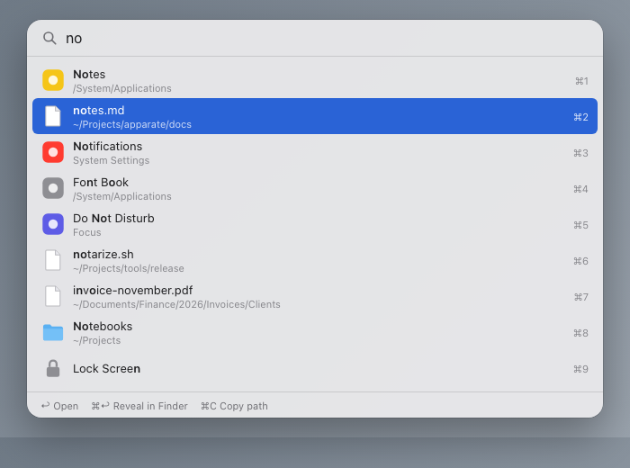

# UI follow-up — Settings, panel, rows, folders and Open With

Written by Claude for Codex during the [supervised session](../verification/supervised-session.md), after the user's feedback on the running app. Same process: pushback first, then build ([how guides are used](index.md#how-a-guide-is-used)). It lands as its own commit before the M6 on-screen stage, because the panel change affects what M6 measures.

## Decisions that apply

| Decision | What it means here |
| --- | --- |
| [DEC-051](../decisions.md#round-13-2026-11-19) | Setup drops status text that says nothing. Settings keep their layout; their groups, options and fields take Rex's style. |
| [DEC-052](../decisions.md#round-13-2026-11-19) | The panel opens as its search strip and grows to fit its results, up to nine rows. |
| [DEC-053](../decisions.md#round-13-2026-11-19) | No em dash in result rows; the location layout is a setting: inline (default), right or below. |
| [DEC-054](../decisions.md#round-13-2026-11-19) | Folders outside the index: by path (`/` or `~/` at the start) and by name (home and the disk's top level, one level deep). |
| [DEC-055](../decisions.md#round-13-2026-11-19) | Dot names are indexed (not looked inside) and shown only when the typed name starts with a dot. |
| [DEC-056](../decisions.md#round-13-2026-11-19) | Tab completes the selected result in every search. |
| [DEC-057](../decisions.md#round-13-2026-11-19) | Open With: ⇧Return (configurable) on a file or folder lists its apps in the panel. |
| [DEC-058](../decisions.md#round-13-2026-11-19) | → completes a selected folder like Tab, when the caret is at the end. |
| [DEC-025](../decisions.md#round-3-ui-design-spike-2026-11-18) | The layout that stays: toolbar tabs General, Search and Folders, with the same content in the same order. |
| [DEC-013](../decisions.md#round-2-2026-11-18) | AppKit only. No SwiftUI, including `NSHostingView`. |

## 1. Setup window text

What the user flagged, citing `rule-plain-ui`:

- **Remove** "Ready — Apparate holds ⌃⌥⌘Space." The ✓ and the step title already say it.
- **Remove** the access line when it has nothing to report. "Not checked" for each folder says nothing.
- **Keep** text that leads to an action or reports something the user must act on: Spotlight's conflict with Open Keyboard Shortcuts…, "Shortcut unavailable. Choose another in Settings.", "Checking Desktop…" during a check, and after a check only the folders that are not allowed, by name and result (for example "Documents: Denied"). It wraps; it never clips, as the current line does.
- **Explanation.** Claude proposes keeping "macOS may ask for access to each folder." (it prepares the user for the prompts) and dropping "~/Projects needs no permission." (the folders are configurable, and the sentence leads to nothing).
- Status text is a plain label, not selectable.

Apply the same pass to every text in the Settings window, and list each text kept, changed or removed in the run.

## 2. Settings: same layout, Rex-style controls

The user's references, all from Rex's settings. They are dark; for light mode use System Settings on macOS 27, which uses the same grouped style.

The Terminal reference showed section headings, a card, a menu, number fields with steppers, a Choose… button and switches with descriptions. Its screenshot is kept locally and is not published.

The Interface reference showed switch rows, a borderless menu, a segmented control and footnotes. Its screenshot is kept locally and is not published.

For comparison, today's [General](../evidence/2026-11-18T212428Z-m5/native/settings-general-dark.jpg), [Search](../evidence/2026-11-18T212428Z-m5/post-review/settings-search-dark.jpg), [Folders](../evidence/2026-11-18T212428Z-m5/post-review/settings-folders-dark.jpg) and [setup](../evidence/2026-11-18T212428Z-m5/native/setup-incomplete-light.jpg).

### The parts

Build them once, in `PreferencesSupport.swift`, and use them on every tab and in setup.

| Rex element | Build |
| --- | --- |
| Section heading ("Typography", "Colors") | 13 pt semibold label above its card. Only where the rows don't already say what the group is. |
| Card | Rounded rectangle, about 10 pt corners, filled with a subtle fill (as Rex in dark, as System Settings in light). Rows separated by hairlines inset to the row text. |
| Row | Title 13 pt on the left; an optional description in 11 pt secondary text below it; the control right-aligned and vertically centred. About 40 pt high for one line. |
| Footnote ("Hold the ⌥ key …") | 11 pt secondary text under a card, aligned with the row text. |
| On/off option | `NSSwitch`, replacing every checkbox. |
| Menu ("Swipe ⌃⌄", "Regular ⌃⌄") | `NSPopUpButton`, right-aligned in its row. |
| Number with stepper ("12 ⌃⌄ pt") | A rounded filled field with an attached stepper. For folder depth. |
| Text field | Rounded and filled, without the old bezel; the focus ring stays. |
| Shortcut ("⌘N", "Record Shortcut") | A filled rounded rectangle about 160 × 28 pt with the shortcut centred. While recording it says so; Esc cancels as today. |
| Buttons ("Choose…") | Rex's rounded filled buttons. |

### Per tab

Claude's proposal. Push back where AppKit or the content says otherwise; the user judges the renders.

- **General.** A card with the row "Open Apparate" and the shortcut button. Shortcut errors and Spotlight's conflict appear as that row's description, with Open Keyboard Shortcuts… under it. A second card with switches for Launch at login (its approval or unavailable state as the description, only when there is one) and Show menu bar icon.
- **Search.** A "Prefixes" heading, then a card with one row per scope that has a prefix: the scope's name as the title and a small one-character field on the right, replacing the table and its column headers. Adding and removing prefixes stays. Codex chooses between buttons under the card acting on a selected row and a remove control in each row. Either way, it must work from the keyboard and have VoiceOver labels. A second card holds Search engine (menu) and Search URL (a monospaced field the width of the card, since URLs are long).
- **Folders.** A card with one row per folder: the path as the title, its status as the description ("Waiting for access", "Denied", "Indexing…"), and depth as a number field with a stepper on the right, labelled so the number is understood. Adding, removing and Allow Access… stay, in Rex's button style. A card with the `.gitignore` switch. A card with the row "Index": "13,412 items · updated 2 minutes ago" as its description, Rebuild on the right, and any index error.
- **Broken config.** The error and Show in Finder, in a card.
- **Setup.** Its checklist layout stays; its buttons take the new button style.

The window stays the same width and keeps resizing its height per tab.

## 3. Panel size

The user chose the strip that grows to fit ([DEC-052](../decisions.md#round-13-2026-11-19)), after seeing the empty full-size panel and comparing it with Spotlight and Alfred.

- The height follows the visible rows: one to nine 28 pt rows plus the insets, the dividers and the footer. A query with no rows yet (the field is empty) shows the strip only. "Searching…", "No results" and the web fallback count as one row.
- The strip is the search row without its divider. The footer appears only with results.
- The panel grows downward. Its top edge stays where the full panel's top is today, so the field never moves.
- The resize happens in the same Core Animation transaction as the first drawn rows. No frame shows a larger empty window or clipped rows. No animation.
- The M6 marker and observer must still see one complete frame per result revision. The first-frame and keystroke measurements include the resize.

## 4. Result rows: location layout

Added during the session ([DEC-053](../decisions.md#round-13-2026-11-19)). The user didn't like the em dash between a result's title and its location, and accepted three of the four prototypes from a visual spike, as a setting. The prototypes are in `docs/design/rows-location-*.html`.

- **Config.** A new optional key in config version 1, `resultLocation`: `"inline"`, `"right"` or `"below"`, default `"inline"` (round 15). An unknown value is a validation error like any other.
- **Settings.** One row on the General tab, in its own card: "Location in results" with a three-part segmented control (Rex's "Snappy · Natural · Off" style): Inline, Right, Below. The change applies to the open panel at once.
- **A, inline.** Title, a 10 pt gap, then the location in 12 pt secondary text. No separator character.
- **B, right.** Title on the left; the location right-aligned, ending a fixed gap before the ⌘1–9 hint, at least 16 pt from the title. Space goes to the title first: the location truncates in the middle, then disappears; the title truncates at its tail only when no location is left.
- **C, below.** Rows are 40 pt: the title, and the location in 11 pt secondary text under it. A row without a location (a command) centres its title. Nine rows make the full panel 442 pt high; the panel still grows to fit (DEC-052).
- In every layout: matched letters stay semibold, settings items show their pane as the location, selection colours stay as today, and accessibility keeps title, location, kind and position.
- The M6 marker and observer already handle per-frame geometry; add the 40 pt rows to their tests.

## 5. Folders outside the index

Added during the session ([DEC-054](../decisions.md#round-13-2026-11-19)). The user wants to open Applications, Library and Application Support, and hidden folders such as ~/.ssh, ~/.codex and ~/.config, without a hand-written list.

### By path

- **Trigger.** After prefix parsing, the query starts with `/` or `~/` (or is exactly `~`). The part up to the last `/` is the folder; the part after it narrows that folder's entries with the usual matcher. `~/.config/` lists `.config`; `~/.ss` finds `.ssh`; `/app` finds Applications.
- **Listing.** Read that one folder directly, off the main thread, cancelled by newer revisions; reuse the listing while only the part after the last `/` changes. No index writes. At most 50 rows, ranked as usual (folders and files only); an empty filter lists the folder alphabetically.
- **Dot names** appear only when the typed name starts with a dot, as in a shell. `node_modules` is listed (it's a direct look, not an index).
- **Tab** puts the selected folder's path plus `/` in the field (home shown as `~`). Return, ⌘Return and ⌘C act as on any file row.
- **No web fallback** for these queries; "No results" when nothing matches, and a plain message when the folder can't be read.
- **Protected folders.** Desktop, Documents and Downloads are read only after an "allowed" observation, as the index does today; otherwise say that access is needed, with no prompt. Other folders are read when the user types them; macOS may ask for some (other apps' data in ~/Library). That's accepted, because the user typed the path.
- **DEC-031:** a `/` anywhere else in the query keeps searching indexed paths.

### By name

- **New default folders** for new configs: `~` and `/`, depth 1, after the existing four. Existing configs keep their list (no migration).
- **Overlap.** An entry that is also a root, or under one (for example ~/Projects inside `~`), appears once.
- **Watching.** A depth-1 root is watched on the folder itself (a vnode watch), not with a recursive FSEvents stream, so changes deeper in ~ or / never wake Apparate. Idle CPU must stay at the M6 levels; measure it.
- **Hidden flag.** The Finder "hidden" flag no longer excludes items, so ~/Library is found by name (and /usr, /opt and similar at the top of the disk). Dot names and `node_modules` stay excluded from the index (DEC-006).
- **Ranking.** Equal matches prefer the shorter path (fewer components), after the usage boost and before the folded name, so /Applications ranks above a project folder named "applications".

### Checks

- Path queries: `~/`, `~/.ss`, `~/.config/`, `/app`, `~/Library/App` then Tab, a file, a missing folder, an unreadable folder, a protected folder without access, Unicode names, a folder with more than 50 entries, fast typing across folders.
- Index: fixture trees standing in for `~` and `/` at depth 1, overlap with nested roots, the hidden flag, shorter-path ranking, and an idle measurement with a busy subtree under a depth-1 root (no wake-ups).

## 6. Dot names by name

Added during the session ([DEC-055](../decisions.md#round-13-2026-11-19)). The user typed `'.config` and expected ~/.config; the index skipped every name starting with a dot.

- **Index.** Every item whose name starts with a dot, in every indexed folder within its depth, becomes an entry, but the crawler never descends into a dot folder. `.git/objects` and the like stay out. A dot folder the user adds as its own folder (for example `~/.config`) is crawled as usual.
- **Rules that still apply.** `node_modules` stays excluded. The `.gitignore` switch still applies, so a `.env` listed in `.gitignore` stays out while the switch is on. Rule files keep being read as today.
- **Visibility.** Dot entries are candidates only when the typed name starts with a dot: the text after the scope prefix, or a path query's last segment. Every other query skips them before matching, so normal searches cost nothing more. Unprefixed `.config` is still a Settings search, because `.` is the Settings prefix; with `'` or a path it works.
- **Ranking.** As usual: `'.config` puts ~/.config first (exact name, folder, shorter path), with names like vite.config.js after it.
- **Cost.** Re-measure memory at 20,000 and 200,000 and the 200,000 pipeline with fixtures that include a realistic share of dot entries (each repository's `.git`, `.github`, `.gitignore`, `.env` and similar). The file-rule signature changes, so cached indexes rebuild.
- **Path mode** already shows dot names when the typed name starts with a dot; no change.

## 7. Tab completes the selected result

Added during the session ([DEC-056](../decisions.md#round-13-2026-11-19)). The user selected `quinecms-demo-site` after typing `quinecm`, pressed Tab, and the field selected its own text instead.

- **Folder:** the field becomes the folder's home-abbreviated path plus `/`, so the panel lists what's inside it (section 5). A scope prefix is dropped, as in path Tab.
- **File:** the field becomes the file's home-abbreviated path, showing that file.
- **App, setting or command:** the field becomes its name, keeping any scope prefix.
- **Never leaves the field.** Tab with no selection, during marked text (the input method owns it), or while the selected row is not part of the accepted results does nothing. Shift-Tab does nothing.
- The change goes through the native editor, so ⌘Z restores what was typed.

## 8. Open With

Added during the session ([DEC-057](../decisions.md#round-13-2026-11-19)). The user asked for an Open With panel, and accepted Claude's suggested version, with a configurable key. Raycast puts Open With inside its ⌘K Action Panel and Alfred inside its → File Actions; Apparate goes straight to the app list.

- **Trigger.** The Open With key (default ⇧Return) on the selected row, when it is a file or folder from the current, accepted results. Other rows: nothing. The footer for file and folder rows adds the key, for example "⇧↩ Open With…".
- **The list.** The field empties and shows "Open notes.md with…" as its placeholder. The rows are the apps macOS says can open the item (`NSWorkspace.urlsForApplications(toOpen:)`, off the main thread): the app last chosen for that kind of item first (its content type; `public.folder` for folders), then the default app, then the rest A–Z. Their location text says "Last used" or "Default"; others have none. Typing filters them with the usual matcher and also brings in every other app from the catalog, after the ones that claim the file.
- **Keys in this mode.** Return or a click opens with the selected app (`open(_:withApplicationAt:configuration:)`), hides the panel, records a successful open of the item and remembers the app for that content type (a small, bounded table in the usage database). ⌘1–9 work. Esc returns to the previous query, selection and viewport; a second Esc behaves as usual. ⌘Return, ⌘C and Tab do nothing. The footer reads "↩ Open with Visual Studio Code   esc Back".
- **Failures** use the existing alert path; a vanished item uses the existing missing path.
- **Settings.** A card row on the General tab, "Open With", with the same keycap recorder as Open Apparate, default ⇧↩. A key must include a modifier and must not clash with the panel's keys (↩, ⌘↩, ⌘C, ⌘1–9, Tab, Esc, ⌘Q, ⌘, and the arrows); a clash is rejected with a message. Config key `openWithKey` (keyCode, modifiers, display), optional in version 1.
- **Checks.** A fake workspace in tests: claimed apps, default, last used per type, the all-apps tail while typing, a folder, a missing item, a failed open, key clashes and recording, Esc back to the exact previous state. Hidden renders in light and dark: the list, a filtered list with unclaimed apps, and the General card.

## 9. → completes a selected folder

Added during the session ([DEC-058](../decisions.md#round-13-2026-11-19)). While trying section 7, the user asked for → to do what Tab does on a highlighted folder.

- **When.** The selected row is a folder from the current, accepted results; the caret is at the end of the text; nothing is selected; no marked text. Then → does exactly what Tab does for that folder (section 7 and row 25): home-abbreviated path plus `/`, scope prefix dropped, through the native editor so ⌘Z restores the typed text.
- **Otherwise → is untouched.** The caret moves as usual for any other kind of row, mid-text, with a selection, or while the input method composes. ⇧→, ⌥→ and ⌘→ are untouched. In Open With mode → does nothing new. If the completion equals the current text, → does nothing.
- **Footer.** Unchanged; Tab stays the documented key.
- **Checks.** The panel verification gains → cases: folder at the end (completes, undo restores), folder mid-text and with a selection (caret moves, no completion), a file, an app and a setting (no completion), marked text, and Open With mode.

## 10. Launch at login and the app icon

Added 2026-11-20 after the user ran the latest build from `/Applications`.

- **Launch at login is wrongly disabled.** For an ad-hoc signed app that has never been registered, `SMAppService.mainApp.status` returns `.notFound`, not `.notRegistered` (Claude confirmed this with a throwaway probe bundle on this Mac). `NativeLoginService.state` maps `.notFound` to `.unavailable`, so the switch is disabled with "Launch at login is unavailable for this app." and `register()` is never reached. Klip and Yacht call `register()` from this state and it works (Yacht's ad-hoc experiment, `~/Projects/yacht/Sources/Yacht/LaunchAtLogin.swift`). This corrects the M5 guide's row 5, which Claude wrote.
  - Map `.notFound` to `.notRegistered`: switch off and enabled; turning it on calls `register()`, then rereads the status. A refusal shows inline as today and never shows the switch on.
  - `.unavailable` stays only for a run outside a `.app` bundle (no bundle identifier). Its description stays.
  - Update [FEAT-settings](../features/settings.md) to say not found is shown as off.
  - Checks: the fixture service gains a not-found start state; toggling on registers and shows enabled; a refused register stays off with the inline error. No real login changes in automated runs.
- **The app icon isn't in the bundle.** The icon is final and committed (`Resources/AppIcon.icns`, [DEC-047](../decisions.md#round-11-2026-11-19)), but the plan left bundling it to M7, so the app shows the generic icon. Pull it forward: `build.sh` copies `AppIcon.icns` into `Contents/Resources/` and the Info.plist gains `CFBundleIconFile` = `AppIcon`. The review bundle's assembly does the same. Check: `Contents/Resources/AppIcon.icns` exists in the signed bundle, the plist key is set, and `codesign --verify --deep --strict` passes. Strike the icon item from [M7](../plan.md#m7-release-0-1-0).

## 11. Larger icons in the "below" layout

Added 2026-11-20 from the user's screenshot: with location below, each row is 40 pt tall but the icon stays at the single-line 20 pt, leaving empty space above and below it. "Make it fit a suitable available vertical space."

- **Size.** In the below layout only, the icon is 32 pt, centred vertically (4 pt above and below in the 40 pt row), at x = 9. Inline and right stay 20 pt. Rows with no location in the below layout keep the 32 pt icon so the column stays even.
- **Text column.** Title and location start 9 pt after the icon (x = 50), so the two lines stay aligned with each other. Their vertical positions don't change. Truncation and the hint column follow the new start.
- **Sharp at 2×.** `IconLoader` rasterizes file icons at 40 px for 20 pt. For the below layout it renders at 64 px and sets the image size to 32 pt; app and setting icons are drawn at the matching size too. The icon size is part of the cache key, or changing `resultLocation` invalidates the cache. Either way, no blurry upscaled 20 pt icon is ever drawn at 32 pt, even for one frame after switching layouts.
- **No other change.** Row height (40), panel heights (122, 202, 442), hit testing and selection drawing stay as they are.
- **Checks.** Light and dark renders of the below layout at 1, 3 and 9 rows with app, file, folder, setting and web rows, plus a selected row; the inline and right renders are unchanged (same hashes as before). Report steady memory with the below layout at 20,000 items against section 6's numbers, since 64 px icons take about 2.6× the cache bytes.

## 12. Skip hidden files

Added 2026-11-20 ([DEC-059](../decisions.md#round-13-2026-11-19)). The user: "we should have a similar switch here for ignoring hidden files", pointing at the `.gitignore` switch.

- **Settings.** Folders tab, a second switch row in the same card, directly below "Skip files listed in .gitignore": "Skip hidden files". No description. Same accessibility label style as the `.gitignore` switch.
- **Config.** `skipHiddenFiles`, Bool, optional in version 1, default `true` (the user changed this from off); a config without the key gets it on, so the first launch after this build re-indexes once without dot items; unknown values rejected as with `respectGitignore`. Written with the existing expected-value check; an external edit is picked up as for the `.gitignore` switch.
- **On.** An entry whose own name starts with a dot is not indexed, in the crawler, incremental updates and the compact search alike, and nothing below it is reached. A configured root is never skipped because of its own name (a dot folder added in Settings is indexed inside as before; dot entries inside it are skipped). Paths typed with `/`, `~/` or `~` (section 5) are unaffected: they list the folder live, dot items included.
- **Off.** Exactly section 6.
- **Changing it.** Changes the file-rule signature, so the switch triggers the same re-index as the `.gitignore` switch and cached indexes never mix both states. Searches during the re-index follow the usual rebuild rules.
- **Checks.** Config round-trip, missing key and bad value; crawler and watcher fixtures with the switch on (dot files, dot folders, dot `.app`, a dot root added explicitly, `'.env` finding nothing, `~/.config` by path still listing); switch off matches section 6 byte for byte; the toggle re-indexes once. Hidden renders of the Folders tab in light and dark. Update [FEAT-settings](../features/settings.md) and [FEAT-file-index](../features/file-index.md).

## 13. Path queries prefer the tightest path

Added 2026-11-20 ([DEC-060](../decisions.md#round-13-2026-11-19)). With `apparate/build`, `~/Projects/apparate/docs/wiki/build` ranked above `~/Projects/apparate/build`. Both names are exact; `scoreParents` gives `apparate` the same score in both chains because it takes the best in-order alignment and ignores skipped folders; the user had opened the deeper folder once (usage boost ≈ 0.11), and depth is only the tie-break after usage.

- **Penalty.** In `scoreParents`, the chosen alignment pays 0.1 for each folder in the chain that the alignment skips **after the first matched segment**: between matched segments, and between the last matched segment and the item's own parent. Folders above the first match (`/Users/…/Projects`) are free, so `apparate/build` doesn't punish the home path. The alignment maximises score minus penalty, not score alone. Total penalty is capped at 0.4.
- **Why these numbers.** Usage boost is `0.5 · min(1, log1p(n)/log1p(20))`: one open ≈ 0.11, five ≈ 0.29, twenty = 0.5. Two skipped folders (0.2) beat one or two opens; a folder opened about five times or more still rises; the cap keeps a heavily used result reachable. Raise numbers in pushback if the fixtures say otherwise.
- **Where.** The same rule in the compact file search and the regular index (section 6's rule that both paths agree), before the top-50 choice. Section 5's live path listing (`/`, `~/`, `~`) has no ranking change. Queries without `/` are untouched: no new work on that path, and their results stay byte-identical.
- **Highlights.** Unchanged.
- **Checks.** Fixtures: `apparate/build` with `apparate/build` and `apparate/docs/wiki/build`, the deeper one with 1 and with 5 opens (shallow wins, deep wins); `a/b/c` with a skip between `a` and `b` vs none; a match whose first segment sits deep under home (no penalty for folders above it); the cap. Compact and regular agree. 200k pipeline p95 for a path query reported against section 6.

## 14. One indexing indicator on the Folders tab

Added 2026-11-20. The user: switching either "Skip" switch re-indexes every folder, each folder row then shows "Indexing…" as a second line, and the card grows and shifts everything below it. "i want to eliminate this layout shift, and just combine all 'indexing...' text into one single indicator to the right of 'add folders', in the same row."

- **Folder rows.** No "Indexing…" line (the `.indexing` case in the row status, `SettingsWindow.swift` around line 270). A row's height never changes because indexing starts or ends. Denied, Not found, Unavailable and Waiting for access stay as the row's second line: they are lasting states the user acts on, not progress.
- **The indicator.** In the Add Folders… row, to the right of the button, vertically centred on it: a small `NSProgressIndicator` (spinning, `.small`) and "Indexing…" in secondary text, 8 pt after the button. Shown while any folder is indexing (the same state that disables Rebuild), hidden otherwise. The row's height is fixed by the button, so showing or hiding it moves nothing. VoiceOver reads "Indexing".
- **No delay or minimum.** It appears and disappears with the state; no fade.
- **Index card.** Unchanged.
- **Checks.** Hidden renders of the Folders tab in light and dark with no indexing, with every folder indexing, and with one folder indexing while another is denied; the card and everything below it keep identical frames across the idle and indexing renders (compare the frames, not only the images). Toggling either switch in the fixture shows the indicator and no row status. Update [FEAT-settings](../features/settings.md).

## While the session runs

For sections 1–9, the user was using `build/Apparate.app` with their real data folder. The section-10 mailbox confirms they now run a separate copy under `/Applications` and explicitly permits `./build.sh` after checks pass. Do not modify, replace, launch or quit anything in `/Applications`, or access the running app's data, real data or Claude's earlier supervised-session folder. The later section-11 clarification permits read-only installed-app metadata for the production memory profile. The remaining isolation rules still apply.

- Before the section-10 exception, do not run `build.sh`, replace or quit that app, or touch the session's test folder. Use `swift build`, and assemble review bundles separately, such as `build/review/`. Section 10 keeps a fresh review bundle as well as the authorized local build output.
- Hidden only, as before: offscreen renders through the test profiles, no visible windows, no activation. On-screen M6 work still waits for "on-screen window open" ([DEC-049](../decisions.md#round-12-2026-11-19)).

## Checks

- The full suite passes, debug and release.
- Renders of each tab in light and dark, including: a validation error, a broken config, login approval required, a folder waiting for access and denied, shortcut recording, and the Spotlight conflict. Setup incomplete, partly complete and complete. The panel: the strip, one row, three rows and nine rows, in light and dark, for each of the three location layouts, with long-title and long-location rows.
- VoiceOver: each switch reads its title, the shortcut button reads its shortcut, and every row control has a label.
- Memory with Settings open at 20,000 items (the M6 full-graph measurement): report the change against 47 MiB.
- Records: a verification run, and updates to [FEAT-settings](../features/settings.md), [FEAT-first-run](../features/first-run.md) and [FEAT-panel](../features/panel.md).
- Commit after review: `UI: Settings, panel, rows, folders and Open With`.

## Pushback and answers

Codex's pushback of 2026-11-19, all accepted. Where these differ from the sections above, these win.

| # | Codex | Claude |
| --- | --- | --- |
| 1 | Setup: drop success explanations and unknown or unchecked entries; keep the ✓s, actionable shortcut and conflict messages, checking progress and named failures. Keep "macOS may ask for access to each folder."; drop the ~/Projects sentence. Plain wrapping labels, not selectable. Inventory every Settings string in the run. | Accepted. |
| 2 | Shared AppKit card, row, field and button helpers with semantic light and dark colours; native switch, menu and stepper behaviour, focus and disabled states. Rex is style guidance, not a reason to imitate System Settings internals. Same tabs, order and width; the height grows inside a bounded scrolling area, so many folders or long errors never exceed the screen. | Accepted. |
| 3 | A labelled remove button in each prefix and folder row (for example "Remove Files and folders prefix" for VoiceOver), with Add Prefix below the card; no selected-row state in cards. Depth gets a visible Depth label and a labelled stepper, with today's validation and commit behaviour. | Accepted. |
| 4 | Login: "approval required" shows the switch on with the approval description, so turning it off still cancels. Unavailable is disabled with an explanation. No mixed switch state. No real login changes in automated runs. | Accepted. |
| 5 | Accessibility labels and the view tree are checked automatically; spoken VoiceOver stays Untested ([DEC-050](../decisions.md#round-12-2026-11-19)). The memory comparison uses the same hidden full graph as the 47 MiB baseline and is diagnostic while the session runs. | Accepted. |
| 6 | Isolation: a separate SwiftPM build path and a review bundle under `build/review/`, each hidden driver with its own temporary home; nothing reads or touches the session's app or folder. | Accepted. |
| 7 | Panel: while a new query is pending, keep the previous complete rows and their height; show the one-row "Searching…" only when no completed result exists. Clearing the field returns to the strip at once. "Searching…" and "No results" get no action footer; the web fallback is a real result and gets one. | Accepted. This also avoids the panel jumping on each keystroke. |
| 8 | Lay out the accepted revision before resizing, keep the top edge fixed and don't animate, but don't claim the resize and the rows reach the screen together on the strength of a hidden transaction. The on-screen observer must show there is no blank or clipped frame in between. | Accepted. That check joins the M6 on-screen stage. |
| 9 | The 4 × 80 pt marker doesn't fit the strip or a single row, and the observer assumes a fixed 640 × 334 window. Section 3 needs a compact marker that still certifies complete drawing, per-frame geometry and scale handling, and tests for strip to rows, rows to strip, 1, 3 and 9 rows and pending generations. | Accepted. |
| 10 | Rows: a change of `resultLocation` alone is presentation only: no new search, and query, selection, viewport and marked text stay; a pending query's previous rows reflow at once. Right uses 12 pt location text, a 9 pt gap before the hint and at least 16 pt after the title; the location drops when less than a useful 32 pt fragment fits. Below: 11 pt, commands centred, Restart's confirmation keeps its line. | Accepted. |
| 11 | One row-height source drives drawing, hit testing, wheel scrolling, accessibility frames, panel size, invalidation and observer bounds. Below gives 122, 202 and 442 pt for 1, 3 and 9 rows; the strip and status heights stay 41 and 82. Fractional wheel scrolling resets when the height changes. | Accepted. |
| 12 | Config stays version 1 and backward compatible; unknown values are rejected; the segmented control writes with the existing expected-value check, with tests for external edits and stale writes; an open panel picks up the change. The marker keeps its schema and place; the observer canvas grows to 442 pt, with raster decoding tested in all three layouts. | Accepted. |
| 13 | Folders by path: a leading `/`, `~/` or exact `~` wins after prefix parsing and shows only filesystem rows, even before the catalog is ready. Tab completes only a selected folder in a current, unmarked query, through the native editor (undo works), and drops any scope prefix. | Accepted. |
| 14 | One listing at a time on a worker, cancelled by generation; only the current folder's listing is kept, dropped on a folder change, leaving path mode, a new showing or an access change. No index writes, watcher or timer. Separate messages for no matches, missing or unreadable or not a folder, and access needed. | Accepted. |
| 15 | `..` is normalised and symlinked aliases are resolved before the protected-folder check, so a link can't bypass it. Typed paths may follow folder links; the index still doesn't. Packages and apps stay single rows unless the user types a path inside them. | Accepted. |
| 16 | Depth-1 vnode watches are independent of nested recursive roots; shallow roots are rechecked at startup; no recursive stream below a depth-1 boundary. The idle check measures Apparate's watcher while a separate process churns a deeper folder. | Accepted. |
| 17 | `~` and `/` join only new or default folder lists, never an existing explicit list. The Finder-hidden exclusion goes; dot names, `node_modules` and permission gates stay. The file-rule signature changes, so cached indexes pick up newly included items. | Accepted. |
| 18 | The shorter-path tie-break applies in the compact file search, the regular index and merged ranking, after tier, kind and score plus usage, and before the folded name, without building full paths in the hot loop. | Accepted. |
| 19 | Dot visibility uses the item's own name and the last typed name after prefix parsing: `'Repo/.env` shows dot items, `'Repo/` doesn't. Children of an explicitly added dot folder are ordinary items. The same rule runs in the compact search and the regular index, before matching and the top-50 choice. | Accepted. |
| 20 | Incremental updates: a dot item's own create, delete, rename or metadata event refreshes its folder without walking inside it; events below a dot folder are ignored unless it's part of a configured root. `.gitignore` edits still re-evaluate rules; a full rescan keeps dot items without descending. | Accepted. |
| 21 | A dot-named `.app` keeps its app kind and handling; visibility follows its own dot name, which also becomes an alternate name for matching, so it never leaks into ordinary searches and stays findable with a dot query. | Accepted. |
| 22 | Not "no cost": eligibility is prepared once per chunk, and ordinary and dot queries are both measured. | Accepted. |
| 23 | Fixtures: 500 projects with six dot items each plus hidden contents and ignored dot items, at 20,000 and 200,000; full-graph memory and the 200,000 pipeline with ordinary, dot and inner-dot-path queries. The 40 MiB and 100 MiB rows stay honest pass or fail. | Accepted. |
| 24 | Tab during marked text: the input method gets it first; if it reaches Apparate, it's consumed with no completion or focus change. A physical input method may handle Tab itself; that stays Untested. | Accepted. |
| 25 | Completion text: folder → home-abbreviated path plus `/`; file → home-abbreviated path (Claude's correction from "absolute", to match how paths show); app, setting or command → its displayed name, **keeping** the scope prefix (Claude's correction, so `.disp` + Tab stays a Settings search). A web row, or a completion identical to the current text, does nothing. Only a current, accepted selection completes, through the native editor, caret at the end. | Accepted with the two corrections. |
| 26 | Open With's key is local to the panel, not a global shortcut. The recorder allows ⇧Return and other modified non-printing keys but rejects Shift with a printable key (it would steal uppercase typing), the reserved panel keys, Tab, Esc and the arrows with any modifiers, the Open Apparate key, and editing keys such as ⌘A, ⌘X, ⌘V, ⌘Z and ⇧⌘Z. Validated in the recorder and for hand-edited config. | Accepted. |
| 27 | Order: the remembered app (even one macOS doesn't list for that type, since the user chose it), the default, the other listed apps A–Z, then, only while typing, other catalog apps; duplicates removed. A remembered app that no longer exists is skipped. An app that is both last used and default says "Last used". Typing uses the usual matcher within each group, with no prefixes, paths or web fallback. | Accepted. |
| 28 | Only a current, accepted file or folder enters the mode; app lookup runs off the main thread with "Searching…" and "No applications" states, cancelled by generation. No watcher, polling, permission probe or content read. | Accepted. |
| 29 | Esc returns straight to the saved query, selection and viewport, even with a filter typed; if sources changed meanwhile, the query reruns and the selection survives by ID. Hiding discards the mode. | Accepted. |
| 30 | History: at most 128 type-to-app entries, oldest evicted; content type, or `public.folder`; no key when the type can't be resolved (the open still works). Only an accepted open records the item's use and the choice, in one transaction. A missing chosen app never marks the item missing. | Accepted. |
| 31 | →: only plain `moveRight:`, after the marked-text guard; current accepted folder, editor text equal to the query, caret at the UTF-16 end with no selection. Shares Tab's replacement and undo helper, but → is consumed only when it replaces; every other case goes back to AppKit unchanged. Modified arrows and selection keep their native behaviour, and → is not caught before the input method. Checks cover Unicode caret offsets and the real caret movement in fallthrough cases. Physical keyboard and input-method delivery stay Untested. | Accepted. |

## Implementation handoff

Codex built all three sections and recorded the [hidden verification and light/dark render matrix](../verification/runs/2026-11-19T064952Z-ui.md). Review bundle: `build/review/2026-11-19-ui/Apparate.app`; the supervised bundle was not accessed. Debug/release 88/88, native Settings and panel checks passed; after-preferences 20k footprint 46.09 MiB. No commit yet. The on-screen resize proof, composed appearance and spoken VoiceOver retain their explicit pending scope.

## Review fixes

Claude requested six fixes: center single-line row titles, put the Spotlight action in its card, narrow and center prefixes, integrate depth arrows inside one fill, skip unchanged panel frames, and raise the magnifier 2 pt. All six are implemented with [new verification and light/dark renders](../verification/runs/2026-11-19T070456Z-ui-review.md). Native action checks and both 88-group Core suites passed. The new immutable review bundle is `build/review/2026-11-19-ui-review1/Apparate.app`. Switch accent colour remains a live session check; hidden non-key windows render on tracks grey. No commit pending user review.

## Section 4 implementation handoff

DEC-053 is built with the accepted details: persisted Inline / Right / Below segmented control, immediate presentation-only reflow, 28/40-point row geometry, title-first truncation and no em dash. The [section 4 run and full light/dark matrix](../verification/runs/2026-11-19T085025Z-row-location.md) include the preceding search/footer centering fix, 91/91 Core debug/release, hidden Settings/panel checks, and expanded observer self-tests. The default-Right full graph measured 46.05 MiB after preferences at 20k, versus the requested 47 MiB comparison; M6's 40 MiB target remains missed. Review bundle: `build/review/2026-11-19-row-location/Apparate.app`. No commit; supervised app/session untouched.

## Round 15 default follow-up

The default is now Inline, including new configs and missing keys; saved choices remain intact. The [default follow-up](../verification/runs/2026-11-19T090422Z-inline-default.md) records 91/91 Core debug/release and passing native Settings/panel checks, with initial Inline renders. Review bundle: `build/review/2026-11-19-inline-default/Apparate.app`. No commit or supervised app/data access.

## Section 5 implementation handoff

DEC-054 is built with the accepted details: direct directory queries, native Tab completion, protected-path checks, shallow home/root defaults without migration, vnode watches, Finder-hidden entries and shorter-path ranking. Allow Access… is available whenever any saved Allowed observation is missing, including an empty index list. The [section 5 run](../verification/runs/2026-11-19T095817Z-path-folders.md) records 102/102 Core debug/release, passing signed hidden panel/Settings checks, and 20 new path/error renders. The native checks also led to query reconciliation after undo and a guard against reading key-repeat state from a non-key event.

With 14,655 mutations in a deeper subtree, the shallow watcher recorded zero filesystem batches/scans/updates/publications over 66.76 seconds at 0.0025% CPU. The final full app measured 0.0045% idle CPU, near the matched prior binary's 0.0059%, and 45.89 MiB after preferences at 20k. That is below the requested 47 MiB comparison; the existing 40 MiB M6 target remains Failed. The 200k pipeline agrees on all 240 result hashes, with 9.345 ms p95 and 29.747 ms maximum; this excludes directory I/O, native input and screen delivery.

Final review bundle: `build/review/2026-11-19-path-folders-idle/Apparate.app`, SHA-256 `59b4b7fee15f9882000d5e38494354da8f4970cca075877a4a55ab0a55e4a21f`. Ready for Claude's review, no commit. Live input, key-event undo grouping/redo, privacy prompts and presentation remain Untested. No access to the running app, real data or supervised-session folder.

## Section 5 review corrections

The fixture icon loader now uses the row kind: folders show a folder symbol, files a document. Direct-path kinds were already correct. The requested highlight check confirms the usual name ranges were also already applied: the native receipt now verifies actual semibold font runs for `.ss`, `App` and a Unicode filter, with regular weight on unmatched letters. Debug/release remain 102/102, and the signed hidden panel and Settings profiles pass with zero stderr/native effects. The [updated run and JPEG matrix](../verification/runs/2026-11-19T095817Z-path-folders.md) record the review corrections and evidence retention: 2.89 MB (2.75 MiB) for the complete run, with one final JPEG set and hashes for superseded images.

New review bundle: `build/review/2026-11-19-path-folders-review1/Apparate.app`, SHA-256 `2f3efb95691bea674f3dd32bf4f719fc65f1b51629b7cc45820a5221bf5cb7a8`. Prior measurements keep their original fingerprints; this visual follow-up does not remeasure performance. No commit or running-app/data access.

## Section 6 implementation handoff

DEC-055 is built with all five confirmed details: terminal dot entries with ignore rules, final-name visibility before matching, explicit dot-root traversal and independent watch coverage, dot-app basename gates/alternates, and rule signature 5. The [section 6 run](../verification/runs/2026-11-19T115135Z-dot-names.md) records 108/108 debug/release, passing signed hidden panel/Settings profiles, six new light/dark render cases and 2.76 MB of retained evidence.

The 200k plain-corpus pipeline agrees with the prior binary on 240/240 digests; p95 is 9.244 versus 9.306 ms. The dot-inclusive pipeline agrees on 360/360 hashes, p95 9.129 ms. Full graph preferences footprint is 45.52 MiB at 20k and 101.35 MiB at 200k; sampled rebuild peaks are 46.44/103.92 MiB. The 40 MiB target and 100 MiB 200k steady/rebuild limit are Failed; the 60 MiB 20k ceiling and requested 47 MiB comparison pass. Both idle windows record zero file/catalog activity. Details and fingerprint-specific limits stay in the run.

Review bundle: `build/review/2026-11-19-dot-names/Apparate.app`, release SHA-256 `b089544af866c8a75dbb726c7fa778dbc37c744ac58e5ca05aa5857d3e5e5ced`. No commit. Running app, real data and supervised-session folder untouched; on-screen work remains unauthorized.

## Section 7 implementation handoff

DEC-056 is built with both corrections: files and folders complete to home-abbreviated paths and drop scope; app/setting/command names retain scope. Tab uses the current accepted selection in every search, stays in the native editor and supports native undo/redo. Web, identical, pending, composing, missing-selection and unreconciled-text states are consumed no-ops; Shift-Tab does nothing.

The [section 7 run and before/after renders](../verification/runs/2026-11-19T121020Z-tab-completion.md) record 110/110 Core debug/release and passing signed hidden panel/Settings checks, with zero stderr/native effects. Native history is tested with fixture input history cleared before completion; physical key-event grouping and real IME remain Untested. Evidence is approximately 3.05 MB, with original hashes and deduplicated JPEG mappings. No new resource measurement; section 6 limits and fingerprint remain intact.

Review bundle: `build/review/2026-11-19-tab-completion/Apparate.app`; release SHA-256 `437084b119977f27da3a2d1bad2922d6df5ebcbcd5613faf5fcc679bb4f761fd`. No commit or running-app/data/session access.

## Section 8 implementation handoff

DEC-057 is built with all five confirmed details: panel-local default ⇧Return and General recorder, protected shortcut validation, remembered/default/claimed/catalog groups, literal filtering, exact Back with source revalidation, worker discovery/matching and bounded success-only type history. Missing remembered apps are skipped; missing chosen apps never evict the item. Schema 3 adds the history table without deleting existing usage or file data; older schema-2 binaries cannot read a migrated database.

The [section 8 run and light/dark matrix](../verification/runs/2026-11-19T123000Z-open-with.md) record 120/120 Core debug/release and passing signed hidden panel/Settings profiles, with zero stderr/native effects. Owned native events exercise default/custom triggers, list labels, Back, no-op keys, Return/click/number actions, folders, empty apps and marked triggers. The recorder adds no global registration. Real Workspace discovery/opening, physical keys, IME and presentation remain Untested. Evidence is 3.05 MB with 198 scenarios represented by 168 unique JPEGs; resource measurements and M6 attribution were not repeated.

Review bundle: `build/review/2026-11-19-open-with/Apparate.app`; release SHA-256 `04a60ae42f7cf98c49c1db14f9b3fd60a026eb1856ec8f1b97da9feba48c82fc`. Ready for review; no commit or running-app/data/session access.

## Section 9 implementation handoff

DEC-058 is built with guide row 31: plain Right completes only the current accepted folder with an empty selection at the UTF-16 end, after the marked-text guard. It shares Tab's native replacement/undo helper, drops scope and uses the home-abbreviated path plus slash. Right is consumed only on replacement; other states keep AppKit behavior. Footer unchanged.

The [section 9 run and before/after renders](../verification/runs/2026-11-20T010038Z-right-folder.md) record 120/120 Core debug/release, passing signed hidden panel/Settings checks, four native completion/undo/redo cases and 21 actual caret/selection fallback checks. Eight new light/dark images were inspected; 198 regression renders exactly match section 8's raw hashes and reference its preserved JPEGs. Incremental evidence is approximately 0.38 MB. Physical keyboard/IME, real-event undo grouping and presentation remain Untested. Resource measurements and M6 attribution were not repeated.

Fresh review bundle: `build/review/2026-11-20-right-folder/Apparate.app`; release SHA-256 `43e59ddf458145de27e5e686e6b19a79b7ec7d347187cdc4ab8c64bd74667bb2`. Section 8 bundle/evidence preserved. Ready for review; no commit or running-app/data/session access.

## Section 10 implementation handoff

Launch at login now maps `.notFound` to `.notRegistered`, leaving the switch off and enabled so the existing registration path can run. The service status is reread after changes; refusal stays off with an inline error. Unsupported non-bundle runs remain unavailable. The fixture starts at not found and shares the production status mapping; native switch checks cover successful registration, unregister, refusal, unsupported state and approval cancellation without real login changes.

Both build.sh and the fresh review assembly include the unchanged AppIcon.icns and `CFBundleIconFile = AppIcon`. The [section 10 verification and login-state renders](../verification/runs/2026-11-20T084750Z-login-icon.md) record 120/120 Core debug/release, passing signed hidden Settings/panel profiles, eight new light/dark images and approximately 0.38 MB of incremental evidence. The other 206 render hashes match previous evidence. All 83 inputs, render mappings, icon bytes and bundle signatures verify. Actual login behavior and Finder/Dock presentation remain Untested; no resource measurement was repeated.

Review bundle: `build/review/2026-11-20-login-icon/Apparate.app`, SHA-256 `909ca2158ba430856fd713346c8796ddaa8ccd8c260400f8cd049e652f74f6f5`. After checks passed, the explicitly authorized `./build.sh` completed: `build/Apparate.app`, SHA-256 `202a2faddeba71b79ff9bb6912a75d42dce7030098a5e71fa45207742124b1a8`. Both are signed and contain the icon. Normal output was not launched or installed; `/Applications`, running app, real data and session folder untouched. No commit.

## Section 11 implementation handoff — memory check pending

Below uses 32-point icons at (9, 4), 64-pixel file/app/setting rasters and aligned x = 50 title/location text. Size-specific cache/pending keys and row callback guards prevent an old-size image from appearing after a switch. Old row images clear immediately; a cold request can leave the icon blank briefly until the matching raster arrives. Rows without locations keep the same icon column. Inline/Right stay unchanged.

The [section 11 run and native-resolution matrix](../verification/runs/2026-11-20T111919Z-below-icons.md) record 120/120 debug/release and passing signed hidden panel/Settings checks. Three controlled load/switch scenarios verify immediate clearing, late-result rejection in both directions and cached-size reuse. All 36 Inline/Right raw renders match section 10; only 16 expected populated Below regression images changed. Eight new mixed-row light/dark renders remain at 2×. Evidence is approximately 0.97 MB, with 222 scenarios and 24 local images.

Review bundle: `build/review/2026-11-20-below-icons/Apparate.app`, SHA-256 `f47335321d554595ce3e9182d90cbc0586410f5f877d31a1f30d4aeff3c85c95`. Following functional checks and render review, authorized build.sh completed: `build/Apparate.app`, SHA-256 `f54b474b85612d778132bfdce9300655efd4a03713cfcfcc192133b316556392`. Both signatures, app icons, input hashes and render references verify. The normal output was not launched or installed; no running-app/data/session access or commit.

At this initial handoff, the requested 20k memory comparison was pending clarification of section 10's installed-app restriction: the existing full profile reads catalog metadata in `/Applications`. That read-only profile has not run in this section. The driver now accepts `--result-location below`, and the planned matched prior/candidate commands are recorded. Section 6's historical numbers and M6 budget failures remain intact; this handoff does not claim the performance requirement is finished. Section 12 is queued separately.

## Section 12 implementation handoff

DEC-059 is built with the corrected default on. The second Folders switch saves against its rendered value, handles external changes and broken config, and changes file-rule signature 6. Dot entries are removed before metadata reads; explicit roots remain eligible, `.gitignore` still supplies rules, Finder-hidden non-dot names stay eligible and direct paths retain their prior dot filter. Pending rebuild views hide forbidden file/app candidates immediately, failed reads cannot preserve forbidden memberships, and matching caches retain the policy.

The [section 12 run](../verification/runs/2026-11-20T113654Z-skip-hidden.md) records 128/128 Core debug/release, passing signed hidden panel/Settings checks and a sequential 200k off-state comparison: all 360 cross-binary result digests match section 11; pipeline p95 is 10.444 versus 10.664 ms. All 180 panel raw renders match the prior run. Only the expected four Folders/denied regression images change; four on/off images are added. Retention covers 226 scenarios with 218 prior references, six local JPEGs and approximately 0.6 MB of evidence.

Review bundle: `build/review/2026-11-20-skip-hidden/Apparate.app`, SHA-256 `77fa1c2827972b67bf9d130cc1e60cf0e67fba29cdba1fa3eb33465a4ca94891`. After checks passed, authorized build.sh completed: `build/Apparate.app`, SHA-256 `2acf75994bd09c7ae78fef9df42c309340424dc532d064c28250d25ecc0af696`. Both signatures/icons, all 84 inputs and render mappings verify. The normal output was not launched or installed. No running-app/data/session access or commit. At this handoff, section 11's memory comparison awaited the installed-app read clarification; its subsequent completion is recorded below. The prior bundle/evidence are preserved.

## Section 11 memory completion

The read-only catalog clarification allowed the matched section-10/11 20k Below comparison. Candidate preferences: **49.14 MiB**, versus **47.63 MiB** matched prior and **45.52 MiB** historical section-6 Inline. Candidate idle: **47.39 MiB**; sampled rebuild peak **50.33 MiB**. The 40 MiB target and 47 MiB preferences comparison fail; 60 MiB ceiling passes. Both idle windows have zero file/catalog work. [Updated section 11 report](../verification/runs/2026-11-20T111919Z-below-icons.md#memory-comparison-completed) records corpus/catalog differences, timing and interpretation limits. Original binaries/functional evidence remain intact; no installed app mutation/launch/quit. This resolves the memory-check pending notes in the earlier section-11/12 handoffs.

## Section 13 implementation handoff

DEC-060 is built: compact and regular parent alignment share a 0.1 penalty for each skipped ancestor after the first match, capped at 0.4, while retaining the existing 0.2 adjacency bonus. Charging the complete alignment's gap count at its first match makes the existing DP maximize the adjusted score before top-50 selection. No extra state/persistent cache or non-path scoring work is added; direct directory browsing and highlights are unchanged.

The [section 13 run](../verification/runs/2026-11-20T115638Z-tight-paths.md) records **133/133 debug/release**, passing signed hidden panel/Settings profiles, the one/two/five-open crossover, free leading ancestors, shared cap, competing alignments, a 160-case exhaustive oracle and top-50/equivalence checks. All **288 non-path digests** match section 12 in both 200k measurement pairs; every production/reference run matches 360/360. `project/read` p95 is **11.671 ms** in the first candidate run and **10.871 ms** in the reversed-order repeat, versus prior **10.350/10.684 ms** and historical section-6 **10.055 ms**. Per-query samples are twelve; both pairs and their mixed-direction median changes are recorded without a performance guarantee.

All **226 prior raw renders** match exactly. Four new light/dark one/five-open examples were inspected; retention covers 230 scenarios with four local JPEGs and under 1 MB of evidence.

Review bundle: `build/review/2026-11-20-tight-paths/Apparate.app`, SHA-256 `f75e72e9045cdd1cdee92e88de164966afe3f26af2cf6994f184fb8fd88d5c1e`. Authorized build.sh completed after checks: `build/Apparate.app`, SHA-256 `f6e0f8c34f26352a0b1e7fbe73aeafb21f51e072007d063e01bd56e2803700f1`. Both signatures/icons, all **86 inputs** and render references verify. Normal output was not launched or installed. Section 11's separate memory comparison is complete as recorded above; source/binary evidence remains distinct. No installed-app mutation/launch/quit, running-app/data/session access, visible window or commit. Ready for review.

## Section 14 implementation handoff

Section 14 is built: folder rows omit indexing text, with one small native spinner and secondary label 8 points after Add Folders. The reserved slot and button-height row keep both action buttons and following cards stationary. Previously actionable root statuses survive a retry until new results replace them; progress-only updates retain existing folder controls. The Index card, including its count/status text, is unchanged. Animation runs only while Folders is visible; no new timer or delayed display.

The [section 14 run](../verification/runs/2026-11-20T121149Z-indexing-indicator.md) records **134/134 debug/release**, passing debug and signed Settings profiles, and a passing signed panel profile. Native frames compare exactly for ready/all-indexing, mixed-error and waiting transitions, including both Skip switches toggled on/off. All **184 panel renders** match section 13. Retention covers **238 final scenarios**: 222 raw matches, 14 local JPEGs after duplicate removal, under 1 MB. New light/dark idle/all/mixed images were inspected. Visible animation and spoken VoiceOver remain supervised; no memory/pipeline remeasurement is claimed.

Review bundle: `build/review/2026-11-20-indexing-indicator/Apparate.app`, SHA-256 `ed436bbe06a3f516ef09c3e0a79d17fc5bda08f5457eae8a5c5145d1005ba5f1`. Authorized build.sh completed after checks: `build/Apparate.app`, SHA-256 `2571d459f653a684f8494903c17ab2c6c2fa3cffd139c699ed014afdf8feaaa4`. Both signatures/icons, all **86 source inputs** and retained render references verify. Prior review bundles/evidence remain intact. No install, normal-app launch, installed-app mutation/quit, running-app/data/session access, visible window or commit. Ready for review.
