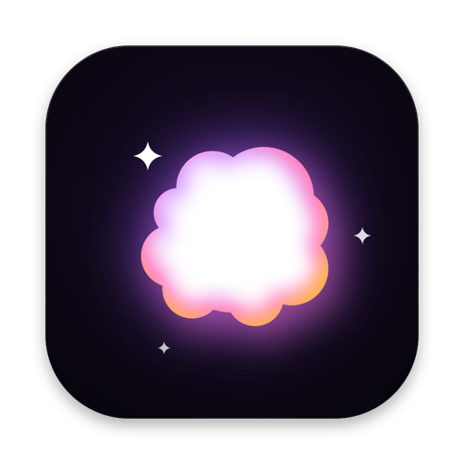
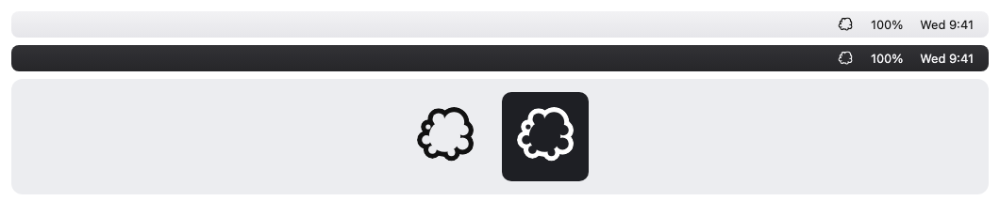
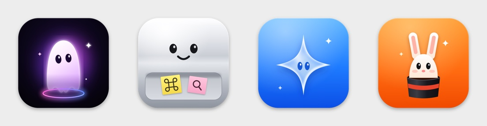
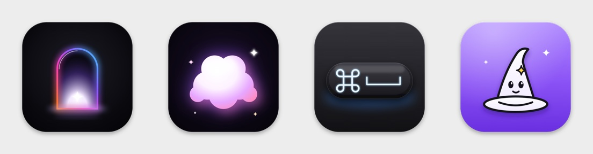
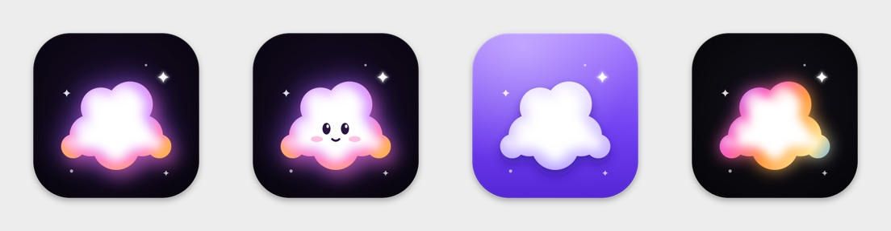
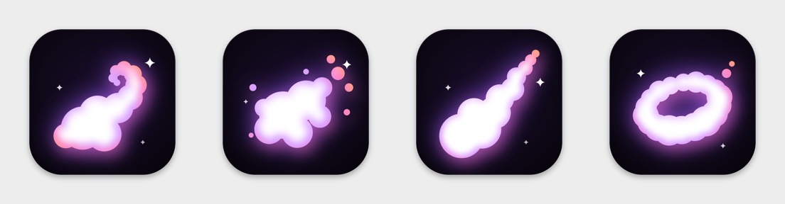
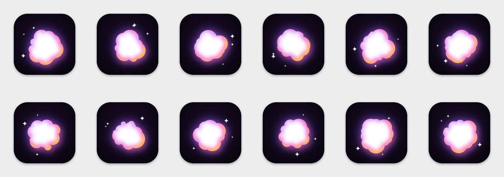
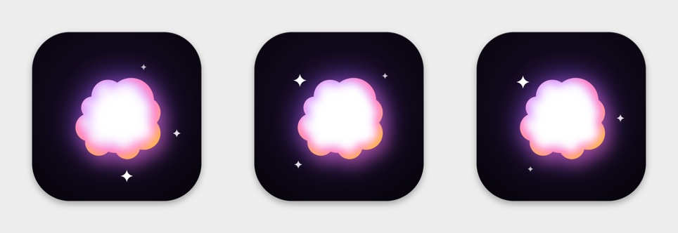

# App icon

The app icon is a glowing ball of poof on black: the puff of smoke when something apparates. The menu bar shows the same puff as an outline. Decided over grill-form rounds 4–11 ([decisions](../decisions.md#round-11-2026-11-19)).

## Files

All in `Resources/`, generated by `Resources/make-icon.sh` (as in Klip). The outputs are committed, so a build needs no SVG renderer.

| File | What |
| --- | --- |
| `AppIcon.svg` | Source artwork: 1024 canvas, 824-point tile at (100, 100), corner radius 185. |
| `AppIcon.icns` | Every size from 16 to 1024 pixels. Bundled by build.sh and review assembly since [UI follow-up section 10](../build/ui-follow-up.md#10-launch-at-login-and-the-app-icon), with `CFBundleIconFile = AppIcon`. |
| `MenuBarIcon.svg` | Source for the menu bar glyph: black on transparent. |
| `MenuBarIconTemplate.png`, `@2x` | 18 and 36 pixels. The `Template` suffix makes AppKit tint it for light and dark menu bars. M5 uses it for the menu bar item. |

## How it was chosen

The icon brief changed as the user reacted to each round. Everything below was a grill-form round.

| Round | Offered | Outcome |
| --- | --- | --- |
| 4 | Pop, Keycap, Portal, Speed lens | Rework: serious and sleek, not in Klip's style ([DEC-035](../decisions.md#round-4-2026-11-18)). |
| 5 | Graphite field, Light rift, Chrome monogram, Glass lens | Start from scratch, after designer Katya Neray's work ([DEC-038](../decisions.md#round-5-2026-11-19)). |
| 6 | Apparition, Chrome buddy, Glass spark, Pop rabbit | Four more ([DEC-040](../decisions.md#round-6-2026-11-19)). |
| 7 | Doorway, Poof, Spacebar, Wizard | Poof, with variations ([DEC-043](../decisions.md#round-7-2026-11-19)). |
| 8 | Poof with glow, face, violet tile, prismatic edges | Too symmetrical; vary the shape, not the colour ([DEC-044](../decisions.md#round-8-2026-11-19)). |
| 9 | Curl, Burst, Trail, Smoke ring | Keep the round ball; vary it like random seeds ([DEC-045](../decisions.md#round-9-2026-11-19)). |
| 10 | Eight seeded balls of poof | Seed 10, with balanced but not symmetrical sparkles ([DEC-046](../decisions.md#round-10-2026-11-19)). |
| 11 | Two sparkle layouts; three menu bar glyphs | Layout B and the outlined puff ([DEC-047](../decisions.md#round-11-2026-11-19), [DEC-048](../decisions.md#round-11-2026-11-19)). |

Round 6 and later, as offered:

## The recipe

The ball is a round core with a ring of lumps whose number, sizes and angles come from a seeded random generator; seed 10 was chosen. The colour is a white core, eroded from the shape and blurred, over an edge gradient running from lilac through violet and pink to amber, with a violet and pink glow behind, on a near-black radial background. The sparkles are four-pointed stars: the largest at the upper left, opposite the ball's amber weight, a medium one at the right and a small one at the lower left.
