# UI design spike

Run by Claude alone on 2026-11-18, as the user asked ([DEC-012](../decisions.md), [DEC-022](../decisions.md#round-2-2026-11-18)). For each of the five interfaces, 3–4 variations were shown in grill-form (round 3) for the user to choose from. The look follows the user's own apps Klip, Yacht and Portia: dark appearance, pure AppKit controls, blue selection, 28 pt rows and key hints. This page records the method and what the spike verified. The user's choices are added when the form is submitted.

## Method

- The previews are self-contained HTML in the grill-form, about 750 KB in total, under Fungi's 1 MiB input limit.
- The four launcher panel variations are interactive. Each uses one shared JavaScript engine that implements the agreed behaviour:
  - prefixes (`'` files and folders, `.` settings, `?` web);
  - match tiers (exact, prefix, word-start/acronym, substring, subsequence, keywords), then the kind order from DEC-002;
  - the DuckDuckGo fallback row when nothing matches, and Restart confirmation;
  - Return, ⌘Return (reveal), ⌘C (copy path), ⌘1–9 and Esc;
  - the selection kept on the same item across updates.
- The sample data is 195 items:
  - 19 apps installed on this Mac;
  - 4 system commands;
  - 153 real System Settings panes and items from the `.searchTerms` files;
  - folders and files from `~/Projects`.
  
  Opening anything is simulated.
- Icons are real: they were exported with `NSWorkspace` at 32 px and embedded as data URLs.
- Before the form was shown, every variation was rendered offscreen in WebKit (`WKWebView` snapshots). The launcher variations were also rendered with typed queries. Two defects were found and fixed this way: the first-run C rows lost their layout once a step was marked done, and no row stayed selected after that.
- The generator and screenshots are temporary research files, not product code.

## Verified: settings item names and icons

Two open items from the [research alignment](../research/alignment.md) (difference 14 and the pane names) were checked on macOS 27.0:

- **Names:** `Bundle(url:).localizedInfoDictionary["CFBundleDisplayName"]` gives a proper name for 50 of 52 System Settings extensions. Examples: `AccessibilitySettingsExtension` → Accessibility, `WiFiSettings` → Wi‑Fi, `ControlCenterSettings` → Menu Bar. The two exceptions are the headphone pane (`HeadphoneSettingsExtension`) and the battery pane (`PowerPreferences`). They need fixed names, which are the same two overrides Tinycast hard-codes.
- **Icons:** `NSWorkspace.icon(forFile:)` on the extension bundle returns the correct System Settings icon for 50 of 52 panes. The same two panes return a placeholder brick. The 12 panes that declare an `ISTypeIdentifier` give identical icons through `NSWorkspace.icon(for: UTType)`. So the type-identifier route adds nothing; use the bundle icon, with overrides for Battery and Headphones.

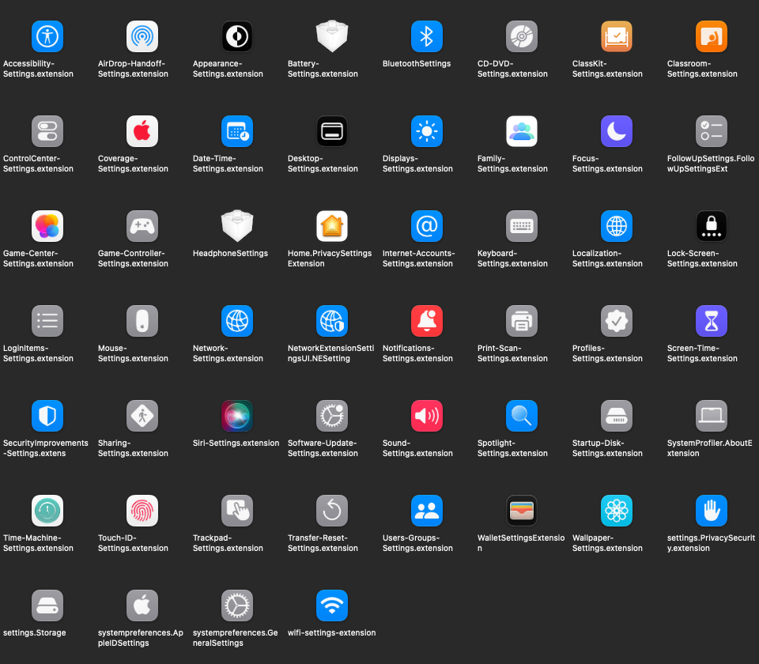

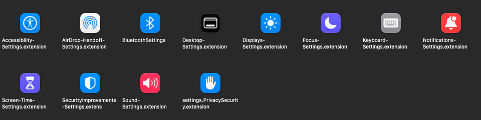

Still unverified: whether each `.searchTerms` group key opens its section as a URL anchor. That needs System Settings opened on screen and remains for the settings deep-link spike.

## Variations offered

| Interface | Variations | Claude's recommendation |
| --- | --- | --- |
| Launcher panel | A compact, fixed size, key hints (Klip); B large Spotlight-style; C grouped by kind with an action footer; D field only until typing | A |
| Result rows | A title + kind; B two lines; C one line with matched letters bold and dimmed location; D title only with a settings badge | C |
| Settings window | A one scrolling page (Yacht); B toolbar tabs; C sidebar; D one compact grid (Klip) | A |
| Menu bar menu | A Open/Settings/Quit; B index status + Rebuild; C per-folder counts; D click opens the panel | B |
| First run | A one setup window; B three steps; C setup items in the panel; D Settings with a Finish setup section | A |

Screenshots of some variations as rendered in WebKit:

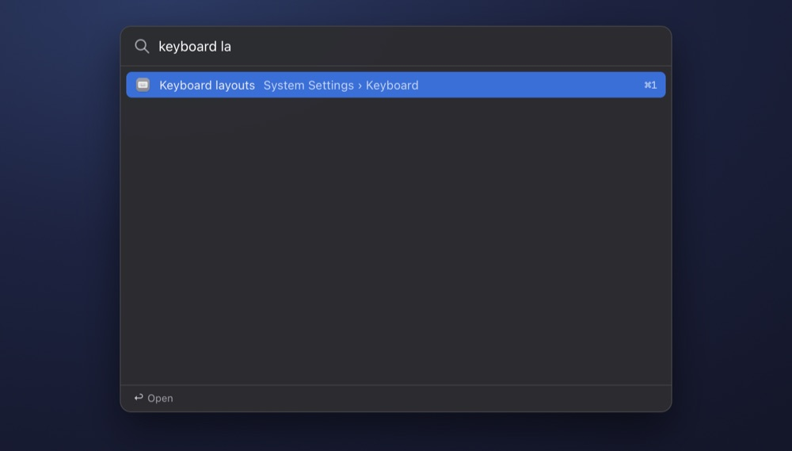

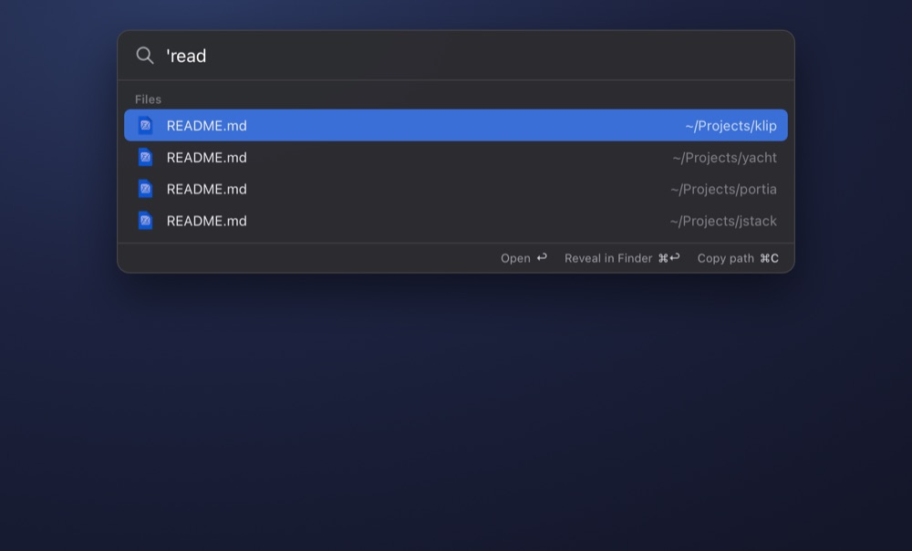

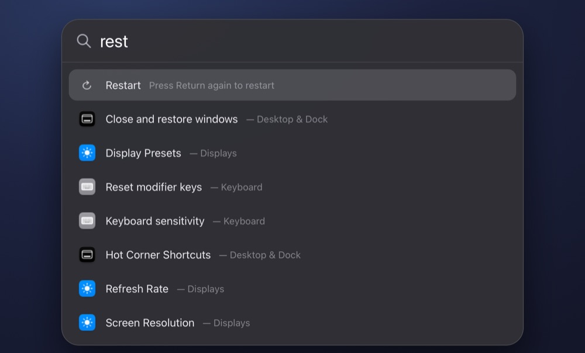

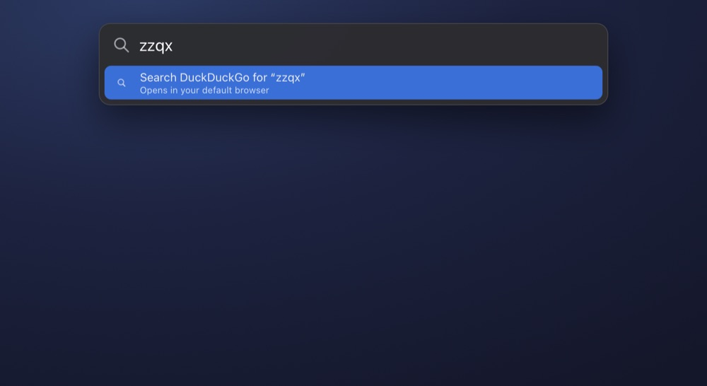

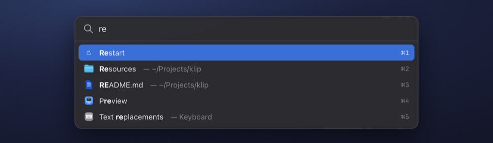

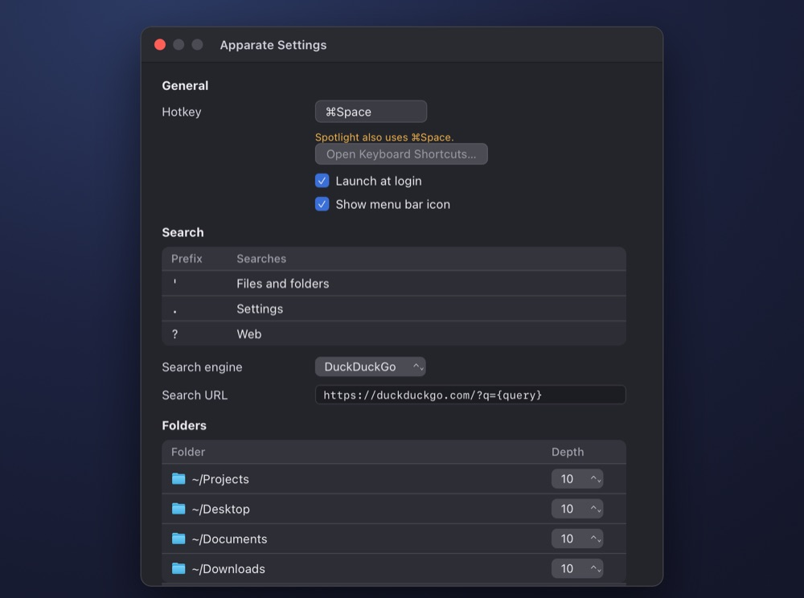

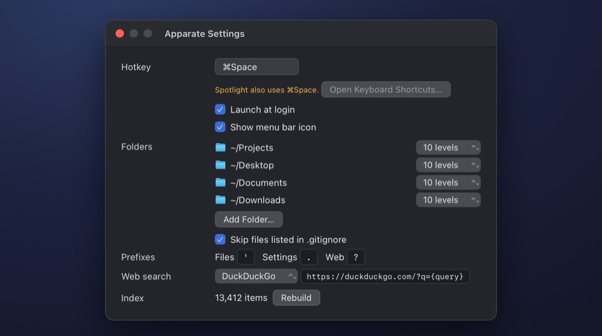

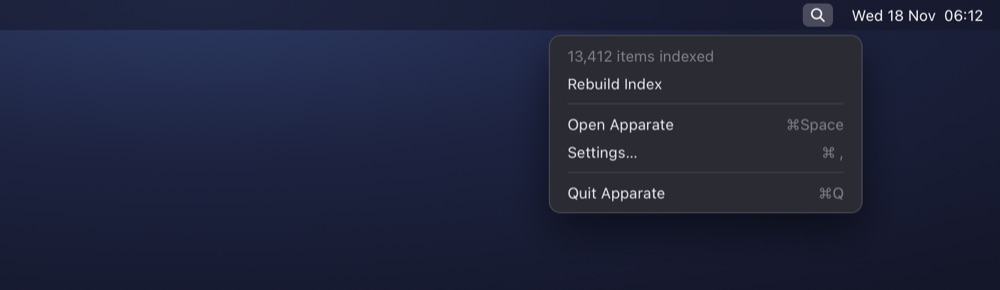

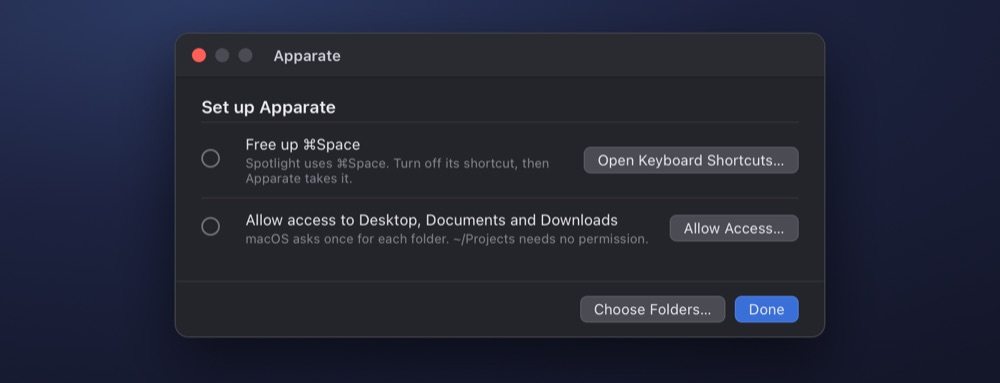

## User choices

Round 3 (submitted 2026-11-18):

- **Launcher panel:** A, compact and fixed size like Klip ([DEC-023](../decisions.md#round-3-ui-design-spike-2026-11-18)).
- **Result rows:** C, one line with matched letters bold and location dimmed ([DEC-024](../decisions.md#round-3-ui-design-spike-2026-11-18)).
- **Settings window, menu bar menu, first run:** not decided. The form laid option previews out in three narrow columns, which squeezed and clipped the windows. Claude's WebKit check had rendered each preview alone at 860 px, so it missed the real column width.

  The user asked for these three again in a single full-width column. The jstack grill-form now stacks option previews full width (a change made outside this session). Round 3b shows the same variations as windows that fit the frame, at heights that show each whole window without scrolling. The duplicate Spotlight warning in first-run D was also removed.

Round 3b (submitted 2026-11-18):

- **Settings window:** B, toolbar tabs General, Search, Folders ([DEC-025](../decisions.md#round-3-ui-design-spike-2026-11-18)). Claude had recommended A.
- **Menu bar menu:** A, Open, Settings, Quit ([DEC-026](../decisions.md#round-3-ui-design-spike-2026-11-18)). Claude had recommended B.
- **First run:** A, one setup window with both steps ([DEC-027](../decisions.md#round-3-ui-design-spike-2026-11-18)).

Lesson for later spikes: check previews at the width the form actually gives them, not only in isolation.
