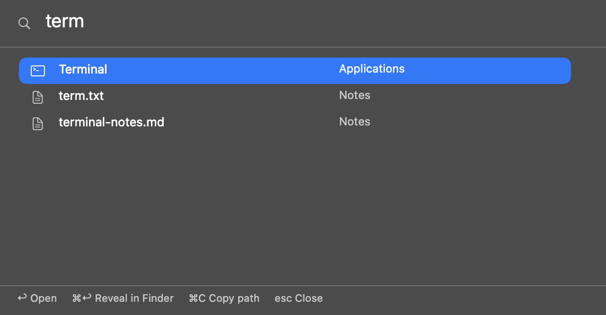
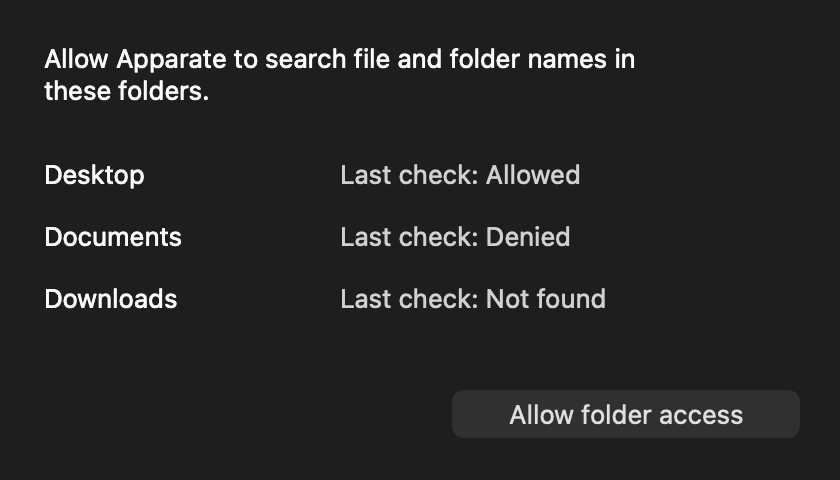

# M2 sources, actions and panel verification

Run `2026-11-18T164000Z-m2`. Codex implemented and verified the automated scope of the [M2 guide](../../build/m2-sources-actions-panel.md), including its accepted pushback. **Passed applies only to the selected automated scenarios below.** Claude's [review](../../build/m2-sources-actions-panel.md#review) requested five fixes, now applied and verified in [Post-review fixes](#post-review-fixes). Recheck is pending. The original results below are preserved as history. No git command was run and no commit was made.

Real opens/commands, Carbon key delivery, protected-folder grants/rebuild persistence and physical IME behavior belong to the separate [supervised run](2026-11-18T164001Z-m2-supervised.md), currently Untested and required before M7 release. They are not hidden omissions from an overall native-integration pass.

## Scope and build identity

Covers [FEAT-apps](../../features/apps.md), [FEAT-settings-items](../../features/settings-items.md), [FEAT-actions](../../features/actions.md), [FEAT-panel](../../features/panel.md), [FEAT-access](../../features/access.md), plus the unchanged [search](../../features/search.md) and [config](../../features/config.md) correctness groups. Selected scenarios cover source changes/races, typed targets, success/failure accounting, pending actions, Restart cancellation, shortcut replacement, access persistence and native view rendering with synthetic data. [Setup](../setup.md) supplies repeatable commands, timing boundaries and cleanup.

- macOS 27.0 (26A5368g), Apple M1 Pro, 16 GiB, arm64; Swift 6.4.2 Command Line Tools, Swift 6 mode, MacOSX27.2 SDK. No downloaded package or full Xcode dependency.
- App version 0.1.0, identifier `local.apparate`, minimum system 27.0, accessory bundle, arm64 only; fixed ad hoc designated requirement `identifier "local.apparate"`.
- [Input manifest](../../evidence/2026-11-18T164000Z-m2/source-manifest.json) SHA-256: `45135e78e8468b452b7eb04b749dfeb162fe4ac91ce38196614d964f14a5c2b5`.
- [Bundle checks](../../evidence/2026-11-18T164000Z-m2/bundle-checks.json) include app/test binary hashes, metadata, architecture, all three folder-purpose strings, strict signature verification, linked system libraries and bundled notice equality. [Build log](../../evidence/2026-11-18T164000Z-m2/build.log) retains the known optional Command Line Tools search-path warnings; there is no missing runtime library.
- Core correctness used temporary synthetic fixtures. Every app run used a pre-seeded temporary APPARATE_HOME and an explicit test profile. Native action/global-key/protected-folder adapters were replaced with fakes before registration. Receipt zero-native fields describe that selected wiring; fake call counts and Core protocol tests verify the exercised route.
- Live profiles read installed app metadata and system settings resources only. Receipts contain counts/timing, never real item names/paths. Owned processes exited and their data directories, caches and fixture bundles were removed. Screenshots, sanitized logs and the signed bundle remain for review.

Final [consistency and visual checks](../../evidence/2026-11-18T164000Z-m2/final-checks.json) confirmed the source manifest, both binary hashes, headless Core boundary, receipt isolation and private-path scan. Report metadata and the wiki build/internal-link check passed (29 pages).

## Observed results

The same **40 groups passed in debug and release** (group count, not assertion count). The filesystem regression also passed five consecutive isolated runs after its fix.

| Scenario | Expected | Observed | Result | Evidence |
| --- | --- | --- | --- | --- |
| Release packaging | Clean signed arm64 bundle, required metadata/purpose strings, system dependencies only | Build and strict verification passed; fixed requirement retained | Passed | [Checks](../../evidence/2026-11-18T164000Z-m2/bundle-checks.json) |
| M1 regression coverage | Ranking, Unicode, config, usage and coordinator behavior retained | All original 20 groups passed in both configurations | Passed | [Debug](../../evidence/2026-11-18T164000Z-m2/tests-debug.log), [release](../../evidence/2026-11-18T164000Z-m2/tests-release.log) |
| App fixtures | Localized names/alternates, one-level nesting, no descent into apps, canonical link dedup and removal | Expected five-item fixture set, typed canonical targets and removed-item exclusion | Passed | [Release tests](../../evidence/2026-11-18T164000Z-m2/tests-release.log) |
| Settings fixtures | Pane/entry items, regional locale matching, English fallback, merged keywords, malformed isolation, overrides and legacy pane | All records and typed targets matched; only one translation per pane | Passed | [Release tests](../../evidence/2026-11-18T164000Z-m2/tests-release.log) |
| Settings cache | Persisted equality; build/language/schema changes and corruption invalidate; failed save leaves parsed catalog usable | Round-trip and all invalidation/fallback branches passed | Passed | [Release tests](../../evidence/2026-11-18T164000Z-m2/tests-release.log) |
| Catalog lifecycle | Watch before scan, discard stale work, coalesce events, watch new targets before verifying, retain snapshot after failed read, recover from watch failure | Controlled scan completions proved each transition; failed registration remained visible | Passed | [Release tests](../../evidence/2026-11-18T164000Z-m2/tests-release.log) |
| Real fixture FSEvents | External linked-app edit, creation, removal, moved root and recreated root all update the catalog | Actual filesystem notifications updated complete snapshots; five repeat runs passed | Passed | [Repeated regression](../../evidence/2026-11-18T164000Z-m2/fsevents-repeated.log) |
| Typed actions and usage | Correct executor call for every target; reveal/copy excluded from history; only accepted primary open counts | All five target types and four commands dispatched to fake; opaque IDs did not affect target choice | Passed | [Release tests](../../evidence/2026-11-18T164000Z-m2/tests-release.log) |
| Action failures | Failed/present and unknown existence retained; confirmed missing removed; history failure does not undo accepted action | Error title/reason/missing ID and zero failed usage checked | Passed | [Release tests](../../evidence/2026-11-18T164000Z-m2/tests-release.log) |
| URL encoding | Exact query values survive special characters and Unicode; settings links keep bundle/anchor form | Exact URL table and invalid template/bundle rejection passed | Passed | [Release tests](../../evidence/2026-11-18T164000Z-m2/tests-release.log) |
| Selection and pending action | Follow item ID/fallback; pending Return/reveal/copy uses only current generation; edit/navigation/hide cancels | Model and out-of-order usage-read tests passed; initial catalog wait never opened premature web fallback | Passed | [Release tests](../../evidence/2026-11-18T164000Z-m2/tests-release.log) |
| Restart and composition | Two fresh Returns; repeats cannot confirm; typing/movement/new results/hide disarm; marked text owns keys | Model tests passed, including a queued first Return that only arms | Passed | [Release tests](../../evidence/2026-11-18T164000Z-m2/tests-release.log) |
| Hotkey replacement | No-op for unchanged key, preserve old on conflict, register new before removing old, clean stop | Fake registrar sequence and error behavior passed | Passed | [Release tests](../../evidence/2026-11-18T164000Z-m2/tests-release.log) |
| Folder access | No launch probe; explicit sequential checks, duplicate-click guard, separate saved hints, distinct errors | Fake mixed statuses persisted/reopened; real reads confined to temporary allowed/missing/non-directory fixtures | Passed | [Release tests](../../evidence/2026-11-18T164000Z-m2/tests-release.log) |
| Isolated app integration | Complete fixture catalog, one fake registration, controlled exit | Nine synthetic items, no errors; no native effects or protected reads | Passed | [Hidden receipt](../../evidence/2026-11-18T164000Z-m2/fixture-hidden/receipt.json) |
| Panel and fake action | Correct result order/footer and selected target; empty, no-results and web states readable | Native AppKit views inspected; `term` selected Terminal and performed one fake open after capture | Passed | [Panel receipt](../../evidence/2026-11-18T164000Z-m2/panel-term/receipt.json), images below |
| Access window rendering | Labels, three status outcomes and action button readable | Own-view bitmap inspected after fixing opaque background drawing | Passed | [Setup receipt](../../evidence/2026-11-18T164000Z-m2/setup/receipt.json), image below |
| Live source/cache measurements | Nonempty live catalog, cache survives process restart, counters/timings only | 96 apps + 734 settings + four commands; relaunch's first load hit the cache | Passed | [Cache/relaunch receipt](../../evidence/2026-11-18T164000Z-m2/cache-relaunch/receipt.json) |
| Quiet idle observation | At least 60 hidden seconds; no catalog work during the measured interval; memory/CPU reported | 63.998 s, zero scans/publications during interval, 21.626 MiB, 0.0821% of one core | Passed | [Idle receipt](../../evidence/2026-11-18T164000Z-m2/idle-60/receipt.json) |
| Callback timing capture | In-app show-return and next-transaction proxy timestamps ordered and present | All four final panel profiles recorded both boundaries; no presentation claim | Passed | Timing table below |
| Native mechanism declarations | Current SDK declarations/export and compiled calls checked without running effects | Lock symbol export, IOKit declarations, restart event and exclusive registration option verified statically | Passed | [Static checks](../../evidence/2026-11-18T164000Z-m2/native-mechanisms.json) |

## Measurements and limits

The final hidden observation started one second after the first complete catalog, excluding startup watch replay. It ran **63.998 seconds** (a 60-second requested timer delivered later), consumed **0.052554 seconds** of process user+system CPU (**0.0821% of one core**), and ended at **21.626 MiB phys_footprint**. There were zero scans or catalog publications during that interval, one publication and two successful scans in the process overall, and no reported errors. No build, test or other app-profile process ran concurrently with this final interval. Other user/system activity was not controlled.

The idle process found **96 apps, 734 settings items and four commands**. Zero app bundles were skipped; two settings records/resources were malformed or unavailable and counted, with valid panes/items retained. First app scan: **101.716 ms**; verifying app scan: **59.613 ms**. First settings cache miss (parse plus write): **77.731 ms**; subsequent disk-cache load: **3.793 ms**. Snapshot preparation after loading: **2.967 ms**. These are scans in one process, not whole application-launch latency.

The separate two-launch cache experiment used the same isolated data directory: fresh miss **74.774 ms**, cache load in that process **3.734 ms**, then first load in a new process **3.856 ms** (hit). This supports retaining the small disposable cache keyed by schema, macOS build and ordered languages. Filesystem caches were not flushed. A [pre-cache development scan](../../evidence/2026-11-18T164000Z-m2/live-preliminary/receipt.json) measured 122.476 ms first parsing and 54.930 ms on its next pass; that receipt predates the final cache/measurement wiring and is decision evidence, not the final build identity.

Each panel timing below is the first show in a fresh process, with synthetic rows and an injected callback. The app-owned bitmap capture happens later. The completion timestamp is for the next implicit nonanimated Core Animation transaction: **a commit proxy, not an exact commit or display timestamp**. No private commit hook, synchronous drawing or flush was used for the timing. The visible fixture query is entered immediately after show, so transaction completion can include that work. The global key event and screen presentation are outside these measurements.

| Fixture state | Callback → show returned ms | Callback → transaction completion ms | Evidence |
| --- | --- | --- | --- |
| Populated `term` | 19.458 | 44.280 | [Receipt](../../evidence/2026-11-18T164000Z-m2/panel-term/receipt.json) |
| Empty query | 19.288 | 37.968 | [Receipt](../../evidence/2026-11-18T164000Z-m2/panel-empty/receipt.json) |
| Explicit settings miss | 29.165 | 55.581 | [Receipt](../../evidence/2026-11-18T164000Z-m2/panel-no-results/receipt.json) |
| Explicit web query | 29.258 | 58.447 | [Receipt](../../evidence/2026-11-18T164000Z-m2/panel-web/receipt.json) |

These cold-process show-return times exceed the provisional 16 ms goal; they do not establish a hotkey-to-screen budget result. There is no warmed repeated-show distribution or p95 claim. M4/M6 must measure the finished real-source interface and its on-screen boundary. The idle footprint is below the provisional 100 MiB goal for this app/settings-only workload; M3's file corpus and rebuild overlap remain unmeasured.

## Visual evidence

These are 2× app-owned view bitmaps, captured during two-second fixture windows. They exclude window-server composition/title bars; vibrancy may differ on screen. Native global keys, real bundle-icon rendering, focus/Spaces and IME remain supervised.

## Repairs and remaining work

Development tests exposed an uncancelled coalescing timer that could schedule a redundant scan. Starting a scan now cancels that timer. Real filesystem checks then exposed `/var` versus `/private/var` path spellings: requested roots now retain both the supplied and POSIX-resolved forms, including a missing suffix. Root-change events rearm the stream, and a captured event boundary covers registration-time changes. Actual external edits and moved/recreated roots pass after these fixes. The access view now paints an opaque system background so its own-view capture preserves readable native controls.

Core tests were not rerun after the final diagnostics-only timer accounting and access-background changes because those edits do not affect Core or its test binary. The signed app was rebuilt; final profile receipts and access rendering were regenerated against it. Matching/ranking did not change, so M1 performance data was not rerun or relabeled as M2 evidence.

The public Core Animation completion hook supplies only the stated proxy; exact commit/presentation measurement remains an explicit limitation for review. All disruptive/private effects and real privacy decisions remain [Untested in the supervised run](2026-11-18T164001Z-m2-supervised.md). Custom app folders remain a pending user decision. M3 file discovery, M4 finished rows and M5 settings/menu/first-run controls are not implemented here. Review and milestone commit are still pending.

## Post-review fixes

2026-11-18 — Applied all five review items, including Claude's 17:17 UTC clarification that the extension's own terms take precedence over legacy resources. **Automated result: Passed; independent recheck and commit are pending.** The earlier M2 evidence remains unchanged. Corrected-build evidence is under `post-review/`.

| Fix | Implemented behavior | Verification |
| --- | --- | --- |
| Usage outside the keystroke path | One usage snapshot per panel showing, reused for typing and config/source changes. An accepted primary open invalidates it for the next showing, or explicitly refreshes an already reopened panel. A stale showing's read cannot overwrite the current one. | Several pending/completed edits assert one read; accepted-open refresh, stale-read rejection, queued Return and once-per-showing read failure tests pass. |
| Date & Time source and target | No separate legacy scan or hard-coded English name. Prefer the extension's own localized/English terms; when absent, try its declared legacy pane. Always keep the extension's ID/name/icon. Cache version 2 invalidates earlier legacy targets. | Fixtures cover legacy-only terms, modern-file precedence when both exist, and a retired legacy name with valid modern terms. Live receipts assert one Date & Time pane, three anchored entries, and zero legacy-ID targets. |
| Missing app roots | Directory-level FSEvents cover existing roots and external bundles, with overlapping roots collapsed. Missing roots get non-recursive parent vnode watches. Only a changed missing chain triggers a rescan; a newly created empty root switches to FSEvents. The home directory is never a recursive root. | Fixture asserts no recursive parent stream, zero scans during 40 sibling-cache writes plus direct sibling creation, and discovery after root creation. Existing external-link and moved/recreated-root tests still pass. |
| Error handling | User open/reveal/copy failures and unregistrable hotkeys activate the app before an alert. Config/catalog/usage/access-persistence failures log only. Latest config error is retained and clears on valid recovery. | [Routing audit](../../evidence/2026-11-18T164000Z-m2/post-review/before-resource-order/routing-audit.json), existing config recovery tests and once-per-showing usage-failure test. Native modal activation remains supervised. |
| Pending display | Keep the prior rows, footer and empty label while a new query is pending. “Searching…” is restricted to initial catalog readiness. | Each of four fixture panel profiles synchronously enters three queries and asserts the actual table/footer/empty label stay unchanged before results can arrive; all pass. |

The final **43 groups passed in both [debug](../../evidence/2026-11-18T164000Z-m2/post-review/tests-debug.log) and [release](../../evidence/2026-11-18T164000Z-m2/post-review/tests-release.log)**. The watcher cases additionally passed three runs each before the final settings-resource adjustment; their code is unchanged ([repeat log](../../evidence/2026-11-18T164000Z-m2/post-review/attempt-1/watch-repeated.log)). `./build.sh`, strict signing, fixed requirement, metadata, arm64 and dependency checks passed ([build](../../evidence/2026-11-18T164000Z-m2/post-review/build.log), [bundle checks](../../evidence/2026-11-18T164000Z-m2/post-review/bundle-checks.json)).

The [final source manifest](../../evidence/2026-11-18T164000Z-m2/post-review/source-manifest.json) SHA-256 is `2e11c632c9b825d6c0a3f60ed701573859efd53260d18773d30452c314ff3a1c`. [Final consistency checks](../../evidence/2026-11-18T164000Z-m2/post-review/final-checks.json) confirm the manifest and app/test binary hashes. All app runs used isolated APPARATE_HOME and fake effects. No real opens, system commands, clipboard changes, global shortcut registrations, protected-folder probes or TCC resets occurred; owned processes and data directories were cleaned up.

### Resource fallback correction

The first implementation of the review wording always used a declared legacy pane. The live check caught a regression to **156 settings items and 26 malformed resources**, despite passing the then-current fixtures. This [failed development attempt](../../evidence/2026-11-18T164000Z-m2/post-review/attempt-1/finding.json) and its fingerprints/receipts are retained. Many extensions retain old pane names after moving their terms into their own resources. The new retired-pane fixture covers that case; Claude confirmed modern-first ordering in the mailbox.

On the current Mac, the modern Date & Time resource and its declared legacy resource both contain the same three English entries ([read-only resource audit](../../evidence/2026-11-18T164000Z-m2/post-review/before-resource-order/date-time-audit.json)). Removing the separate legacy scan therefore removes **four duplicate rows**: the pane and three entries. The corrected live catalog has **96 apps, 730 settings items and four commands (830 total)**. Two unrelated malformed/unavailable settings resources remain counted. This corrects the assumption that the duplicate was only a pane with no entries.

### Corrected-build measurements and visual checks

The [final hidden observation](../../evidence/2026-11-18T164000Z-m2/post-review/idle-60/receipt.json) lasted **64.000 s**, with **zero scans and zero publications during the interval**, **20.626 MiB phys_footprint**, and **0.002458 CPU seconds (0.0038% of one core)**. No build/test/profile work ran concurrently with that final interval. Other machine activity was not controlled. First/verifying app scans were **99.413/56.309 ms**; first settings load including parse/cache write was **74.034 ms**, and the later cache load **3.505 ms**. The [relaunch check](../../evidence/2026-11-18T164000Z-m2/post-review/cache-relaunch/receipt.json) confirmed a persisted cache hit on its second process and the modern-only Date & Time targets.

Populated, empty, explicit-miss and web panels and the access view were inspected: labels, rows and buttons remain readable. Their [panel receipt](../../evidence/2026-11-18T164000Z-m2/post-review/before-resource-order/panel-term/receipt.json), [populated image](../../evidence/2026-11-18T164000Z-m2/post-review/before-resource-order/panel-term/panel.png), [empty image](../../evidence/2026-11-18T164000Z-m2/post-review/before-resource-order/panel-empty/panel.png), [miss image](../../evidence/2026-11-18T164000Z-m2/post-review/before-resource-order/panel-no-results/panel.png), [web image](../../evidence/2026-11-18T164000Z-m2/post-review/before-resource-order/panel-web/panel.png) and [access image](../../evidence/2026-11-18T164000Z-m2/post-review/before-resource-order/setup/setup.png) were retained after the last resource-order-only change: panel/model/app-wiring/access source hashes are unchanged ([comparison](../../evidence/2026-11-18T164000Z-m2/post-review/retained-checks.json)). Final Core tests, signing, [hidden fixture startup](../../evidence/2026-11-18T164000Z-m2/post-review/fixture-hidden/receipt.json), live sources/cache and idle observation were rerun on the final binary. The original cold-show/commit-proxy limits and the separate supervised requirements remain; no new end-to-end latency claim is made.

**2026-11-19 gate update:** Claude moved the pending native checks to the M7 release gate in the [M5 guide](../../build/m5-settings-menu-first-run.md). Their recorded outcomes remain unchanged.
