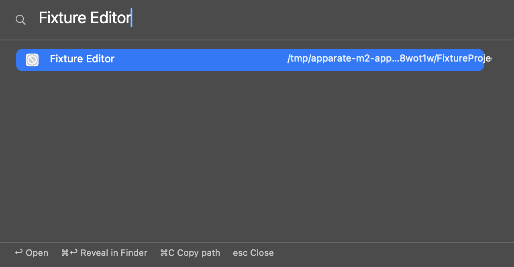
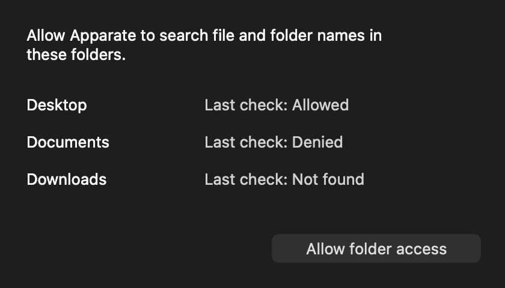
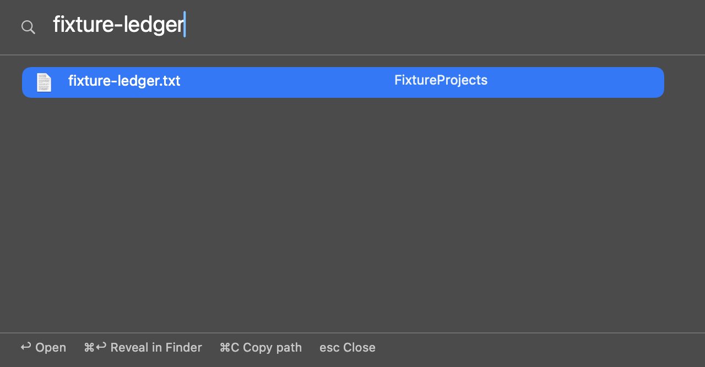

# M3 file index verification

Run `2026-11-18T181500Z-m3`. Codex implemented the [M3 guide](../../build/m3-file-index.md), its accepted answers, and [DEC-041](../../decisions.md#round-6-2026-11-19): apps discovered in indexed folders rank and open as apps. Claude requested a search-speed fix, now implemented and verified in [Post-review search fix](#post-review-search-fix). **The selected correctness, integration and search-speed checks passed.** Original results below remain history, including their performance limits. Current measurements and additional observation limits are in the follow-up; the end-to-end verdict belongs to M6. Claude independently reran all 63 groups and approved M3 on 2026-11-18 at 19:03 UTC.

## Scope and build identity

Covers [FEAT-file-index](../../features/file-index.md), merged [search](../../features/search.md), discovered [apps](../../features/apps.md), and the changed action/access/config/panel integration. [Setup](../setup.md#m3-files-and-persistence) supplies repeatable commands and cleanup. All 43 earlier correctness groups remain, with 18 M3 groups added; counts below are groups, not assertions.

- macOS 27.0 (26A5368g), Apple M1 Pro, 16 GiB, arm64, Swift 6.4.2, Swift 6 mode, MacOSX27.2 SDK. [Environment](../../evidence/2026-11-18T181500Z-m3/environment.json).
- Base commit `b3e68c44e1225c2237b1a59a380adf08811a9cec` (reviewed M2), plus uncommitted M3 inputs. [Build identity](../../evidence/2026-11-18T181500Z-m3/build-identity.json).
- [48-file source manifest](../../evidence/2026-11-18T181500Z-m3/source-manifest.json) SHA-256: `dbdd2960de37286118c64b5ced143e4e963971cb900f0d397a4b5bc2381394bb`.
- Signed app executable SHA-256: `c1237578b35cbeef3c0cd88aff2df8318c97bb9c2edaeaf16cc8856c1325399c`; release test executable: `34cf7bf0ef24b1ac01d1507f20c6894faf5b4a686dce375c766630d64f4cafb4`.
- Version 0.1.0, identifier `local.apparate`, minimum macOS 27.0, accessory app, arm64 only, fixed ad hoc requirement `identifier "local.apparate"`. Strict signature, metadata, folder-purpose strings, system-only dependencies and bundled notice equality passed. [Bundle checks](../../evidence/2026-11-18T181500Z-m3/bundle-checks.json), [build log](../../evidence/2026-11-18T181500Z-m3/build.log).
- Core has no AppKit import or third-party dependency. The known optional Command Line Tools linker search-path warnings remain; compilation/signing succeeds and dependencies resolve to system locations.

The final source manifest matches all measured/tested inputs. No source changed between the final suites, signed bundle, benchmarks and app profiles. [Final consistency checks](../../evidence/2026-11-18T181500Z-m3/final-checks.json) cover fingerprints, evidence privacy, native-effect counters, headless Core and document checks.

## Observed results

**61 groups passed in debug and release.** The real file-event regression additionally passed three consecutive release runs. [Debug log](../../evidence/2026-11-18T181500Z-m3/tests-debug.log), [release log](../../evidence/2026-11-18T181500Z-m3/tests-release.log), [repeat log](../../evidence/2026-11-18T181500Z-m3/events-repeated.log), [release compilation](../../evidence/2026-11-18T181500Z-m3/tests-release-build.log).

| Scenario | Expected | Observed | Result | Evidence |
| --- | --- | --- | --- | --- |
| Prior behavior | Preserve matching, config, usage, catalog, actions and panel/access behavior | All 43 earlier groups pass in both configurations | Passed | Debug/release logs above |
| Crawl boundaries | Depth, hidden flags/names, node_modules, packages and links obey the contract | Terminal packages/links, dangling-link presence, duplicate names and root-relative paths checked | Passed | [Release tests](../../evidence/2026-11-18T181500Z-m3/tests-release.log) |
| Ignore semantics | Agree with isolated Git, including nested rules, escapes, CRLF, classes and both case modes | Oracle equality; switch off; linked rule files never read; excluded parents stay excluded | Passed | Release tests |
| Overlapping roots | Independent ignore scopes; union of eligible entries; outermost path ancestor; removal hides only unsupported entries | Shallow/deep conflicting roots, stable public IDs and root restriction checked | Passed | Release tests |
| Discovered apps | Bundle names/alternates, app ranking/target, deduplication, terminal contents and persistence | Localized fixture, metadata change, typed application dispatch and reload equality pass | Passed | Release tests and [app receipt](../../evidence/2026-11-18T181500Z-m3/panel-app/receipt.json) |
| Incremental updates | New/moved-in trees, replacements and rule changes update affected entries; old snapshots remain stable | Real fixture mutations, manual update boundaries and immutable old-snapshot assertions pass | Passed | Release tests |
| Read errors and access | Failed reads preserve unavailable entries and durable retry work; blocked protected paths never read | Injected failure survives SQLite/relaunch; reader spy confirms allowed-only gate at roots and ancestor traversal | Passed | Release tests |
| Persistence | Preserve v1 usage; atomically activate rows/checkpoints; failed writes keep prior generation; usage can write during staging | Migration in both store-open orders, rollback/activation failure, reopened snapshot equality and usage retention pass | Passed | Release tests |
| Replay/recovery | Watch before crawl; coalesce backlog; route device history; handle zero/sentinel/wrapped/dropped IDs | Injected in-crawl change, 1,000-event burst, changed/missing UUIDs, event flags and two-device routing pass | Passed | Release tests |
| Actual notifications | Creation, rename, deletion, offline replay, moved/returned root and missing-root isolation update correctly | Real temporary filesystem and FSEvents complete each phase; three extra runs pass | Passed | [Repeat log](../../evidence/2026-11-18T181500Z-m3/events-repeated.log) |
| Unnecessary work | Ignore excluded-directory churn; failed stream must not spin; config removal is immediate | No enumeration, save or publication from ignored churn; one failed-watch scan; synchronous removal checked | Passed | Release tests |
| Search integration | Same ordering/highlights/usage as the existing matcher; global fallback; complete local readiness | Compact/reference equality, merged results, queued startup Return and immediate explicit web search pass; first catalog failure recovers | Passed | Release tests |
| Signed fixture app | Correct file/app counts and typed fake opens, without native effects | Hidden four-entry fixture; one fake file URL open; five-entry app fixture with one fake application open; zero reported errors | Passed | [Hidden](../../evidence/2026-11-18T181500Z-m3/fixture-hidden/receipt.json), [file](../../evidence/2026-11-18T181500Z-m3/panel-file/receipt.json), [app](../../evidence/2026-11-18T181500Z-m3/panel-app/receipt.json) |
| Native view rendering | File/app titles and action footer visible; access statuses use fake observations | Own-view images inspected; long app location is clipped by the existing basic row layout, recorded below | Passed | Images below; [access receipt](../../evidence/2026-11-18T181500Z-m3/setup/receipt.json) |
| Relaunch/cache | New process loads the file snapshot and applies later events without a full crawl | SQLite hit; 70.157 ms read/decode, 15.102 ms prepare; one 1.764 ms incremental update | Passed | [Two-process receipt](../../evidence/2026-11-18T181500Z-m3/cache-relaunch/receipt.json) |
| Quiet fixture | At least 60 seconds, healthy watch, zero updates/publications, then discover a mutation | 67.221 s; zero work; change searchable after 257.875 ms | Passed | [Fixture idle](../../evidence/2026-11-18T181500Z-m3/idle-fixture.json) |
| Quiet full app | At least 60 hidden seconds; no source work in the interval; measure CPU/memory | 64.000 s; zero file updates, catalog scans and publications; 22.688 MiB; 0.00349% of one core | Passed | [App idle](../../evidence/2026-11-18T181500Z-m3/idle-app/receipt.json) |
| Measurement capture | Record real/synthetic load, search, small-update and retained-snapshot costs | Both release modes complete with zero failed directories/unavailable entries; values and limits below | Passed | [Projects](../../evidence/2026-11-18T181500Z-m3/projects.json), [200k](../../evidence/2026-11-18T181500Z-m3/synthetic.json) |

The activation-failure tests simulate the commit boundary; they do not power off the machine or kill a process during an SQLite write. Multi-device/log-loss/drop cases are injected; no user volume was mounted or disconnected. Real offline replay is exercised by stopping the controller, changing a temporary fixture, and constructing a new controller/store.

## Release measurements

The synthetic reader supplies exactly 200,000 initial entries with a deterministic corpus; it does not create 200,000 disk files. Both modes use the actual SQLite schema and loader. Projects is read-only. First crawl includes preparation; database read/decode and preparation after load are separate. Filesystem caches were not flushed. Every number here comes from the final release executable, run serially without concurrent build/test/profile work.

| Measurement | Projects | Synthetic 200k |
| --- | ---: | ---: |
| Initial entries, including roots | 11,003 | 200,000 |
| Discovered apps | 1 | 0 |
| Failed directories / unavailable entries | 0 / 0 | 0 / 0 |
| Crawl and prepare ms | 479.810 | 2,006.668 |
| Initial SQLite save ms | 77.882 | 1,878.743 |
| SQLite read/decode ms | 63.906 | 1,145.377 |
| Loaded snapshot preparation ms | 14.881 | 504.343 |
| Process footprint after crawl MiB | 6.782 | 60.485 |
| Process footprint after load MiB | 7.938 | 54.329 |
| Process footprint after search MiB | 8.688 | 62.657 |
| Name search median / p95 / max ms | 2.180 / 5.667 / 6.307 | 13.023 / 14.712 / 30.638 |
| Path search median / p95 / max ms | 3.388 / 6.006 / 6.257 | 13.346 / 17.921 / 19.676 |

Name queries contribute 243 samples and path queries 96. The query lists and deterministic generator are in `Tests/ApparateCoreTests/FileBenchmark.swift`. Each query is parsed before timing. The interval includes Core scoring, top-50 selection and highlights, but excludes coordinator delivery, table work and screen presentation. This is a prefix-query workload, not a distribution of physical user keystrokes. Core measurements do not establish the provisional end-to-end 16 ms target or 33 ms limit.

At 200k, a one-file addition prepares **five chunks in 5.750 ms**, then persists in **46.968 ms**. Search can use the prepared snapshot in this harness; production publication follows the durable save, so this is not a 5.750 ms event-to-visible claim. The old snapshot still contains exactly 200,000 entries and the updated snapshot contains 200,001. Retaining both takes **62.985 MiB**. Vacated slots are reused; the removal/re-add cycle also prepares five chunks.

A full rebuild was started while the old and updated snapshots were retained, and searches ran concurrently: name median/p95/max **12.996/13.802/14.407 ms** (81 samples), path **13.656/19.662/20.207 ms** (32 samples). Some samples may finish after the rebuild completes. The old, updated and rebuilt snapshots together reach **109.860 MiB**, also the highest rebuild sample at 10 ms sampling. Holding the later removal/reuse snapshots raises the endpoint to **110.329 MiB**. Sampled peaks are lower bounds on the true instantaneous peak, and endpoint values include allocator-retained memory.

**Performance follow-up:** steady-state Core memory is below the provisional 100 MiB goal, but full-rebuild overlap already exceeds it by about 10 MiB before the native interface is included. Synthetic path p95 is above 16 ms, including during rebuild, and the name-search maximum leaves little room below 33 ms for delivery/rendering. M6 must address these costs and measure the finished interface; this run does not waive those goals or call them passed.

## Relaunch and idle

The signed two-process run uses one isolated database. Its first process reports 11,016 file entries; its second reports 11,017, loads from disk, and performs one small incremental update. The driver creates its retained-evidence directory between processes, inside the indexed Projects tree; that known directory creation accounts for the one-entry delta. No real user file was edited. The second process records **70.157 ms** SQLite read/decode, **15.102 ms** preparation, **1.764 ms** incremental crawl and **5.321 ms** incremental save. The app receipt's crawl/save metrics are the latest operation, not cumulative startup duration. The standalone Projects benchmark above is the first-crawl measurement.

The final hidden app observation contains 11,024 file entries, including one discovered app, plus the fixed catalog's 96 apps, 730 settings items and four commands. Counts differ between runs as this project's evidence grows. It records zero unavailable roots/entries, healthy watchers, zero errors, no skipped fixed-source apps and two previously known malformed/unavailable settings resources. Over **63.999638 s**, it consumes **0.002232 CPU seconds**, **0.003488% of one core**, at **22.688 MiB phys_footprint**. There are no file updates, catalog scans or catalog publications within that interval. Startup replay is excluded by a one-second settling delay. No project writes or concurrent build/test/profile jobs were performed during this interval; other machine activity was not controlled.

The independent Core fixture observation lasts **67.221158 s** (64 requested seconds delivered later), consumes **0.000965 CPU seconds**, **0.001436% of one core**, and has zero completed updates/publications. Its watcher remains healthy. A file written afterward becomes present in the published controller snapshot after **257.875 ms**, measured from before the write with 10 ms observation resolution. That is change-to-searchable latency, not screen presentation, and does not modify Projects.

## Visual evidence and limits

These are app-owned 2× bitmaps from brief fixture windows, with fake action/access adapters. They exclude window-server composition and may differ from on-screen vibrancy. The discovered-app capture uses a synthetic directory under `/private/tmp`, so no per-user temporary-cache path is retained in its image.

The file title, synthetic parent, app title and action footer are readable. The app's long parent path is clipped at the right edge by M2's basic cell layout; M4's planned row/truncation work remains necessary. The synthetic bundle has no executable/icon, so its native placeholder icon does not verify real bundle-icon rendering.

Single cold-process injected callbacks measured show-return/next-transaction completion at **62.327/118.961 ms** for the file panel and **33.821/59.703 ms** for the app panel. The latter boundary is a commit proxy, not display presentation. These samples exceed 16 ms and are neither warmed distributions nor a hotkey latency test; M4 warm-up and M6's actual screen boundary remain outstanding.

Native opens, system commands, clipboard effects, global shortcut delivery, physical IME/focus/Spaces and real protected-folder grants/rebuild persistence remain [Untested in the separate supervised run](2026-11-18T164001Z-m2-supervised.md), required before M5. M3 does not change that status.

## Implementation notes and repairs

Files use immutable 256-node chunks, parent chains and reusable slots, without per-file full paths or ID strings. A small app catalog retains discovered bundle metadata. Usage resolution runs on the search worker and is cached for the file/usage snapshot pair. A query captures both catalogs and usage, merges one top 50, and chooses web fallback only after the merge. A first catalog failure now completes readiness with available commands so the file source cannot wait forever.

SQLite schema version 2 shares migration with usage. Rebuilds crawl outside the writer transaction, stage bounded row batches, then atomically activate the new generation. Incremental entries and checkpoints commit together. Failed subtrees remain durable retry work. Removing a root restricts the visible snapshot immediately, even while older work is pending. Core exposes per-root statuses, counts, indexing state and last-update time for M5.

The SDK's `FSEventStreamCreateRelativeToDevice` accepts only one path. As communicated before completion, implementation uses a device-relative stream per disjoint watch root, with nested coverage shared and UUID/cursor per stream/root. It never broadens disjoint defaults into a recursive home watch. Missing roots use non-recursive vnode watches. Recovery respects stream coverage; ignored-directory events do not enumerate, write the database or republish search results.

Development verification caught two concrete bugs: Swift Character splitting did not treat CRLF as a lone newline in ignore rules, and real FSEvents supplied a trailing slash that could prevent the ancestor walk reaching its stop condition. Ignore parsing now splits UTF-8 line bytes, and event paths are normalized with a root-bounded ancestor walk. The Git oracle and repeated actual-event checks pass after these fixes. An initial bundle-check command used the notice filename without its `.txt` suffix; correcting the checker verified the existing bundled file, with no product change.

## Isolation, cleanup and handoff

All app launches used the driver, a preseeded temporary APPARATE_HOME, fake actions, fake hotkey registration and fake protected-folder probes. Native-effect counters are declarations of that selected test wiring, supported by assertions on the exercised fake routes; they are not a system-wide audit. No real opens, clipboard changes, global registrations, protected-folder reads or TCC resets were performed. Real data was read only under Projects and in the existing read-only app/settings sources; only aggregate counts and timings were retained. Core mutations and Git-oracle repositories were temporary fixtures.

Owned app/test processes exited, their temporary data directories were removed, and no user app was terminated. Only read-only Git commands ran in the project; no commit or push was made. M1/M2 evidence remains intact. The signed bundle, sanitized logs, synthetic images and current report remain for Claude's independent review. Report metadata, wiki generation/internal links and `git diff --check` are checked in the final consistency record.

## Post-review search fix

2026-11-19 — Applied Claude's [search-speed review](../../build/m3-file-index.md#review). **The fix passed its selected correctness, signed-app integration, matched-performance and owned-fixture idle checks. Independent recheck passed (63/63).** Earlier M3 evidence remains unchanged. New evidence is under `post-review/`; no end-to-end or quiet live-catalog budget pass is claimed.

### Implementation and correctness

Each immutable chunk now prepares flat optional-kind and parent arrays. Nil kinds exclude unused, structural-only and app slots from ordinary file scanning. Root-removal views prepare their eligible kinds once. The scan and ancestor scorer avoid copying reference-bearing `FileNode` values; cold nodes remain for updates, occasional tie comparisons and published rows. Completing a builder clears transient restrictions before preparing its app catalog.

The matched corpus also exposed expensive ties among repeated directory names. Paths sharing a root now skip identical ancestor IDs and compare the first differing name component. Including its following slash preserves cases such as `a.txt/x` versus `a/x`; Swift String ordering preserves canonical Unicode semantics. Different root anchors keep the prior canonical path comparison. Already-sorted standalone file results return directly when no discovered apps match.

**63 groups pass in [debug](../../evidence/2026-11-18T181500Z-m3/post-review/tests-debug.log) and [release](../../evidence/2026-11-18T181500Z-m3/post-review/tests-release.log).** Two new groups cover changed kinds, slot reuse, old snapshots, restricted overlapping roots, and tied paths across punctuation, Unicode and disjoint roots. Existing real FSEvents, persistence, discovered-app, ranking and queued-action checks remain green.

### Matched comparison

The unchanged mixed M1 corpus still hashes to `56fb7726eb4e13632f181e3601cf78807455c25be65422eff4646e5e6b309b75`. Its current name median/p95/max is **2.718/3.392/4.801 ms**, and path **4.534/10.997/17.434 ms** ([M1 rerun](../../evidence/2026-11-18T181500Z-m3/post-review/m1-original.json)). This provides context; it is not the paired ratio below.

The matched comparison reuses all 200,000 M1 names/paths and the complete M1 query lists. The first 240 app/settings names become files without alternates/keywords. Both engines include the same 7,203 structural directories, yielding **207,203 identical entries** in the crawler's child-batch-before-descent order. This normalization is necessary because ordinary file search cannot represent settings and a crawl includes directories. `FileCrawler` prepares one representation; `SearchIndex` prepares the other. All **163 prefixes** verify complete row equality outside timing, including IDs, kinds, scores and highlights. Three rounds alternate engine order, giving 300 name and 189 path samples.

Both final runs have corpus/order hash `dce1ce1b8f6950daf8b3cc7de4b721b075f36c182be669f9c24007cb0984b00a`. The baseline used an isolated temporary checkout whose production sources were byte-verified against the original M3 manifest before building ([identity](../../evidence/2026-11-18T181500Z-m3/post-review/baseline/identity.json), [inputs](../../evidence/2026-11-18T181500Z-m3/post-review/baseline/source-manifest.json)). That checkout was cleaned up. Initial `exploratory-*` evidence used a different flat-reference traversal order and does not supply this comparison; its initial “identical preorder” description was incorrect. Both final runs use the corrected order.

| Matched workload | Median ms | p95 ms | Max ms |
| --- | ---: | ---: | ---: |
| Original M3 file names | 24.251 | 27.680 | 34.439 |
| Revised file names | 1.999 | 3.297 | 3.569 |
| Paired flat-reference names | 3.081 | 3.737 | 5.508 |
| Original M3 file paths | 27.404 | 37.485 | 53.059 |
| Revised file paths | 5.114 | 12.325 | 13.663 |
| Paired flat-reference paths | 5.106 | 11.185 | 11.657 |

[Before samples](../../evidence/2026-11-18T181500Z-m3/post-review/baseline/comparison.json), [after samples](../../evidence/2026-11-18T181500Z-m3/post-review/comparison.json). Revised name p95 is **0.882×** the paired reference, meeting the requested **≤2×** target, and **8.39× faster** than the original file path. Path p95 is **1.102×** its reference. Timing includes Core scoring, top-50 selection and highlights, excluding parsing, equality checks, discovery, delivery and drawing. This comparison retains both representations and is not a memory benchmark.

### M3 corpus and memory

The original M3 workload was repeated unchanged. Measurements ran serially without concurrent build/test/profile jobs; other machine activity was uncontrolled.

| Measurement | M3 synthetic 200k | Projects, read-only |
| --- | ---: | ---: |
| Entries | 200,000 | 11,048 |
| Failed directories / unavailable entries | 0 / 0 | 0 / 0 |
| Name median / p95 / max ms | 1.614 / 2.176 / 2.451 | 0.883 / 1.396 / 2.117 |
| Path median / p95 / max ms | 2.707 / 8.894 / 12.110 | 1.226 / 2.987 / 3.408 |
| Crawl and prepare ms | 2,013.541 | 513.813 |
| SQLite read/decode ms | 1,191.664 | 61.523 |
| Loaded preparation ms | 558.578 | 14.907 |
| Footprint after load MiB | 47.907 | 7.766 |
| Footprint after search MiB | 48.251 | 8.563 |

[Synthetic receipt](../../evidence/2026-11-18T181500Z-m3/post-review/synthetic.json), [Projects receipt](../../evidence/2026-11-18T181500Z-m3/post-review/projects.json). Synthetic name/path p95 changed from **14.712/17.921 ms** to **2.176/8.894 ms**. Its checksum remains `19000`; Projects still discovers one app, and its count changes as evidence grows.

A one-file update prepares five chunks in **5.893 ms** and persists in **58.470 ms**. During rebuild, name median/p95/max is **1.913/4.279/7.965 ms** and path **3.289/8.177/9.644 ms**. Old + updated snapshots occupy **48.469 MiB**. Old + updated + rebuilt reach a sampled **99.251 MiB**, versus **109.860 MiB** before; retaining subsequent removal/reuse snapshots reaches **99.766 MiB**. Sampling is every 10 ms and may miss instantaneous peaks.

The flat buffers add storage; cold nodes remain present. Lower observed footprint does not mean adding arrays alone reduces owned storage: temporary allocations, allocator retention and OS accounting affect readings. **There is almost no headroom under 100 MiB for the complete native app during rebuild.** M6 must address that. Background loading takes about **1.75 seconds** in this sample. Cold show and long-location clipping remain carried forward as requested.

### Signed app, idle and limits

| Selected scenario | Expected | Observed | Result | Evidence |
| --- | --- | --- | --- | --- |
| Correctness | Prior behavior and new scan/tie invariants | 63 groups pass in each configuration | Passed | Logs above |
| Speed target | Name p95 within twice paired reference with equal rows | 0.882×; all 163 prefixes equal | Passed | Matched samples above |
| Packaging | Signed arm64 bundle, required metadata and system dependencies | Strict signature/fixed requirement, metadata and notice checks pass | Passed | [Bundle](../../evidence/2026-11-18T181500Z-m3/post-review/bundle-checks.json), [build](../../evidence/2026-11-18T181500Z-m3/post-review/build.log) |
| Fixture integration | Exact counts and expected fake adapters | Four-entry file fixture; five-entry app fixture; one fake file open and one fake application open | Passed | [Hidden](../../evidence/2026-11-18T181500Z-m3/post-review/fixture-hidden/receipt.json), [file](../../evidence/2026-11-18T181500Z-m3/post-review/panel-file/receipt.json), [app](../../evidence/2026-11-18T181500Z-m3/post-review/panel-app/receipt.json) |
| Cache relaunch | Load SQLite without a full crawl when nothing changed | Second process: 11,060 entries, zero file updates, 65.137 ms read/decode + 15.064 ms prepare | Passed | [Cache receipt](../../evidence/2026-11-18T181500Z-m3/post-review/cache-relaunch/receipt.json) |
| Owned-fixture idle | Healthy real watch, zero updates/publications over 60 seconds, then discover a write | 67.487 s, zero work, 0.001969% of one core; mutation searchable in 258.107 ms | Passed | [Core idle](../../evidence/2026-11-18T181500Z-m3/post-review/idle-fixture.json) |

The file/app images were inspected with the expected synthetic query, title and footer. One visible app attempt failed its expected-adapter assertion. Diagnostic repeats showed changed query text while the panel had focus, followed by the correct web fallback. The valid diagnostic run captured the exact fixture query and invoked one fake application open. A temporary driver wrapper retained artifacts before assertions without changing the app, input setup or effect adapters. Images containing non-fixture text were removed; only sanitized counts/flags remain for interrupted attempts. Visible runs stopped. [Diagnostic record](../../evidence/2026-11-18T181500Z-m3/post-review/app-smoke-diagnostics.json).

An additional [live full-app observation](../../evidence/2026-11-18T181500Z-m3/post-review/idle-app/receipt.json) lasted 63.531 seconds and included **14 catalog scans and 13 publications**, with **zero file updates**. Its 2.118% CPU sample describes active catalog work. **Quiet full-app idle is Untested by that additional attempt** ([interpretation](../../evidence/2026-11-18T181500Z-m3/post-review/idle-app/interpretation.json)); the event cause was not traced. App/catalog watcher code is unchanged in this review fix. The owned-fixture result supplies the selected file-watcher idle check; the earlier quiet full-app run remains dated evidence. M6 must measure the finished app in a quiet interval. Native effects and real protected-folder grants remain in the separate supervised run, Untested and required before M5.

A further [hidden four-entry fixture profile](../../evidence/2026-11-18T181500Z-m3/post-review/idle-app-fixture/receipt.json) completed 63.999 seconds with zero catalog scans/publications and one file update. Fixture profiles begin accounting at first readiness, so this includes startup replay; it is not used as a separate quiet-interval claim ([interpretation](../../evidence/2026-11-18T181500Z-m3/post-review/idle-app-fixture/interpretation.json)).

### Identity and handoff

The [49-input manifest](../../evidence/2026-11-18T181500Z-m3/post-review/source-manifest.json) SHA-256 is `5679a5f5f62b57156891b018a2c278ffcd40cc356d4b622ab714848b127fdf44`. App executable: `72d3e2bb1bbac56fe0e898caf758ffc8f0196fbcd1e7b7156ff90c2ac4fd2ac8`. Release test executable: `52a6079864c1fb5871857c08737a85a0f1d1685da284494ebbe0d94aa94fd98f`. [Build identity](../../evidence/2026-11-18T181500Z-m3/post-review/build-identity.json), [final consistency checks](../../evidence/2026-11-18T181500Z-m3/post-review/final-checks.json).

No production source changed after final measurements. All app profiles retained isolated APPARATE_HOME and fake-effect guards. Real-data evidence contains aggregate values only. Owned processes, temporary data and the baseline checkout were cleaned up. Project Git stayed read-only; no commit or push. Source/binary hashes, evidence privacy, report metadata, wiki generation/internal links and diff whitespace are checked before handoff.

At handoff, Claude added the resource-only icon commit `f0147c7`. Those assets are not yet consumed by the package or build script; measured inputs and binaries are unchanged. The design page and decision updates are retained for the eventual M3 commit, as requested.
