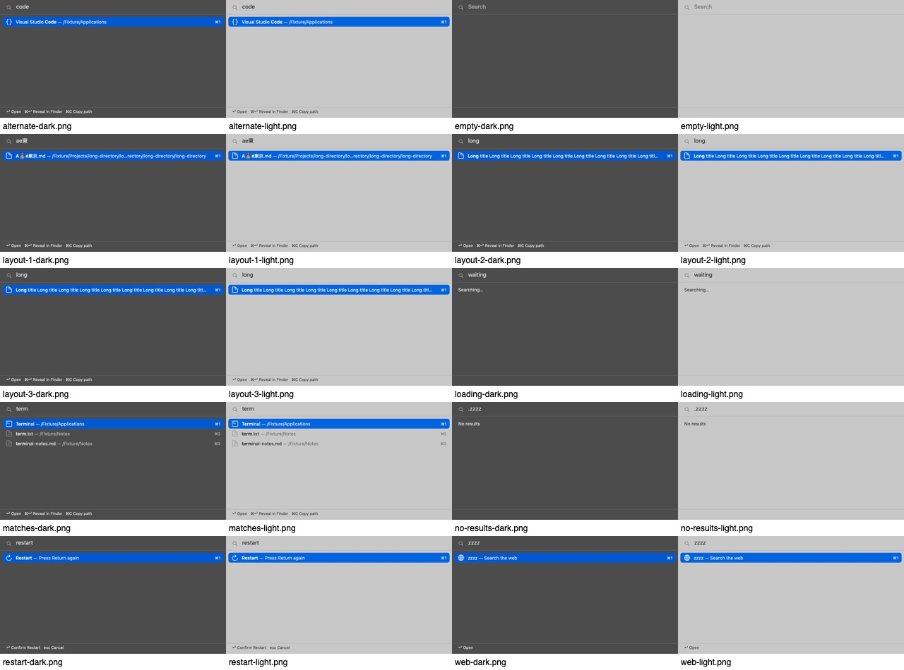

# M4 launcher panel verification

Run `2026-11-18T200340Z-m4`. The [post-review fixes](#post-review-fixes) supersede the original build handoff below. The proxy latency gate remains failed; Claude approved M4 and carried the investigation to M6.

**All selected automated correctness, native fixture, render and measurement-integrity checks passed.** This is the build handoff for [M4](../../build/m4-launcher-panel.md#pushback-and-answers), covering [FEAT-panel](../../features/panel.md), [FEAT-search](../../features/search.md) and [FEAT-actions](../../features/actions.md). It does not qualify actual presentation latency, global input/focus or spoken VoiceOver behavior. Those checks are outside this automated scope and remain Untested. Claude approved M4 after the recheck below; no push is authorized.

## Build and isolation

Base commit `09cd03a1c5f73cef93f84e608cca67dcfa2ce51e`; the tested M4 tree is dirty and identified by the [final input manifest](../../evidence/2026-11-18T200340Z-m4/final/source-manifest.json) and [signed build identity](../../evidence/2026-11-18T200340Z-m4/final/build-identity.json). macOS 27.0 (26A5368g), SDK 27.2, Swift 6.4.2, arm64. Signature, designated requirement, bundle metadata and bundled notice match the existing 0.1.0 LSUIElement bundle. Core remains headless; no third-party package was added. The shared fixture target extracts M3's existing synthetic generator without changing its corpus. Only the known optional Command Line Tools linker search-path warnings remain.

Every app process used `Tests/smoke-app.py`, an owned preseeded temporary config/home, fake registration/actions/access probes and synthetic data. The activation policy is prohibited before any test window is constructed. Launcher and access windows refuse key/main status and ordering in test mode; the checks assert that neither window is visible/key/main and the app is inactive. Native field-editor events are sent only to the owned hidden window. There were no global key events, native opens/system commands, clipboard writes, real folder grants or Desktop/Documents/Downloads reads. No real user file index was profiled.

Timing processes ran serially, without concurrent builds/tests/profiles. Other activity on this shared machine was uncontrolled. [Setup](../setup.md#m4-panel-checks-and-comparison) gives the exact commands, controls, cleanup and reproduction instructions. App-owned rasters require no Screen Recording permission and do not include WindowServer composition.

## Correctness and integration

The full Core suite passes **71 groups in debug and release**: [debug](../../evidence/2026-11-18T200340Z-m4/final/tests-debug.log), [release](../../evidence/2026-11-18T200340Z-m4/final/tests-release.log), [release test build](../../evidence/2026-11-18T200340Z-m4/final/tests-release-build.log), [signed app build](../../evidence/2026-11-18T200340Z-m4/final/build.log). The Core/fixture/test inputs did not change after those runs; later native-only checks use the final signed binary.

| Scenario | Expected | Observed | Result |
| --- | --- | --- | --- |
| Viewport and actions | Reach all 50 results; whole-row clamp, no wrap, fresh top on showing | Model checks and native field-editor arrows; scroll to row 50, ⌘9, click after scroll and offscreen accessibility selection | Passed |
| Pending action identity | Click/⌘N follow the displayed ID and revision; removed/replaced work cannot open another ordinal | Reordered/removed results and cancellation by edit, movement, scroll, composition and hide; existing selected-row Return/reveal/copy generation tests retained | Passed |
| Restart and Esc | Click/number only arm; fresh Return confirms; IME → disarm → clear → close | Repeat suppression, native number shortcuts, row/footer labels, retained query on disarm, immediate empty state and close | Passed |
| Input method and quit | Marked text owns Return/arrows/Esc; ⌘Q still works | Actual owned NSTextView marked text; command-delegate guards and fake quit callback | Passed |
| Highlights and layout | Title's own match, whole grapheme ranges, location-first truncation, reserved hint area | Alias-winning “Code”, accent/CJK/emoji mapping, long location/title/both, exact icon/row geometry and native table cell parity in the comparison | Passed |
| Accessibility model | 50 stable-ID elements, nine visible, full labels/position/selection and press | Stable elements across selection, row 50 selected, offscreen selection reveals row, press activates current ID; notifications counted through a sink only | Passed |
| Pending presentation and states | Preserve prior rows/footer during pending edits; empty always clears | Native assertions, including explicit web completion before local readiness; empty/loading/scoped-empty/web/Restart light and dark captures | Passed |
| Native fixture harness | No presentation/focus/native effects | [Receipt](../../evidence/2026-11-18T200340Z-m4/final/functional/receipt.json): all guards true, four recorded model actions, one fake quit, 50/9 AX rows, zero actual AX notifications | Passed |
| Production integration graph | Discovered fixture app routes through fake application-open adapter | [Receipt](../../evidence/2026-11-18T200340Z-m4/final/integration/receipt.json): five fixture entries, one discovered app, one fake open, no errors/native effects | Passed |
| Access view isolation | Existing fake observations render without activation or ordering | [Receipt](../../evidence/2026-11-18T200340Z-m4/final/setup/receipt.json): fake allowed/denied/not-found checks, hidden guards pass | Passed |
| Measurement integrity | Same corpus/results; stale requests canceled and all events accounted for | All comparison/control processes have zero timeouts and result mismatches; expected hashes match for each count | Passed |

## Render inspection

Codex inspected the app-owned light/dark renders, including all states in the overview and full-size text/truncation examples. Text is upright; selected text/icons use emphasized system colors in both appearances; title/location/hints do not overlap; loading has one status label and no duplicate footer. The gray material here is an off-screen representation, not a claim about live composited vibrancy. Rounded outer window chrome, real file icons and mixed-display scale remain supervised.

All twenty original light/dark images were inspected before review. The overview is retained as JPEG; individual PNGs are retired with hashes in the [retention record](../../evidence/2026-11-18T200340Z-m4/retention.json). Current representative renders appear in the post-review section.

## Renderer decision

**Ship the custom Core Text list.** Both candidates used the same content, layout, CTLine cache, icons, interaction model and accessibility objects. The native candidate used a plain NSTableView with manually laid-out cells, zero automatic insets and no Auto Layout. Both passed the same [drawn](../../evidence/2026-11-18T200340Z-m4/comparison/functional-drawn/receipt.json) / [table](../../evidence/2026-11-18T200340Z-m4/comparison/functional-table/receipt.json) functional contract, including actual native cell-frame checks after scrolling.

The order was drawn/table, table/drawn, drawn/table at each corpus size, in fresh processes. The paired comparison below includes only identical completed raster-phase events, matched by sequence/query/full result hash. All superseded/unpaired events remain in the original receipts and are explicitly counted; none is represented as a completed latency sample. Each row shows a separate process pair, not a pooled p95.

| Files | Pair | Matched rasters | Median table − drawn raster | Drawn faster in pair | Median table − drawn update |
| --- | ---: | ---: | ---: | ---: | ---: |
| 20,000 | 1 | 88 | 2.044 ms | 87.5% | 0.112 ms |
| 20,000 | 2 | 88 | 2.074 ms | 92.0% | 0.120 ms |
| 20,000 | 3 | 83 | 2.843 ms | 95.2% | 0.167 ms |
| 200,000 | 1 | 88 | 1.941 ms | 88.6% | 0.117 ms |
| 200,000 | 2 | 87 | 2.151 ms | 97.7% | 0.136 ms |
| 200,000 | 3 | 88 | 2.162 ms | 81.8% | 0.106 ms |

Across the six processes per renderer, median result raster costs are 10.420–10.667 ms drawn versus 12.590–13.216 ms table; median view-state update costs are 0.483–0.499 versus 0.620–0.663 ms. The roughly 2 ms raster saving repeats in every process pair and is material against the panel's latency budget. Ordinary no-capture end-to-end proxy timings are noisy and do not show a consistent renderer advantage; this decision rests on the matched stage costs. It does not establish a 2 ms on-screen speedup. The shared contract means the custom version also removes the table/cell/scroll plumbing rather than duplicating behavior.

[Paired calculation summary](../../evidence/2026-11-18T200340Z-m4/comparison/paired-comparison.json), [per-process summary](../../evidence/2026-11-18T200340Z-m4/comparison/summary.json), [comparison build identity](../../evidence/2026-11-18T200340Z-m4/comparison/build-identity.json), [input manifest](../../evidence/2026-11-18T200340Z-m4/comparison/source-manifest.json), [historical source overrides](../../evidence/2026-11-18T200340Z-m4/comparison/sources.json), [serial runner](../../evidence/2026-11-18T200340Z-m4/comparison/runner.py.txt).

| Files | Pair 1 | Pair 2 | Pair 3 |
| --- | --- | --- | --- |
| 20k drawn | [events](../../evidence/2026-11-18T200340Z-m4/comparison/20000-1-drawn/receipt.json) | [events](../../evidence/2026-11-18T200340Z-m4/comparison/20000-2-drawn/receipt.json) | [events](../../evidence/2026-11-18T200340Z-m4/comparison/20000-3-drawn/receipt.json) |
| 20k table | [events](../../evidence/2026-11-18T200340Z-m4/comparison/20000-1-table/receipt.json) | [events](../../evidence/2026-11-18T200340Z-m4/comparison/20000-2-table/receipt.json) | [events](../../evidence/2026-11-18T200340Z-m4/comparison/20000-3-table/receipt.json) |
| 200k drawn | [events](../../evidence/2026-11-18T200340Z-m4/comparison/200000-1-drawn/receipt.json) | [events](../../evidence/2026-11-18T200340Z-m4/comparison/200000-2-drawn/receipt.json) | [events](../../evidence/2026-11-18T200340Z-m4/comparison/200000-3-drawn/receipt.json) |
| 200k table | [events](../../evidence/2026-11-18T200340Z-m4/comparison/200000-1-table/receipt.json) | [events](../../evidence/2026-11-18T200340Z-m4/comparison/200000-2-table/receipt.json) | [events](../../evidence/2026-11-18T200340Z-m4/comparison/200000-3-table/receipt.json) |

The final tree removes the losing renderer and its selection flag. It also removes the duplicate loading footer, guards stale AX selection, follows icon-cache invalidation, strengthens access-window/driver hidden assertions, and clarifies that fixture icons are cached symbols. The final controls below rerun the selected renderer after those changes; the exact comparison source remains reproducible independently.

## Final hidden timings and controls

The selected-renderer control build uses the actual M3 compact file index (20,000/200,000 entries), plus nine catalog entries. It uses the same corpus/query/expected-result hashes as the comparison. Each process includes 30 hidden shows, 88 fixed-cadence inputs without forced drawing, 88 matched inputs with explicit letter/result rasters, and 12 inputs at 1 ms cadence. These are native field-editor replacements, not physical keyboard delivery. The view-state endpoint includes accepted complete results and view invalidation, but deferred glyph drawing/presentation is not included. The raster endpoint includes two synchronous bitmap captures and their interference with worker delivery. Neither is an on-screen commit timestamp.

The control build is pinned separately by its [identity](../../evidence/2026-11-18T200340Z-m4/final/controls-build-identity.json), [inputs](../../evidence/2026-11-18T200340Z-m4/final/controls-source-manifest.json) and [historical source overrides](../../evidence/2026-11-18T200340Z-m4/final/controls-sources.json). A final review found that completed explicit web results before catalog readiness still suppressed the action footer. The final build narrows “Searching…” to an actually pending query and adds a native regression check. Both controls already have their catalog/index ready before timing; their measured branch is unchanged in outcome. Fresh final-build confirmations at both counts are recorded below.

All numbers below are milliseconds, **median / p95 / maximum within that process**, with every completed event included in the statistics. Separate-process variation is shown rather than pooled away. “Normal” means warm-up on, vibrancy on, no wait.

| Files / repeat / control | Input → view-state complete | Input → explicit result raster | Completed ordinary / raster | Superseded total |
| --- | --- | --- | ---: | ---: |
| [20000-1-normal](../../evidence/2026-11-18T200340Z-m4/final/controls/20000-1-normal/receipt.json) | 8.713 / 12.955 / 39.847 | 28.551 / 31.900 / 38.607 | 88 / 88 | 11 |
| [20000-1-no-warmup](../../evidence/2026-11-18T200340Z-m4/final/controls/20000-1-no-warmup/receipt.json) | 8.715 / 11.730 / 47.830 | 26.662 / 31.631 / 34.734 | 88 / 88 | 11 |
| [20000-1-opaque](../../evidence/2026-11-18T200340Z-m4/final/controls/20000-1-opaque/receipt.json) | 8.177 / 12.306 / 41.255 | 14.750 / 19.163 / 23.915 | 88 / 88 | 11 |
| [20000-1-wait](../../evidence/2026-11-18T200340Z-m4/final/controls/20000-1-wait/receipt.json) | 9.463 / 13.145 / 37.991 | 30.144 / 37.268 / 69.890 | 88 / 87 | 12 |
| [20000-2-wait](../../evidence/2026-11-18T200340Z-m4/final/controls/20000-2-wait/receipt.json) | 10.045 / 14.482 / 44.590 | 28.574 / 35.072 / 39.222 | 88 / 88 | 11 |
| [20000-2-opaque](../../evidence/2026-11-18T200340Z-m4/final/controls/20000-2-opaque/receipt.json) | 8.742 / 11.944 / 43.560 | 14.855 / 24.183 / 28.638 | 88 / 88 | 11 |
| [20000-2-no-warmup](../../evidence/2026-11-18T200340Z-m4/final/controls/20000-2-no-warmup/receipt.json) | 17.001 / 100.119 / 123.964 | 33.187 / 41.385 / 45.254 | 72 / 88 | 27 |
| [20000-2-normal](../../evidence/2026-11-18T200340Z-m4/final/controls/20000-2-normal/receipt.json) | 17.537 / 28.830 / 54.568 | 27.282 / 34.690 / 47.479 | 88 / 88 | 11 |
| [20000-3-normal](../../evidence/2026-11-18T200340Z-m4/final/controls/20000-3-normal/receipt.json) | 12.696 / 17.300 / 39.926 | 27.081 / 32.813 / 40.454 | 88 / 88 | 11 |
| [20000-3-no-warmup](../../evidence/2026-11-18T200340Z-m4/final/controls/20000-3-no-warmup/receipt.json) | 9.698 / 17.608 / 40.094 | 28.403 / 40.149 / 55.302 | 86 / 88 | 13 |
| [20000-3-opaque](../../evidence/2026-11-18T200340Z-m4/final/controls/20000-3-opaque/receipt.json) | 10.189 / 32.704 / 74.821 | 12.611 / 16.278 / 26.769 | 87 / 88 | 12 |
| [200000-1-normal](../../evidence/2026-11-18T200340Z-m4/final/controls/200000-1-normal/receipt.json) | 11.030 / 19.030 / 38.414 | 27.541 / 31.716 / 52.377 | 88 / 88 | 11 |
| [200000-1-no-warmup](../../evidence/2026-11-18T200340Z-m4/final/controls/200000-1-no-warmup/receipt.json) | 8.439 / 16.045 / 38.604 | 29.584 / 34.541 / 39.699 | 88 / 88 | 11 |
| [200000-1-opaque](../../evidence/2026-11-18T200340Z-m4/final/controls/200000-1-opaque/receipt.json) | 9.055 / 15.362 / 43.179 | 15.714 / 21.357 / 25.958 | 88 / 88 | 11 |
| [200000-1-wait](../../evidence/2026-11-18T200340Z-m4/final/controls/200000-1-wait/receipt.json) | 11.590 / 48.661 / 116.228 | 32.457 / 101.379 / 120.385 | 83 / 67 | 37 |

The ordinary 20k normal processes have p95 12.955–28.830 ms and maxima 39.847–54.568 ms; the 200k normal process has p95 19.030 ms and maximum 38.414 ms. These observations do **not** establish the 8 ms target or 16 ms limit. In particular, cold input and main-thread delivery remain investigation items for M6. The no-warm-up repeat 2 and 200k wait controls contain large outliers and superseded fixed-cadence inputs; they remain in the table and receipts. The experiment does not identify the cause of that shared-machine scheduling variation, and no outlier is discarded as “background noise”.

### First hidden show and footprints

A “show” here resets the model, lays out and captures the empty view without ordering a window. Warm-up is an extra prior hidden raster, whose own cost is recorded separately. These process-local first cycles are not cold system launches or first real frames.

| Files / control | First hidden show | Later 29 median / p95 / maximum | After 30 shows / typing (MiB) |
| --- | ---: | --- | --- |
| 20000-1-normal | 9.018 | 8.051 / 14.523 / 16.910 | 21.907 / 30.532 |
| 20000-1-no-warmup | 12.362 | 7.271 / 7.731 / 7.913 | 21.891 / 30.376 |
| 20000-1-opaque | 0.831 | 0.481 / 0.657 / 0.801 | 18.454 / 27.173 |
| 20000-1-wait | 8.103 | 7.876 / 11.422 / 21.829 | 21.720 / 30.579 |
| 20000-2-wait | 8.184 | 7.697 / 8.025 / 8.061 | 21.766 / 30.751 |
| 20000-2-opaque | 0.862 | 0.528 / 0.764 / 0.810 | 18.470 / 27.392 |
| 20000-2-no-warmup | 12.853 | 7.600 / 8.269 / 8.922 | 21.876 / 31.720 |
| 20000-2-normal | 7.653 | 7.881 / 8.430 / 8.714 | 21.751 / 30.485 |
| 20000-3-normal | 7.955 | 7.708 / 8.147 / 8.442 | 21.782 / 30.548 |
| 20000-3-no-warmup | 12.762 | 7.366 / 7.801 / 9.059 | 21.938 / 30.501 |
| 20000-3-opaque | 0.992 | 0.782 / 1.289 / 1.428 | 18.595 / 27.142 |
| 200000-1-normal | 7.727 | 7.506 / 8.045 / 8.228 | 74.110 / 82.688 |
| 200000-1-no-warmup | 12.826 | 7.439 / 8.175 / 9.096 | 73.970 / 82.501 |
| 200000-1-opaque | 0.914 | 0.510 / 0.753 / 0.812 | 70.454 / 79.017 |
| 200000-1-wait | 7.991 | 7.792 / 8.078 / 8.440 | 74.032 / 82.907 |

**Keep one hidden warm-up.** Across the three 20k normal processes, first hidden show is 7.653–9.018 ms; fresh-process no-warm-up controls are 12.362–12.853 ms. At 200k the pair is 7.727 versus 12.826 ms. Warm-up itself costs 12.289–14.035 ms in these normal processes and shifts work to launch; it is not free. Its benefit to first actual presentation remains Untested.

**Keep production vibrancy pending supervised evidence.** The true opaque control has no NSVisualEffectView. Median result raster cost at 20k is 3.375–3.434 ms opaque versus 10.393–10.678 ms normal; at 200k it is 3.358 versus 10.626 ms. This repeatable hidden capture cost justifies a supervised composited comparison, but does not establish the WindowServer cost or visual quality of vibrancy. Production still honors Reduce Transparency with a plain background.

**Do not adopt the short wait.** The bounded four-millisecond worker-readiness wait raises the 20k fixed-phase input-handler median from 2.310–3.648 ms across normal processes to 3.414–3.426 ms in the two wait controls; because runs vary, this range alone is not a causal estimate. Each event records the actual wait duration. The letter-raster median rises from 10.913–11.302 to 12.185–12.241 ms; at 200k it rises from 11.499 to 13.807 ms. A completed worker still requires asynchronous main-thread delivery, so this experiment neither coalesces the full results into the typed-letter capture nor proves removal of visible flicker. No production main-thread wait or forced transaction flush was added.

The normal selected-renderer control endpoint footprint after typing is 30.485–30.548 MiB at 20k and 82.689 MiB at 200k. These are endpoint observations, not peaks, and the experiment excludes SQLite, the real app/settings catalogs, native filesystem icons and background watchers. They do not replace M3's full-index/rebuild measurements or qualify the whole app's memory budget.

[Final control summary](../../evidence/2026-11-18T200340Z-m4/final/controls/summary.json), [serial control runner](../../evidence/2026-11-18T200340Z-m4/final/controls-runner.py.txt), [cross-build measurement-integrity check](../../evidence/2026-11-18T200340Z-m4/measurement-integrity.json). The 27 comparison/control processes have 188 accounted events each (5,076 total); the two final confirmations below bring the original measured total to 29 processes / 5,452 events, zero timeouts, zero result mismatches, and matching corpus/oracle hashes at each size. Superseded requests are reported separately, including those in the nominal 40 ms phase; the final 1 ms overlap phase also confirms current-generation delivery.

### Final readiness-correction confirmation

The final build also passes the native `explicit_web_before_catalog` regression. These two fresh processes confirm the selected renderer after that correction; each accounted for all 188 events before evidence compaction and has zero timeouts/mismatches. The earlier control matrix stays pinned to its own build rather than being relabeled as this one.

| Files | Input → view complete (median / p95 / max) | Input → result raster (median / p95 / max) | First / later median hidden show | Typing footprint |
| --- | --- | --- | --- | --- |
| [20000](../../evidence/2026-11-18T200340Z-m4/final/readiness-confirmation-20000/receipt.json) | 8.196 / 12.397 / 33.902 ms | 28.217 / 32.416 / 49.417 ms | 8.209 / 7.780 ms | 30.626 MiB |
| [200000](../../evidence/2026-11-18T200340Z-m4/final/readiness-confirmation-200000/receipt.json) | 8.959 / 12.684 / 46.946 ms | 27.372 / 30.477 / 34.652 ms | 7.718 / 7.630 ms | 81.923 MiB |

## Development failures preserved

The first functional render exposed flipped Core Text glyphs and incorrect light-mode selected-text color. The first table attempt threw an AppKit row-range exception when a synchronous icon callback tried to invalidate row 0 before the table had reloaded. Its owned process was terminated, and it produced no completed receipt; no window was presented. The next table render exposed default system insets, so the comparison was deferred until the actual cell frames matched the contract. Earlier raster-only sanity measurements are excluded from the renderer decision because they preceded that geometry fix and mixed ordinary delivery with explicit capture overhead.

[Failure/correction record](../../evidence/2026-11-18T200340Z-m4/development/findings.json), [retired image hashes](../../evidence/2026-11-18T200340Z-m4/retention.json), excluded sanity receipts [drawn](../../evidence/2026-11-18T200340Z-m4/development/raster-only-drawn/receipt.json) / [table](../../evidence/2026-11-18T200340Z-m4/development/raster-only-table/receipt.json). The old alternate-highlight golden expectation was updated for the accepted M4 contract. An initial release-test invocation guessed an obsolete Swift build directory and did not run; the final invocation used `swift build -c release --show-bin-path` and passed 71/71.

## Limits, cleanup and review

The real global hotkey, keyboard focus/return, first on-screen frame, Spaces/full-screen/multiple monitors, input-method candidate UI, spoken VoiceOver and live composited appearance are **Untested**. The [panel recipes](../../features/panel.md#supervised-recipes-untested) make these concrete for the user's explicit supervised slot. The [M2 native checks](2026-11-18T164001Z-m2-supervised.md) remain pending and required before M5. Neither the native marked-text guard nor the owned accessibility tree substitutes for those checks. The rendering/control results inform M6; they do not qualify DEC-008 end-to-end budgets.

Owned app processes exited and their temporary config/index homes were removed. Synthetic Core fixtures also clean up their own directories. Compact receipts, historical source overrides and the losing renderer are retained; see the post-review retention policy. [Final consistency checks](../../evidence/2026-11-18T200340Z-m4/final-checks.json) record input/binary matching, safe receipts, privacy, cleanup and document validation. This paragraph describes the original handoff. The post-review build and its separate identity are below; commit remains deferred until Claude’s recheck.

## Post-review fixes
Claude requested stage-level latency investigation and a smaller public evidence archive. The activity lifecycle, text-input harness correction and search merge are implemented. **The hidden-proxy targets are still missed; this is not a latency pass.** No commit or push has been made.
### Implementation and regression checks
- A per-showing `ProcessInfo` user-initiated/latency-critical activity starts once, survives duplicate show calls, and ends on hide, empty-query Esc, session close or controller teardown. Hidden warm-up does not acquire it. Native checks cover enabled/disabled activity and balanced repeated show/hide.
- `NSSearchField` retains the existing appearance and explicitly disables completion, spelling/grammar/correction, prose substitutions and writing tools. The measured editor confirms those flags. The driver previously called `makeFirstResponder` for every injected query, repeatedly setting up AppKit editing; it now reuses the editor and changes only the suffix. One-time editor setup is measured separately before keys, as production show establishes its first responder before typing. This corrects the proxy and must not be reported as an equivalent production speedup.
- Profiling also found the coordinator re-sorting already ordered results, repeatedly normalizing names. It now merges the ordered catalog/file/discovered-app sources, deduplicating IDs and retaining the highest-ranked occurrence. Exhaustive sort comparisons cover Unicode ties, duplicate IDs, usage scores, empty sources and limits. The existing independent full-sort UI oracle still matches every completed result.
- Task and Dispatch delivery both retain the synchronous generation guard. Slow-worker/burst and invalidation-after-enqueue tests run against both. Neither hop has a consistent timing advantage here; production retains Task. Activity remains enabled as requested. A diagnostic userInteractive worker-QoS trial showed no benefit and was reverted.
All **74 Core groups pass in debug and release** ([debug](../../evidence/2026-11-18T200340Z-m4/post-review/tests-debug.log), [release](../../evidence/2026-11-18T200340Z-m4/post-review/tests-release.log)). Subsequent changes only added native diagnostic CPU sampling; Core/fixture/test inputs stayed identical. Final hidden native checks pass with activity [on](../../evidence/2026-11-18T200340Z-m4/post-review/functional/receipt.json) and [off](../../evidence/2026-11-18T200340Z-m4/post-review/functional-no-activity/receipt.json), plus discovered-app [fake open](../../evidence/2026-11-18T200340Z-m4/post-review/integration/receipt.json) and [setup render](../../evidence/2026-11-18T200340Z-m4/post-review/setup/receipt.json). Signing passes. No visible showing, activation, global event, real action or protected-folder read was used.
### Stage measurements and limits
The [ten-run stage matrix](../../evidence/2026-11-18T200340Z-m4/post-review/stage-matrix/build-identity.json) and [four-run CPU diagnostic build](../../evidence/2026-11-18T200340Z-m4/post-review/build-identity.json) were fingerprinted before measurement. Only the native observer changed between them; its prior source is retained as an override. Both preserve the same 88 scheduled 40 ms queries, 88 explicit-raster queries and 12 overlap requests per process. No benchmark ran alongside our builds/tests/profiles. Other shared-machine work was uncontrolled. The table keeps every process, including target misses and superseded fixed-cadence inputs.
| Build / files / repeat / delivery / activity | Input → view median / p95 / max (ms) | Ordinary complete / superseded | Target |
| --- | --- | --- | --- |
| [20000-1-dispatch-on](../../evidence/2026-11-18T200340Z-m4/post-review/20000-1-dispatch-on/receipt.json) | 8.107 / 14.662 / 17.768 | 88 / 0 | Missed |
| [20000-1-task-on](../../evidence/2026-11-18T200340Z-m4/post-review/20000-1-task-on/receipt.json) | 6.433 / 14.550 / 75.899 | 87 / 1 | Missed |
| [200000-1-dispatch-on](../../evidence/2026-11-18T200340Z-m4/post-review/200000-1-dispatch-on/receipt.json) | 10.257 / 15.595 / 25.759 | 88 / 0 | Missed |
| [200000-1-task-on](../../evidence/2026-11-18T200340Z-m4/post-review/200000-1-task-on/receipt.json) | 8.944 / 14.538 / 25.565 | 88 / 0 | Missed |
| [stage-matrix/20000-1-dispatch-on](../../evidence/2026-11-18T200340Z-m4/post-review/stage-matrix/20000-1-dispatch-on/receipt.json) | 9.378 / 18.478 / 26.985 | 88 / 0 | Missed |
| [stage-matrix/20000-1-task-off](../../evidence/2026-11-18T200340Z-m4/post-review/stage-matrix/20000-1-task-off/receipt.json) | 8.622 / 15.156 / 18.986 | 88 / 0 | Missed |
| [stage-matrix/20000-1-task-on](../../evidence/2026-11-18T200340Z-m4/post-review/stage-matrix/20000-1-task-on/receipt.json) | 8.011 / 13.530 / 18.592 | 88 / 0 | Missed |
| [stage-matrix/20000-2-dispatch-on](../../evidence/2026-11-18T200340Z-m4/post-review/stage-matrix/20000-2-dispatch-on/receipt.json) | 7.731 / 16.024 / 23.837 | 88 / 0 | Missed |
| [stage-matrix/20000-2-task-off](../../evidence/2026-11-18T200340Z-m4/post-review/stage-matrix/20000-2-task-off/receipt.json) | 6.718 / 12.205 / 15.578 | 88 / 0 | Missed |
| [stage-matrix/20000-2-task-on](../../evidence/2026-11-18T200340Z-m4/post-review/stage-matrix/20000-2-task-on/receipt.json) | 7.805 / 15.295 / 17.248 | 88 / 0 | Missed |
| [stage-matrix/200000-1-dispatch-on](../../evidence/2026-11-18T200340Z-m4/post-review/stage-matrix/200000-1-dispatch-on/receipt.json) | 9.623 / 16.777 / 20.336 | 88 / 0 | Missed |
| [stage-matrix/200000-1-task-on](../../evidence/2026-11-18T200340Z-m4/post-review/stage-matrix/200000-1-task-on/receipt.json) | 8.362 / 15.797 / 18.405 | 88 / 0 | Missed |
| [stage-matrix/200000-2-dispatch-on](../../evidence/2026-11-18T200340Z-m4/post-review/stage-matrix/200000-2-dispatch-on/receipt.json) | 9.175 / 17.522 / 23.897 | 88 / 0 | Missed |
| [stage-matrix/200000-2-task-on](../../evidence/2026-11-18T200340Z-m4/post-review/stage-matrix/200000-2-task-on/receipt.json) | 9.103 / 16.340 / 24.711 | 88 / 0 | Missed |

The requested gate is median ≤3 ms and p95 ≤8 ms at 20k; p95 ≤10 ms at 200k. **None of these 14 processes passes its gate.** All 2,632 events are accounted for, with zero timeouts or result mismatches. [Summary](../../evidence/2026-11-18T200340Z-m4/post-review/summary.json) includes completed/superseded counts and oracle hashes; [CSV](../../evidence/2026-11-18T200340Z-m4/post-review/events.csv) retains all 376 events from final Task/activity-on runs at both sizes.
Independent stage medians / p95 below are from the final Task/activity-on runs; quantiles do not add to the end-to-end quantile. Search is actual coordinator work, including merge and result construction, rather than a search-only microbenchmark.
| Stage (ms median / p95) | 20k | 200k |
| --- | --- | --- |
| input before delegate | 0.830 / 1.774 | 1.387 / 1.816 |
| delegate to submit | 0.126 / 0.284 | 0.226 / 0.418 |
| worker queue | 0.043 / 0.763 | 0.061 / 0.123 |
| search | 1.440 / 3.607 | 4.666 / 10.266 |
| main queue | 1.754 / 8.451 | 0.119 / 3.194 |
| delivery to accept | 0.012 / 0.026 | 0.014 / 0.025 |
| accept | 0.236 / 0.800 | 0.382 / 0.559 |
| view | 0.859 / 1.989 | 1.364 / 2.251 |
| worker cpu fixed | 1.304 / 2.589 | 4.666 / 9.919 |
| main queue process cpu fixed | 0.863 / 1.872 | 0.136 / 3.265 |
| main queue non cpu lower bound fixed | 0.473 / 7.104 | 0.000 / 0.081 |

The last row subtracts **all process CPU** consumed between worker completion and main delivery from elapsed wait, clamped at zero. Because other threads can consume CPU too, a positive difference is a conservative indication of non-execution time; zero does not prove the main thread was busy. Small timestamp/clock-call gaps remain. At 20k the final Task run has a 7.104 ms p95 lower bound and a 37.831 ms maximum during delivery wait. At 200k this wait is small and search dominates instead. This establishes a scheduling/wait contribution to some outliers, **not an explanation of every miss or proof of App Nap**. Thermal state was nominal. Native text-input work and search/view CPU also consume the budget.
The [first profile excerpt](../../evidence/2026-11-18T200340Z-m4/post-review/profile-excerpt.txt) identifies repeated first-responder setup, AutoFill/WritingTools callbacks and repeated name folding in the merge sort. Reusing the editor reduced median delivery wait from roughly 4–5 ms to 0.1–0.6 ms in early diagnostic attempts, but later runs varied substantially; [all diagnostic receipts](../../evidence/2026-11-18T200340Z-m4/post-review/diagnostic-attempts/m4-review-stage-task-off.json) are retained as exploratory data, not fingerprinted paired evidence. The [later excerpt](../../evidence/2026-11-18T200340Z-m4/post-review/profile-final-excerpt.txt) still contains AppKit WritingTools loading despite the public disable flags, with no AutoFill path sampled. Both profiles sampled only the owned test child for three seconds and are excluded from timings. Sampling amplifies synchronous dyld debugger notification: those sample counts are not normal per-key latency. No private API, system setting or TCC change was used.
One-time editor setup, cold/warm hidden rendering and endpoint memory remain separately reported in every receipt. Moving editor setup before timed input is disclosed, not dropped as an outlier; the original receipts remain. Real first-frame/focus, input-method candidate UI and WindowServer vibrancy still require the supervised recipes. The current evidence supports the fixes and identifies residual costs, but does not close DEC-008 or the review’s proxy gate.
### Evidence retention
The [retention manifest](../../evidence/2026-11-18T200340Z-m4/retention.json) records original byte counts and SHA-256 hashes for every pre-compaction artifact, with unchanged/compacted/removed disposition. Receipts retain all summary statistics, correctness/safety counters and event/oracle hashes; original event JSON arrays and duplicate diagnostics/stdout are removed. One combined CSV retains the final selected mode at both counts. Five JPEGs replace the PNG collection. Original failure descriptions and hashes remain.
Historical source JSON files now contain only overrides relative to the final post-review source, verified against each original full input manifest. They are not standalone source archives. The [losing renderer](../../evidence/2026-11-18T200340Z-m4/comparison/losing-renderer.swift.txt) is also retained directly. Reproduction means copying the post-review tree into a disposable checkout, applying the desired overrides, then verifying the historical manifest before building; [setup](../setup.md#m4-panel-checks-and-comparison) documents this.

Representative current full-size JPEGs: [matches, dark](../../evidence/2026-11-18T200340Z-m4/post-review/functional/matches-dark.jpg), [Unicode and long location, light](../../evidence/2026-11-18T200340Z-m4/post-review/functional/layout-1-light.jpg), [Restart, light](../../evidence/2026-11-18T200340Z-m4/post-review/functional/restart-light.jpg).

The full M4 evidence directory is now approximately **1.45 MB** (under the 3 MB cap), including prior comparison/control receipts and the post-review investigation. [Final consistency checks](../../evidence/2026-11-18T200340Z-m4/post-review/final-checks.json) verify 54 current inputs, the signed binary, all three historical override reconstructions, safe native receipts, 376 CSV rows and five JPEGs. Owned test processes exited and their temporary homes were removed. The report is marked **Failed** because the requested proxy latency gate remains unmet; automated correctness and evidence-retention checks passed. Claude’s recheck passed on 2026-11-19, with latency investigation carried to M6.

## Review disposition

Claude approved M4 on 2026-11-19 after independently re-running all 74 Core groups. The hidden 3/8 ms proxy aim was diagnostic; its measured failures remain recorded above and the report result stays Failed for that gate. The [review decision](../../build/m4-launcher-panel.md#review) carries investigation of delivery wait, WritingTools loading, search pipeline cost and native input/view work to M6, where on-screen measurement qualifies DEC-008. Supervised checks remain pending.
