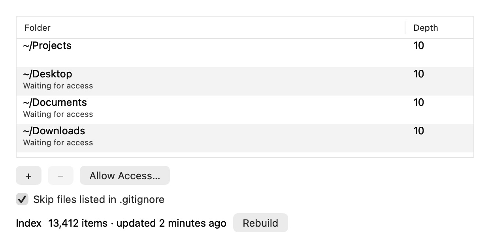
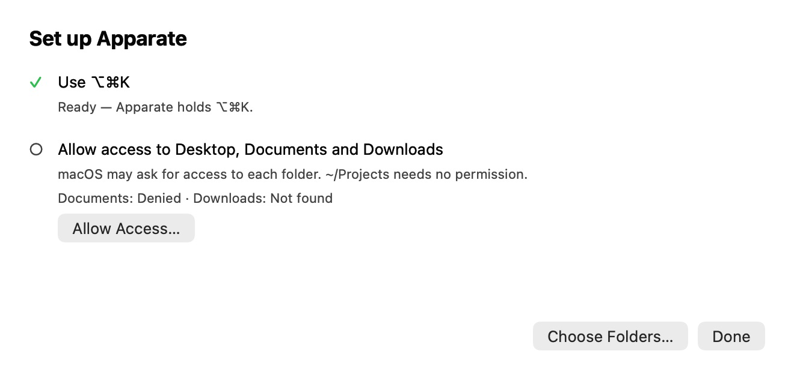
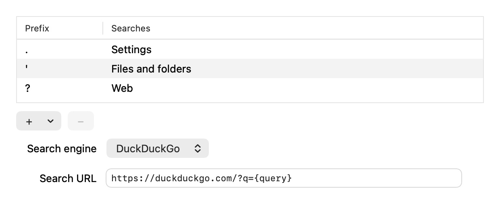
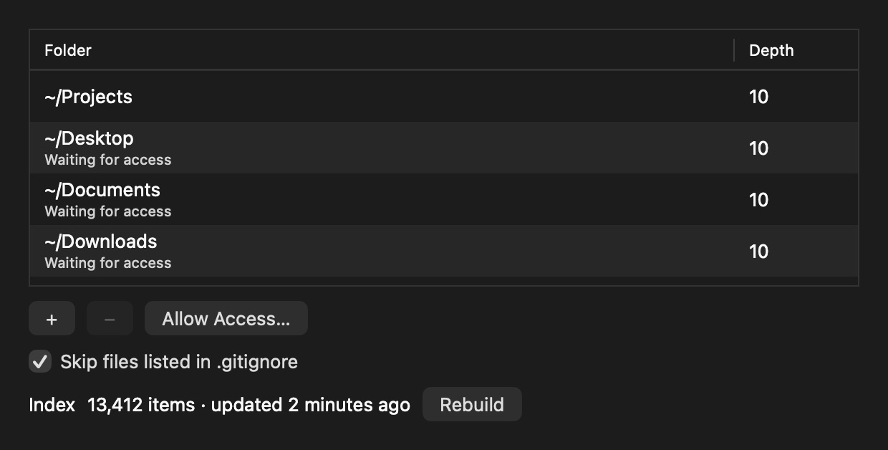

# M5 Settings, menu and first-run verification

Run `2026-11-18T212428Z-m5`. The [post-review fix](#post-review-fix) records the final table layout and binary; the original handoff below remains dated evidence. **All selected automated checks passed.** This is the build handoff for [M5](../../build/m5-settings-menu-first-run.md#pushback-and-answers), covering [FEAT-settings](../../features/settings.md), [FEAT-menu](../../features/menu.md), [FEAT-first-run](../../features/first-run.md), and config/access/index/panel integration. Claude approved committing after the table-row fix, now verified below. Native presentation and real system effects are outside this automated scope and remain **Untested**.

## Build and isolation

Base `e1543de` (approved M4). The dirty M5 inputs are identified by the [source manifest](../../evidence/2026-11-18T212428Z-m5/source-manifest.json) and [signed build identity](../../evidence/2026-11-18T212428Z-m5/build-identity.json). Original handoff app SHA-256: `159b765b64efd6a5933ef6f123212c8cd70c6a39cd269d4504340e03c3a976eb`. macOS 27.0, SDK 27.2, Swift 6.4.2, arm64. Signing, designated requirement, bundle metadata, both menu-template PNGs and the bundled notice were checked. Core stays headless and no package was added. The [build log](../../evidence/2026-11-18T212428Z-m5/build.log) contains only the existing optional CLT framework/library search-path warnings.

All native processes used `Tests/smoke-app.py`, a preseeded owned temporary home, prohibited activation and non-presenting windows. Login, registration, access probes, picker and action effects were fake. The real closed NSMenu graph was inspected without opening it or installing a status item/main menu. Zero native opens, global key events, login changes, status items, symbolichotkeys writes or protected-folder probes occurred. The dedicated settings profile has no crawler; the normal integration graph indexes only its generated fixture tree. Every receipt confirms hidden/focus guards and cleanup of its owned process/home. No user's folder was crawled for M5.

The exact commands and expectations are in [verification setup](../setup.md#m5-settings-menu-and-setup). Builds and native/Core runs were serial. Timing fields in receipts are incidental diagnostics, not M5 performance claims. No M4 latency benchmark was repeated or reclassified.

## Correctness and native integration

The full suite passes **83/83 groups in debug and release**: [debug log](../../evidence/2026-11-18T212428Z-m5/tests-debug.log), [release log](../../evidence/2026-11-18T212428Z-m5/tests-release.log), [release build](../../evidence/2026-11-18T212428Z-m5/tests-release-build.log). This adds nine groups to M4's 74. Core/test inputs stayed unchanged after those runs; subsequent fixes changed native layout and its dedicated assertions only. All four final native profiles below ran on the recorded signed binary.

| Scenario | Expected | Observed | Result |
| --- | --- | --- | --- |
| Field commits | Validate on commit; preserve unrelated fresh fields; reject same-field conflict; never overwrite broken JSON | Fresh-disk mutations, external edits, bad types/values, same-field conflicts, repair and injected write failure; native URL Return/Esc and prefix/depth edits | Passed |
| Shortcut transaction | Register candidate, persist, then release old; failures retain old; no callback duplicate | Core refusal/save failure/reentrant callback/no-op checks; native recorder Esc/tab/focus/close, refused and successful custom key, current-key capture | Passed |
| Shortcut status | Known actual Spotlight collision only; unknown not falsely ready; retry on focus | Boolean/type/parameter fixtures; changed bindings, unknown/malformed, same-key retry and custom-key readiness; inline notice and fake keyboard link | Passed |
| Login status/action | Service is authoritative, pending approval can be disabled, failure stays inline | All four Core states, no config write, native mixed checkbox click disables pending registration, failed enable keeps off | Passed |
| Search controls | One symbol per scope, add unused scope, derive preset from URL | Invalid native prefix, actual remove/draft/add, URL validation, Kagi commit and Custom preserving/focusing URL; shared Core preset/validation cases | Passed |
| Folder controls | Normalize identity, retain duplicate depth, target selected identity after reorder | Fake picker cancellation and duplicate/new selection, native invalid/valid depth, external reorder and removal of original selected path; selection clears after deletion | Passed |
| Index status | Start/finish/failure status, stored date/count, rebuild disabled while active | Core start/finish, .gitignore rebuild, root removal during rebuild, restored update time and relative-time tests; native rebuild button disable; error path notifies Settings | Passed |
| Access | No focus probes; explicit sequential checks; close cancels subsequent or not-yet-started work | Core no-probe refresh, cancellation and last-check hints; native conditional Allow button, three fake partial probes, immediate close after scheduling does not add probes | Passed |
| Setup | Eligibility before default write, custom shortcut ready, incomplete Done works | Eligibility predicate, partial states, retained Choose Folders route and Done while incomplete; both appearance geometry checks | Passed |
| Menu and owned routes | Order/equivalents/active key, hide item, panel releases activity | Real closed graph/actions, fake installation state, panel ⌘, route, Cmd-W/Q menu entries; local commands keep priority if assigned as global key | Passed |
| Broken config UI | Disabled editing, recovery action, no overwrite | Actual disabled controls and fake Show in Finder callback, original bad bytes unchanged, repair re-enables | Passed |

[Dedicated settings receipt](../../evidence/2026-11-18T212428Z-m5/native/receipt.json): three fake registration attempts (one refused), two fake login actions (one refused), two fake picker calls, three fake probes, one fake keyboard link and one fake reveal. The normal [setup profile](../../evidence/2026-11-18T212428Z-m5/setup/receipt.json) passes with fake partial observations. The normal [app integration](../../evidence/2026-11-18T212428Z-m5/integration/receipt.json) has five fixture entries, one discovered app and one fake application open. The retained [panel functional regression](../../evidence/2026-11-18T212428Z-m5/panel/receipt.json) also passes, including its existing input/accessibility/action contract.

The dedicated native routes use the same controllers and callback pattern. AppDelegate's actual reopen/focus events are source-wired and remain supervised; no reopen event, physical key or key-window transition was synthesized. The normal graph separately asserts settings/setup/panel hidden and zero native status items.

## Render inspection

Codex inspected all twelve settings/setup content JPEGs at the original handoff, including full-size text/error states. Labels and controls align, text remains inside bounds, errors are legible, disabled controls are distinct, and layout fits each tab. Setup's status column remains narrow in both appearances and with a custom shortcut. These are app-owned content renders: toolbar/window chrome, actual menu appearance and live composition are not represented.

| Content | Light | Dark |
| --- | --- | --- |
| General | [image](../../evidence/2026-11-18T212428Z-m5/native/settings-general-light.jpg) | [image](../../evidence/2026-11-18T212428Z-m5/native/settings-general-dark.jpg) |
| Search | [image](../../evidence/2026-11-18T212428Z-m5/native/settings-search-light.jpg) | [image](../../evidence/2026-11-18T212428Z-m5/native/settings-search-dark.jpg) |
| Folders | [image](../../evidence/2026-11-18T212428Z-m5/native/settings-folders-light.jpg) | [image](../../evidence/2026-11-18T212428Z-m5/native/settings-folders-dark.jpg) |
| Setup incomplete | [image](../../evidence/2026-11-18T212428Z-m5/native/setup-incomplete-light.jpg) | [image](../../evidence/2026-11-18T212428Z-m5/native/setup-incomplete-dark.jpg) |

Additional inspected states: [invalid URL](../../evidence/2026-11-18T212428Z-m5/native/settings-validation-dark.jpg), [approval required](../../evidence/2026-11-18T212428Z-m5/native/settings-login-approval-light.jpg), [broken config](../../evidence/2026-11-18T212428Z-m5/native/settings-broken-config-dark.jpg), and [custom shortcut with partial access](../../evidence/2026-11-18T212428Z-m5/native/setup-partial-light.jpg).

## Failed attempts and corrections

- The first native compile used nonexistent `NSButton.buttonType`; the [failed build log](../../evidence/2026-11-18T212428Z-m5/attempts/initial-build.log) is retained. Button styling now uses known checkbox identities. A subsequent compile also rejected `NSBitmapImageRep(contentsOf:)`; the final resource loader uses NSImage representations. That intermediate log was superseded, not retained as a successful run.
- Initial control assertions passed but [General alignment was poor](../../evidence/2026-11-18T212428Z-m5/attempts/general-alignment-before.jpg). Fixed grid column widths, whole-row visibility and fitting-size window height. The [early receipt](../../evidence/2026-11-18T212428Z-m5/attempts/initial-controls-receipt.json) establishes only its then-selected controls, not a visual pass.
- The expanded native check [failed on disabling pending login approval](../../evidence/2026-11-18T212428Z-m5/attempts/mixed-login-failure.json), with [input/binary hashes](../../evidence/2026-11-18T212428Z-m5/attempts/mixed-login-identity.json). AppKit cycles a mixed checkbox to On. The handler now derives the requested toggle from the service state; the actual click passes in the final run.
- Final inspection found [setup's light status column stretching](../../evidence/2026-11-18T212428Z-m5/attempts/setup-alignment-before.jpg), despite the dark image being aligned. Fixed both column widths and added geometry checks for light, dark and custom-key states. An initially over-exact frame assertion [failed](../../evidence/2026-11-18T212428Z-m5/attempts/setup-frame-assertion-failure.json) after the image was corrected; the assertion now allows NSTextField's text insets while rejecting the original stretched position. Its [binary identity](../../evidence/2026-11-18T212428Z-m5/attempts/setup-frame-assertion-identity.json) is retained.
- Inspection also closed the queued-access race: the shared model retains the requested check task, closing cancels it, and a cancelled check returns before probing. Core and native regression checks pass. Closed preferences no longer relay background index changes into layout work.

## Limits, retention and handoff

The real menu, toolbar/window appearance, shortcut capture/delivery on actual layouts, focus/Spaces, launch-at-login registration and approval, native folder picker, System Settings navigation, TCC prompts/retries/persistence and spoken accessibility remain **Untested**. Concrete recipes are in [Settings](../../features/settings.md#supervised-recipes-untested), [Menu](../../features/menu.md#supervised-recipes-untested), [First run](../../features/first-run.md#supervised-recipes-untested) and the existing [M2 supervised run](2026-11-18T164001Z-m2-supervised.md). Claude's accepted M5 gate change requires all native checks before M7 release; it does not convert earlier Untested results to Passed.

M6 retains the failed M4 hidden latency proxy and must qualify the finished app on screen, including startup/idle costs with retained Settings/setup controllers. M7 still removes test profiles/fixtures from distribution and adds the final app icon. No real login or privacy setting was changed for verification.

Evidence is about **0.85 MB**, below the 3 MB budget. [Retention record](../../evidence/2026-11-18T212428Z-m5/retention.json) hashes superseded raw outputs; final receipts, the twelve preferences JPEGs and compact failure evidence are retained. Earlier M1–M4 manifests/results are unchanged; only their procedural native-test gate wording was updated with a dated note. Wiki report validation, rebuild/check, manifest recheck and whitespace checks complete the handoff. No commit or push had been made at the original handoff.

## Post-review fix

Claude reviewed the source/renders and independently re-ran 83/83 Core groups. His single finding was top-aligned content in tall table rows; he authorized the M5 commit after correction without another review round ([guide review](../../build/m5-settings-menu-first-run.md#review)).

Prefix rows are now 24 pt, with a compact 108 pt table viewport. Folder rows remain a constant 36 pt to fit a name plus an optional status. Native NSTableCellView containers centre each field or name/status group vertically. An absent folder status creates no empty line, so a single-line name and its depth are centred. Draft-prefix focus and the existing native editor driver now reach the container's textField.

The [post-review source manifest](../../evidence/2026-11-18T212428Z-m5/post-review/source-manifest.json) differs from the original only in SettingsWindow.swift and the native verification helper that locates its field editors. Core and Core-test inputs and the release test binary are unchanged; their 83/83 debug/release results carry forward without an unnecessary rerun. The [new signed build](../../evidence/2026-11-18T212428Z-m5/post-review/build-identity.json) has SHA-256 `772fee7e5b76d29d2fb72317a469743ec8f8100475d25edfcabcc514f2d303ea`; [build log](../../evidence/2026-11-18T212428Z-m5/post-review/build.log). The signature and unchanged release-test fingerprint were checked before the run.

| Check | Expected | Observed | Result |
| --- | --- | --- | --- |
| Prefix layout | Compact, vertically centred single-line rows | 24 pt rows and centred prefix/scope fields in both appearances | Passed |
| Folder layout | Centred single-line names/depth; name/status fits as one group | ~/Projects centred without an empty detail row; protected-folder name/status pairs fit 36 pt rows | Passed |
| Editing regression | Cell containers preserve field editing, draft focus and selection identity | Existing native prefix/depth Return, validation, add/remove, external-reorder and URL Esc checks pass | Passed |
| Effect isolation | Hidden owned views and fake effects only | Dedicated native receipt: no errors, all focus guards, zero native effects/status items/probes | Passed |

The [native Settings receipt](../../evidence/2026-11-18T212428Z-m5/post-review/receipt.json) includes the existing menu, recorder, login, setup, access, broken-config and panel-route checks. Codex inspected the affected full-size [Search light](../../evidence/2026-11-18T212428Z-m5/post-review/settings-search-light.jpg), [Search dark](../../evidence/2026-11-18T212428Z-m5/post-review/settings-search-dark.jpg), [Folders light](../../evidence/2026-11-18T212428Z-m5/post-review/settings-folders-light.jpg), [Folders dark](../../evidence/2026-11-18T212428Z-m5/post-review/settings-folders-dark.jpg) and [validation state](../../evidence/2026-11-18T212428Z-m5/post-review/settings-validation-dark.jpg).

Total M5 evidence is **1,178,703 bytes** (about 1.18 MB); [post-review retention record](../../evidence/2026-11-18T212428Z-m5/post-review/retention.json). Original attempts/results remain intact. Manifest, privacy/whitespace, wiki report validation and wiki build/check passed. This correction and all M5 working-tree changes are included in the authorized `M5: Settings, menu bar and first run` commit. No push is authorized or performed. All supervised limitations and M6/M7 carry-forwards above remain unchanged.
